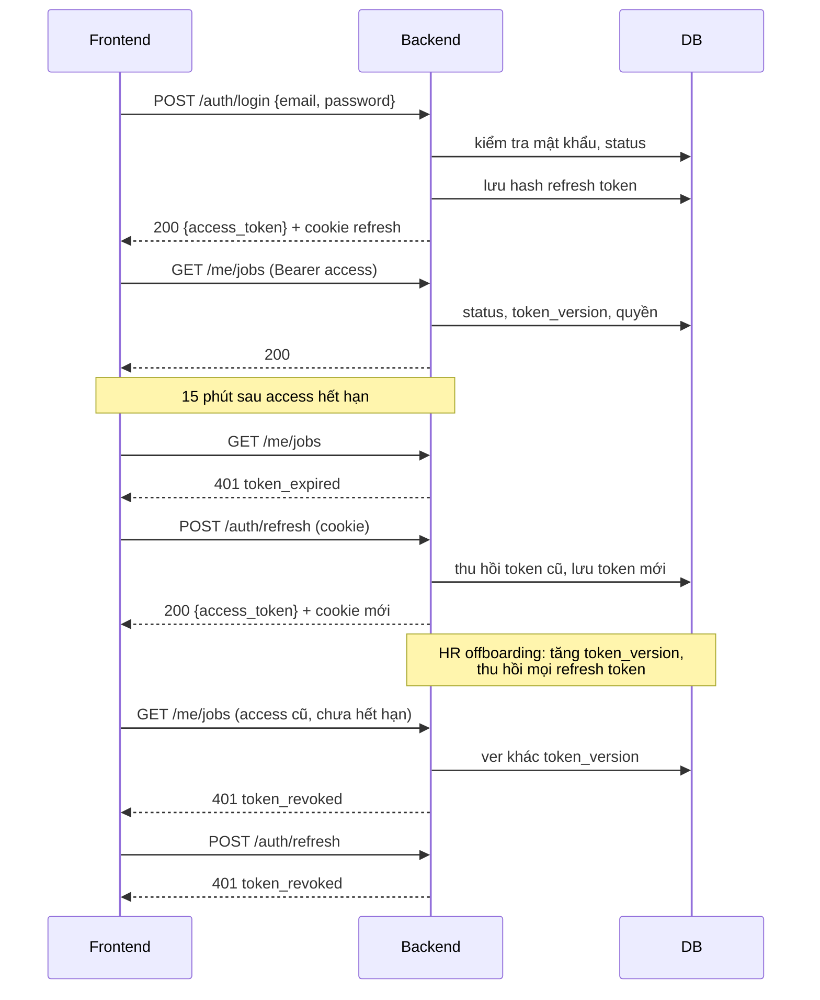
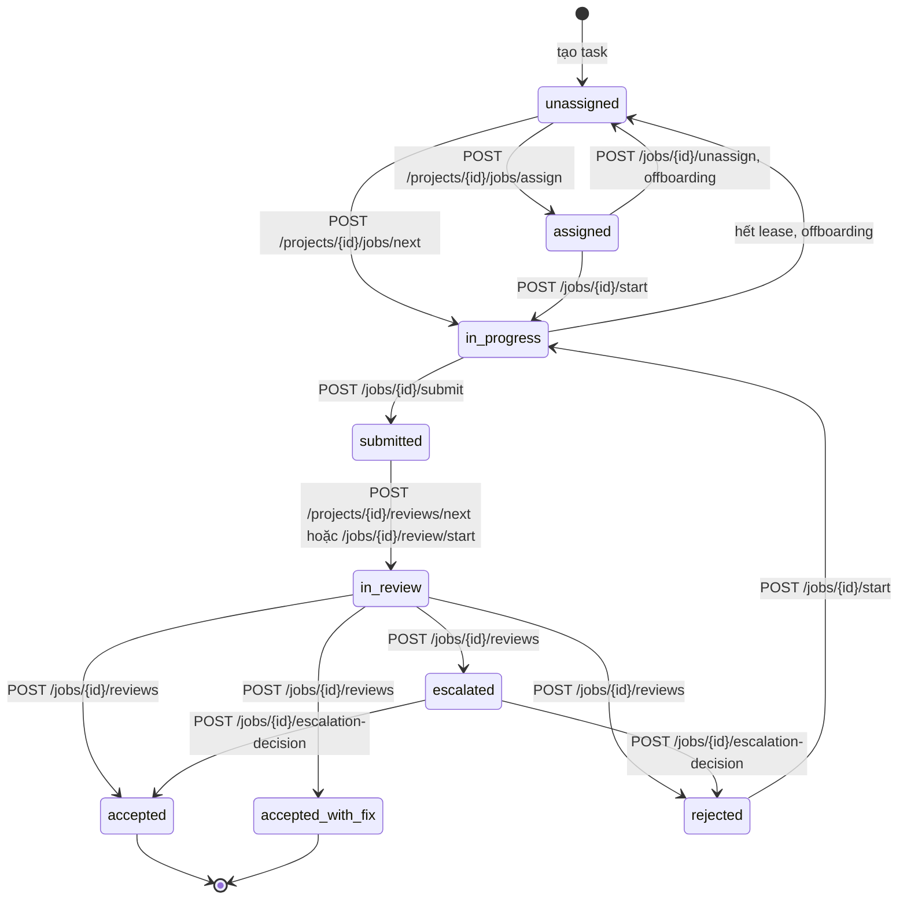
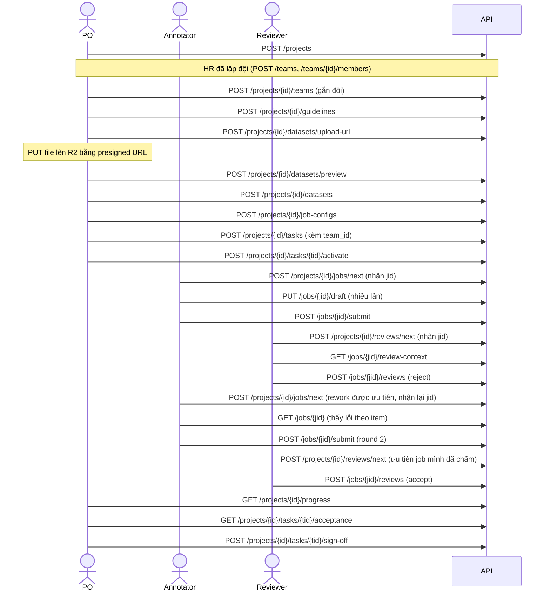

# Thiết kế API

> Danh sách endpoint, quy ước, xác thực, request/response mẫu và mã lỗi của backend.
> Chưa viết code.
>
> Căn cứ: `docs/database_design.md`, `docs/user_stories.md`, `docs/review_workflow.md`,
> `docs/be_build_plan.md`, `docs/dictionary.md`.
> Tên cấp công việc theo CVAT: `Project → Task → Job → Item`.
> Trạng thái: draft.

---

## 1. Quy ước chung

| Mục | Quy ước |
| --- | --- |
| Prefix | `/api/v1` (`settings.API_V1_PREFIX`) |
| Định dạng | JSON. File dataset **không** đi qua backend: frontend xin presigned URL rồi `PUT` thẳng lên Cloudflare R2 (mục 3.8) |
| Xác thực | `Authorization: Bearer <access_token>` (xem mục 2) |
| ID | uuid |
| Thời gian | ISO 8601, UTC, ví dụ `2026-10-30T08:15:00Z` |
| Phân trang | Tham số `offset` (≥ 0, mặc định 0), `limit` (1–100, mặc định 20). Trả `Page`: `{items, total, limit, offset}` theo `be/app/schemas/common.py` |
| Sắp xếp | Tham số `sort`, ví dụ `sort=-submitted_at` (dấu `-` là giảm dần). Mỗi endpoint liệt kê trường được sắp |
| Lỗi | `{code, message, details}` theo `be/app/core/exceptions.py`. Danh mục mã ở mục 7 |
| Tài nguyên có version | Guideline, dataset, job config chỉ có `POST` tạo version mới; không có `PUT`, `PATCH`, `DELETE` |
| Chuyển trạng thái | Dùng **action endpoint** (`POST /jobs/{id}/submit`), không `PATCH status`. Mọi chuyển đi qua state machine |
| Quyền | Mỗi endpoint ghi permission cần có và `limit` (`all`, `P` = project mình thuộc, `A` = job được giao, `own` = của mình). Kiểm tra ở backend |
| Lọc theo membership | Mọi endpoint đọc dữ liệu project chỉ trả dữ liệu của project người gọi thuộc |
| HR | Không endpoint nào trả nội dung item (`payload`) hay nhãn (`annotation.value`) cho `hr_admin` |
| Audit | Mọi endpoint ghi (POST, DELETE) ghi `audit_events` trong cùng transaction |

**Mã HTTP dùng chung**

| Mã | Khi nào |
| --- | --- |
| 200 | Đọc hoặc action thành công |
| 201 | Tạo mới thành công |
| 204 | Thành công, không có nội dung (logout, gỡ quyền) |
| 400 | Dữ liệu sai nghiệp vụ (ví dụ label schema sai) |
| 401 | Thiếu token, token hết hạn, token bị thu hồi |
| 403 | Đã xác thực nhưng không có quyền |
| 404 | Không tồn tại **hoặc** người gọi không được thấy (không tiết lộ sự tồn tại) |
| 409 | Xung đột: trùng, sai trạng thái, vi phạm quy tắc |
| 413 | File upload quá lớn |
| 422 | Request sai định dạng (validation của FastAPI) |

---

## 2. Xác thực (JWT)

### 2.1 Thiết kế

| Thành phần | Chi tiết |
| --- | --- |
| **Access token** | JWT ký HS256 (khoá trong biến môi trường), hạn **15 phút**. Frontend giữ trong bộ nhớ, gửi ở header `Authorization` |
| Claims | `sub` (user id), `ver` (`token_version`), `iat`, `exp`, `jti`. **Không** chứa role hay permission: quyền luôn đọc từ DB |
| **Refresh token** | Chuỗi ngẫu nhiên, hạn **7 ngày**, lưu **hash** trong bảng `refresh_tokens`. Gửi bằng cookie `httpOnly`, `Secure`, `SameSite=Strict`, `Path=/api/v1/auth` |
| Xoay vòng | Mỗi lần refresh cấp refresh token mới và thu hồi token cũ. Dùng lại token đã bị thay thế thì thu hồi cả **family** (dấu hiệu bị đánh cắp) |
| **Kiểm tra mỗi request** | Giải mã access token, rồi đọc `users.status` và `users.token_version` (cùng truy vấn với kiểm tra quyền). `status ≠ active` hoặc `ver ≠ token_version` thì trả 401 `token_revoked` |
| Thu hồi ngay | Offboarding và đổi mật khẩu: tăng `token_version` và thu hồi mọi refresh token của user. Thu hồi một role không cần đổi token: quyền được đọc lại từ DB ở mỗi request nên mất hiệu lực ngay |

### 2.2 Luồng



---

## 3. Endpoint theo nhóm

Ký hiệu cột **Quyền**: `permission (limit)`. `—` là chỉ cần đăng nhập. `public` là
không cần đăng nhập. Path tính sau prefix `/api/v1`.

### 3.1 Auth

| Method | Path | Quyền | Story | Mô tả |
| --- | --- | --- | --- | --- |
| POST | `/auth/login` | public | ALL-01 | Đăng nhập bằng email + mật khẩu. Trả access token, đặt cookie refresh |
| POST | `/auth/refresh` | public (cookie) | ALL-01 | Đổi refresh token lấy access token mới, xoay vòng refresh token |
| POST | `/auth/logout` | public (cookie) | ALL-01 | Thu hồi refresh token hiện tại, xoá cookie. 204. Không cần access token để đăng xuất được cả khi access token đã hết hạn |
| POST | `/auth/activate` | public | HR-01 | Kích hoạt tài khoản bằng token một lần trong email, đặt mật khẩu |
| POST | `/auth/change-password` | — | ALL-03 | Đổi mật khẩu; tăng `token_version`, thu hồi các phiên khác, trả token mới |

Login sai mật khẩu và tài khoản không tồn tại trả **cùng một lỗi** (`invalid_credentials`)
để không lộ email nào có trong hệ thống. Giới hạn số lần thử theo IP và email.

### 3.2 Me

| Method | Path | Quyền | Story | Mô tả |
| --- | --- | --- | --- | --- |
| GET | `/me` | — | ALL-02, ALL-03 | Thông tin của tôi, role platform, ngày hết hạn quyền |
| GET | `/me/projects` | — | ALL-02 | Project tôi thuộc, kèm role project và ngày hết hạn |
| GET | `/me/permissions?project_id=` | — | ALL-02 | Permission hiệu lực của tôi (toàn hệ thống hoặc trong một project), để frontend ẩn/hiện nút |
| GET | `/me/teams` | — | ALL-02 | Đội tôi thuộc, vai trò trong từng đội, có phải trưởng nhóm không |
| GET | `/me/jobs` | `job.annotate (A)` | AN-01 | Job được giao cho tôi. Lọc `status`, `project_id`. Job bị reject kèm tóm tắt lý do |
| GET | `/me/reviews` | `job.review (A)` | RV-01 | Hàng đợi review của tôi, sắp theo cờ `has_unsure` rồi theo tuổi. Không gồm job do tôi làm |

`/me/permissions` chỉ phục vụ giao diện. Backend vẫn kiểm tra quyền ở từng endpoint.

### 3.3 Users và role platform (HR)

| Method | Path | Quyền | Story | Mô tả |
| --- | --- | --- | --- | --- |
| POST | `/users` | `user.manage (all)` | HR-01 | Tạo user (họ tên, email, mã nhân viên, loại hợp đồng). **Trả `activation_url`** (dùng một lần, hạn 72 giờ) để HR gửi cho người dùng; chưa có gửi email. Không chọn project |
| POST | `/users/{user_id}/activation-link` | `user.manage (all)` | HR-01 | Cấp link kích hoạt mới khi link cũ hết hạn; link cũ mất hiệu lực. Người đã kích hoạt thì 409 `already_activated` |
| GET | `/users` | `user.manage (all)` | HR-07 | Tìm theo `q` (tên, email, mã), lọc `status`, `employment_type`, `role` |
| GET | `/users/{user_id}` | `user.manage (all)` | HR-07 | Chi tiết user và role platform. Không có thông tin project chi tiết |
| POST | `/users/{user_id}/disable` | `user.manage (all)` | HR-04 | Offboarding: disable, thu hồi mọi role, vô hiệu membership, tăng `token_version`, thu hồi refresh token, trả job dở về pool. Bắt buộc `reason` |
| POST | `/users/{user_id}/platform-roles` | `platform_role.grant (all)` | HR-02 | Cấp role platform, tuỳ chọn `expires_at`. Không tự cấp cho mình |
| PATCH | `/users/{user_id}/platform-roles/{assignment_id}` | `platform_role.grant (all)` | HR-05 | Gia hạn: chỉ đổi `expires_at` |
| DELETE | `/users/{user_id}/platform-roles/{assignment_id}` | `platform_role.grant (all)` | HR-03 | Thu hồi role, body có `reason`. Membership dựa vào role này mất hiệu lực ngay. 204 |
| GET | `/platform-roles/expiring?within_days=30` | `platform_role.grant (all)` | HR-05 | Quyền sắp hết hạn |

Trường hợp người bị disable là `owner` duy nhất của project đang `active`: trả 409
`last_owner` kèm danh sách project, trừ khi gửi `force=true` (khi đó project được đánh
dấu cần xử lý).

### 3.4 Danh mục (chỉ đọc)

| Method | Path | Quyền | Story | Mô tả |
| --- | --- | --- | --- | --- |
| GET | `/roles` | — | HR-02, PO-02 | Danh mục role (platform và project), kèm role requirement |
| GET | `/permissions` | `audit.read (all)` | AU-02 | Danh mục permission và ma trận role-permission |
| GET | `/parsers` | `project.create (all)` hoặc `dataset.upload (P)` ở bất kỳ project | PO-05, AD-05 | Parser có trong registry: tên, version, `item_type`, schema của `options` |
| GET | `/item-types` | — | PO-07, AD-05 | Item type có trong registry: tên, kiểu trường label schema được hỗ trợ |

### 3.5 Hệ thống

| Method | Path | Quyền | Story | Mô tả |
| --- | --- | --- | --- | --- |
| GET | `/system/settings` | `system.configure (all)` | AD-01 | Tham số hệ thống: hạn token, lease mặc định, giới hạn upload |
| PATCH | `/system/settings` | `system.configure (all)` | AD-01 | Sửa tham số, ghi audit kèm before/after |
| GET | `/health` | public | AD-03 | Có sẵn trong code hiện tại |

### 3.6 Projects và thành viên

| Method | Path | Quyền | Story | Mô tả |
| --- | --- | --- | --- | --- |
| POST | `/projects` | `project.create (all)` | PO-01 | Tạo project; người tạo thành `owner`; trạng thái `draft` |
| GET | `/projects` | — | ALL-02 | Project tôi thuộc. Lọc `status` |
| GET | `/projects/{project_id}` | thành viên project | ALL-02 | Chi tiết project |
| PATCH | `/projects/{project_id}` | `project.update (P)` | PO-01 | Sửa tên, mô tả, mức phân loại dữ liệu |
| POST | `/projects/{project_id}/activate` | `project.update (P)` | PO-09 | `draft`/`paused` → `active` |
| POST | `/projects/{project_id}/pause` | `project.update (P)` | PO-09 | `active` → `paused` |
| POST | `/projects/{project_id}/close` | `project.update (P)` | PO-09 | → `closed`, chỉ đọc |
| GET | `/projects/{project_id}/members` | thành viên project | PO-02 | Danh sách thành viên và role project |
| GET | `/projects/{project_id}/candidates?role=manager` | `member.manage (P)` | PO-02 | Người có role platform phù hợp để thêm trực tiếp (owner, manager, viewer) |
| POST | `/projects/{project_id}/members` | `member.manage (P)` | PO-02, PO-03, PM-10 | Thêm thành viên trực tiếp: `user_id`, `role` (`owner`, `manager`, `viewer`), `expires_at`. Annotator và reviewer vào qua đội (3.18). `manager` không thêm được `owner` |
| GET | `/projects/{project_id}/teams` | thành viên project | PO-17 | Đội đang gắn với project, số thành viên theo vai trò |
| POST | `/projects/{project_id}/teams` | `member.manage (P)` | PO-17 | Gắn đội vào project (`team_id`). Đội phải có ít nhất 1 annotator và 1 reviewer (409 `team_missing_role`). Kiểm tra xung đột vai trò giữa các đội; vi phạm trả 409 `role_conflict` kèm danh sách người. Tỷ lệ reviewer thấp thì trả kèm `warnings` |
| DELETE | `/projects/{project_id}/teams/{project_team_id}` | `member.manage (P)` | PO-17 | Gỡ đội. Task đang giao cho đội phải được giao lại trước (409 `team_has_active_tasks`). 204 |
| DELETE | `/projects/{project_id}/members/{member_id}` | `member.manage (P)` | PO-02 | Gỡ thành viên; job dở của họ về pool. Không gỡ được owner cuối cùng. 204 |

### 3.7 Guidelines và mã lỗi

| Method | Path | Quyền | Story | Mô tả |
| --- | --- | --- | --- | --- |
| POST | `/projects/{project_id}/guidelines` | `guideline.manage (P)` | PO-06 | Tạo guideline version mới (nội dung Markdown, gồm cả rubric) |
| GET | `/projects/{project_id}/guidelines` | thành viên project | PO-06 | Danh sách version |
| GET | `/projects/{project_id}/guidelines/{version}` | thành viên project | PO-06, AN-03 | Nội dung một version |
| GET | `/projects/{project_id}/guidelines/{version}/diff?from=` | thành viên project | PO-06 | Diff giữa hai version |
| GET | `/projects/{project_id}/reason-codes` | thành viên project | RV-02 | Danh mục mã lỗi của project |
| POST | `/projects/{project_id}/reason-codes` | `project.update (P)` | RV-02 | Thêm mã lỗi |
| PATCH | `/projects/{project_id}/reason-codes/{code_id}` | `project.update (P)` | RV-02 | Đổi nhãn, mức độ mặc định, `active`. Không đổi `code` |

### 3.8 Datasets

| Method | Path | Quyền | Story | Mô tả |
| --- | --- | --- | --- | --- |
| POST | `/projects/{project_id}/datasets/upload-url` | `dataset.upload (P)` | PO-04 | Body `{filename, size}`. Trả `{upload_key, url, expires_in}`: presigned URL để `PUT` file lên R2 (hạn 15 phút). Kiểm tra `size` không vượt giới hạn |
| POST | `/projects/{project_id}/datasets/preview` | `dataset.upload (P)` | PO-05 | Body `{upload_key, parser, parser_options}`. Đọc vài dòng đầu từ R2, trả item mẫu và lỗi. **Không tạo version** |
| POST | `/projects/{project_id}/datasets` | `dataset.upload (P)` | PO-04, PO-05 | Body như preview. Đọc toàn bộ file từ R2, parse, tạo dataset version mới (lưu `storage_path` = `upload_key`). Lỗi quá ngưỡng thì không tạo, trả báo cáo lỗi |
| GET | `/projects/{project_id}/datasets` | `dataset.read (P)` hoặc `progress.read (P)` | PO-04 | Danh sách version: số item, checksum, parser |
| GET | `/projects/{project_id}/datasets/{version}` | `dataset.read (P)` hoặc `progress.read (P)` | PO-04 | Chi tiết version kèm báo cáo parse |
| GET | `/projects/{project_id}/datasets/{version}/items` | `dataset.read (P)` | PO-04 | Liệt kê item (có `payload`). Annotator và reviewer không dùng endpoint này, họ đọc item qua job |
| DELETE | `/projects/{project_id}/datasets/{version}` | `dataset.delete (P)` | PO-04 | Chỉ khi chưa có task nào dùng; ngược lại 409 `dataset_in_use`. Xoá mềm |
| POST | `/projects/{project_id}/datasets/{version}/breakglass` | `dataset.breakglass (all)` | AD-04 | P2. Mở quyền đọc tạm thời, bắt buộc `reason`, thông báo PO |

### 3.9 Job configs

| Method | Path | Quyền | Story | Mô tả |
| --- | --- | --- | --- | --- |
| POST | `/projects/{project_id}/job-configs/validate` | `job_config.manage (P)` | PO-07 | Kiểm tra config mà không lưu: label schema hợp lệ, `item_type` có trong registry. Dùng cho màn hình preview |
| POST | `/projects/{project_id}/job-configs` | `job_config.manage (P)` | PO-07 | Tạo job config version mới (bất biến) |
| GET | `/projects/{project_id}/job-configs` | thành viên project | PO-07 | Danh sách version |
| GET | `/projects/{project_id}/job-configs/{version}` | thành viên project | PO-07 | Chi tiết một version |

### 3.10 Tasks

| Method | Path | Quyền | Story | Mô tả |
| --- | --- | --- | --- | --- |
| POST | `/projects/{project_id}/tasks` | `task.manage (P)` | PO-08 | Tạo task từ `dataset_version`, `job_config_version`, `guideline_version`, tuỳ chọn `team_id`, `priority`. **Kiểm tra `item_type` khớp**. Cắt thành job ngay (job ở `unassigned`); trạng thái `draft` |
| POST | `/projects/{project_id}/tasks/{task_id}/team` | `task.manage (P)` | PO-08 | Giao hoặc đổi đội cho task. Đội phải đang gắn với project. Đổi đội thì job chưa bắt đầu trả về `unassigned` |
| PATCH | `/projects/{project_id}/tasks/{task_id}` | `task.manage (P)` | PO-08 | Đổi `name`, `priority` |
| GET | `/projects/{project_id}/tasks` | `progress.read (P)` | PO-08 | Danh sách task. Lọc `status` |
| GET | `/projects/{project_id}/tasks/{task_id}` | `progress.read (P)` | PO-08 | Chi tiết task và kết quả cắt: số job, số item mỗi job, item bị bỏ |
| POST | `/projects/{project_id}/tasks/{task_id}/activate` | `task.manage (P)` | PO-08 | `draft` → `active`. Bắt buộc đã có đội (409 `task_has_no_team`) và đội đủ vai trò (409 `team_missing_role`). Thành viên đội bắt đầu lấy được việc |

### 3.11 Jobs: điều phối (PM)

Cách phân việc chính là thành viên đội tự lấy việc (3.12, 3.13). Các endpoint dưới đây
dùng để xử lý ngoại lệ, hoặc khi `assignment_mode = push_only`. Người được giao phải
thuộc đội của task.

| Method | Path | Quyền | Story | Mô tả |
| --- | --- | --- | --- | --- |
| GET | `/projects/{project_id}/jobs` | `job.assign (P)` | PM-01 | Danh sách job. Lọc `status`, `task_id`, `assignee_id`, `reviewer_id`, `overdue=true`. Sắp `created_at`, `submitted_at` |
| GET | `/projects/{project_id}/workload` | `job.assign (P)` | PM-02, PM-04 | Tải hiện tại của từng annotator và reviewer (số job đang mở) |
| POST | `/projects/{project_id}/jobs/assign` | `job.assign (P)` | PM-02 | Giao hàng loạt: `[{job_id, assignee_id}]`. Job `unassigned` → `assigned`. Ghim version tại lúc giao |
| POST | `/jobs/{job_id}/reassign` | `job.assign (P)` | PM-03 | Đổi người làm; job về `assigned` với người mới; bài nháp của người cũ giữ trong lịch sử |
| POST | `/jobs/{job_id}/unassign` | `job.assign (P)` | PM-03 | Thu hồi job về pool (`unassigned`) |
| POST | `/projects/{project_id}/jobs/reviewers` | `job.assign (P)` | PM-04 | Phân reviewer hàng loạt: `[{job_id, reviewer_id}]`. Reviewer không trùng người làm |

### 3.12 Jobs: gán nhãn (annotator)

| Method | Path | Quyền | Story | Mô tả |
| --- | --- | --- | --- | --- |
| GET | `/jobs/{job_id}` | `job.annotate (A)` hoặc `job.review (A)` hoặc `job.assign (P)` | AN-03, AN-04, AN-11 | Job kèm item (`payload`), guideline version đã ghim, label schema, self-check, bản nháp (nếu là người làm), lý do reject của vòng trước. Người không liên quan nhận 404 |
| POST | `/projects/{project_id}/jobs/next` | `job.annotate (đội)` | AN-02 | **Lấy việc tiếp theo** trong các task `active` của đội mình, theo thứ tự ưu tiên ở `database_design.md` mục 9.4. Job chuyển `in_progress`, đặt lease. Trả job như `GET /jobs/{id}`; hết việc trả 204; quá WIP limit trả 409 `wip_limit_reached` |
| POST | `/jobs/{job_id}/start` | `job.annotate (A)` | AN-02, AN-08 | `assigned` hoặc `rejected` → `in_progress`; đặt `lease_expires_at` |
| PUT | `/jobs/{job_id}/draft` | `job.annotate (A)` | AN-04, AN-05 | Lưu nháp toàn bộ nhãn (thay thế bản nháp cũ). Không validate đầy đủ, chỉ kiểm tra cấu trúc. Gia hạn lease |
| POST | `/jobs/{job_id}/submit` | `job.annotate (A)` | AN-04, AN-05, AN-06, AN-08 | Nộp: validate theo label schema, đủ item, self-check đủ; tạo submission (round) và annotations; `in_progress` → `submitted` |
| GET | `/jobs/{job_id}/history` | `job.annotate (A)` hoặc `job.review (A)` hoặc `job.assign (P)` | AN-07, RV-05 | Các vòng submission và review của job |

### 3.13 Review

| Method | Path | Quyền | Story | Mô tả |
| --- | --- | --- | --- | --- |
| POST | `/projects/{project_id}/reviews/next` | `job.review (đội)` | RV-01, RV-09 | **Lấy job tiếp theo để chấm** trong các task của đội mình: ưu tiên job rework mình đã chấm, job có item `unsure`, job nộp sớm. Loại job do mình làm. Job chuyển `in_review`. Hết việc trả 204 |
| POST | `/jobs/{job_id}/review/start` | `job.review (A)` | RV-01 | Nhận chấm job PM đã phân sẵn cho mình: `submitted` → `in_review`. Người làm job không gọi được |
| GET | `/jobs/{job_id}/review-context` | `job.review (A)` | RV-02, RV-05 | Bài làm vòng hiện tại, item, guideline đã ghim, reason codes, các vòng trước |
| POST | `/jobs/{job_id}/reviews` | `job.review (A)` | RV-02, RV-03, RV-04, AN-07 | Quyết định `accept`, `accept_with_fix`, `reject`, `escalate`, kèm lỗi theo item. `reject` và `escalate` bắt buộc `reason`. Reject vượt giới hạn rework thì job thành `escalated`. Bản ghi bất biến |

### 3.14 Escalation

| Method | Path | Quyền | Story | Mô tả |
| --- | --- | --- | --- | --- |
| GET | `/projects/{project_id}/escalations` | `appeal.decide (P)` | PM-07 | Job `escalated`, kèm lý do (reviewer không chắc hoặc quá số rework) |
| POST | `/jobs/{job_id}/escalation-decision` | `appeal.decide (P)` | PM-07 | PM/PO quyết `accept` hoặc `reject`, bắt buộc `reason`, tuỳ chọn `guideline_issue=true` để báo PO sửa guideline |

### 3.15 Nghiệm thu và tiến độ

| Method | Path | Quyền | Story | Mô tả |
| --- | --- | --- | --- | --- |
| GET | `/projects/{project_id}/progress` | `progress.read (P)` | PO-10, PM-05, AU-03 | % hoàn thành, throughput, backlog, cycle time, số job stuck. Lọc `task_id`, `from`, `to`. Chỉ đếm `accepted` |
| GET | `/projects/{project_id}/progress/breakdown?by=annotator` | `progress.read (P)` | PM-05 | Chia theo `annotator`, `reviewer`, `task`, `day` |
| GET | `/projects/{project_id}/jobs/stuck` | `progress.read (P)` | PM-05, PM-06 | Job quá SLA ở trạng thái hiện tại |
| GET | `/projects/{project_id}/tasks/{task_id}/acceptance` | `task.accept (P)` | PO-12 | Tỷ lệ pass so với ngưỡng, số job theo trạng thái, mẫu ngẫu nhiên 5–10% job `accepted` (mẫu cố định cho mỗi lần mở nghiệm thu) |
| POST | `/projects/{project_id}/tasks/{task_id}/sign-off` | `task.accept (P)` | PO-12 | Ký nghiệm thu: task → `delivered`. Chỉ khi mọi job đã kết thúc |
| POST | `/projects/{project_id}/tasks/{task_id}/re-review` | `task.accept (P)` | PO-12 | Mở re-review cho task hoặc một danh sách job, kèm `reason` |

### 3.16 Audit

| Method | Path | Quyền | Story | Mô tả |
| --- | --- | --- | --- | --- |
| GET | `/audit-events` | `audit.read (all)` | AU-01, HR-06 | Lọc `actor_id`, `action`, `target_type`, `target_id`, `project_id`, `from`, `to`. `hr_admin` chỉ thấy sự kiện về quyền |
| GET | `/projects/{project_id}/audit-events` | `audit.read (P)` | AU-01 | Audit trong một project (owner) |

### 3.17 Sau bản đầu (P1)

| Method | Path | Quyền | Story | Mô tả |
| --- | --- | --- | --- | --- |
| POST | `/jobs/{job_id}/appeals` | `appeal.open (own)` | AN-09 | Khiếu nại quyết định reject trong 7 ngày, bắt buộc `reason` |
| GET | `/projects/{project_id}/appeals` | `appeal.decide (P)` | PM-08, PO-14 | Danh sách khiếu nại |
| POST | `/appeals/{appeal_id}/decision` | `appeal.decide (P)` | PM-08, PO-14 | PM xử lý bước 1 hoặc chuyển PO; PO quyết cuối |
| POST | `/jobs/{job_id}/override` | `review.override (P)` | PO-13 | Review mới `kind = override` trỏ về review cũ, bắt buộc `reason` |
| POST | `/projects/{project_id}/gold-jobs` | `task.manage (P)` | PO-16 | Đánh dấu job là gold và lưu đáp án chuẩn. Không endpoint nào cho annotator hay reviewer biết job là gold |
| GET | `/projects/{project_id}/quality` | `quality.read (P)` | PO-11 | Pass rate, phân bố reason code, chất lượng theo annotator và reviewer |
| GET | `/me/quality` | `quality.read (own)` | AN-10, RV-08 | Số liệu chất lượng của tôi |
| POST | `/projects/{project_id}/tasks/{task_id}/exports` | `export.data (P)` | PO-15 | Tạo bản export JSONL của task `delivered` |
| GET | `/projects/{project_id}/exports/{export_id}` | `export.data (P)` | PO-15 | Trạng thái và link tải |

### 3.18 Đội đánh giá

Đặt cuối để không đổi số các mục đã tham chiếu ở `be_build_plan.md`. Mô hình xem
`database_design.md` mục 9.

| Method | Path | Quyền | Story | Mô tả |
| --- | --- | --- | --- | --- |
| POST | `/teams` | `team.manage (all)` | HR-08 | Tạo đội: `code`, `name`, `description` |
| GET | `/teams` | `team.manage (all)` hoặc `team.read (all)` | HR-08, PO-17 | Danh sách đội, số thành viên theo vai trò. Lọc `status`, `q`. HR không thấy đội đang làm project nào |
| GET | `/teams/{team_id}` | `team.manage (all)` hoặc `team.read (all)` | HR-09, PO-17 | Chi tiết đội. Danh sách thành viên chỉ hiện với `team.manage` hoặc PO của project đang dùng đội |
| PATCH | `/teams/{team_id}` | `team.manage (all)` | HR-08 | Đổi tên, mô tả, `status` (`archived` khi không còn dùng; không archive được đội đang gắn với project đang hoạt động) |
| POST | `/teams/{team_id}/members` | `team.manage (all)` | HR-09 | Thêm người: `user_id`, `team_role` (`annotator`, `reviewer`), `expires_at`. Kiểm tra role platform tương ứng và xung đột (`database_design.md` 9.3) |
| PATCH | `/teams/{team_id}/members/{member_id}` | `team.manage (all)` | HR-09, HR-10 | Đổi `team_role`, `expires_at`, `is_lead`. Kiểm tra xung đột; đội đã có trưởng nhóm khác thì 409 `lead_already_assigned` |
| GET | `/teams/{team_id}/overview` | `team.monitor (T)` | TL-01 | Tải và tiến độ của từng thành viên trên các project đội đang làm: số job đang giữ, đã nộp, đã accept, quá hạn. Chỉ số liệu |
| GET | `/teams/{team_id}/quality` | `team.monitor (T)` | TL-02 | Chất lượng từng thành viên: pass rate, reason code lặp lại, xu hướng theo tuần. Không có đáp án gold |
| GET | `/teams/{team_id}/alerts` | `team.monitor (T)` | TL-03 | Cảnh báo của đội: thiếu vai trò, job kẹt, thành viên quá tải |
| DELETE | `/teams/{team_id}/members/{member_id}` | `team.manage (all)` | HR-09 | Gỡ người khỏi đội, `reason` bắt buộc. Job dở của họ về pool. 204 |

Quyền `(đội)` ở các endpoint lấy việc nghĩa là người gọi có vai trò tương ứng
(`annotator` hoặc `reviewer`) trong một đội đang gắn với project, và chỉ lấy job từ
task giao cho đội đó.

---

## 4. Request/response mẫu

### 4.1 Đăng nhập và refresh

```http
POST /api/v1/auth/login
{ "email": "an@company.vn", "password": "..." }
```

```json
200
{
  "access_token": "eyJhbGciOi...",
  "token_type": "bearer",
  "expires_in": 900,
  "user": { "id": "7b1e...", "full_name": "Nguyễn Văn An", "status": "active" }
}
```

Kèm header `Set-Cookie: refresh_token=...; HttpOnly; Secure; SameSite=Strict; Path=/api/v1/auth`.
`POST /auth/refresh` không có body, trả cùng dạng.

### 4.2 Upload dataset với field mapping

Bước 1: xin presigned URL.

```json
POST /api/v1/projects/{project_id}/datasets/upload-url
{ "filename": "trajectories.jsonl", "size": 52428800 }

200
{
  "upload_key": "projects/9a1c.../uploads/3f2e....jsonl",
  "url": "https://3b825e294fc915fdb8b01779ef494a84.r2.cloudflarestorage.com/annocolector/projects/9a1c.../uploads/3f2e....jsonl?X-Amz-Signature=...",
  "expires_in": 900
}
```

Bước 2: frontend `PUT` file lên `url` (không qua backend).

Bước 3: tạo dataset version.

```json
POST /api/v1/projects/{project_id}/datasets
{
  "upload_key": "projects/9a1c.../uploads/3f2e....jsonl",
  "parser": "jsonl_chat",
  "parser_options": {
    "user_message": "$.input",
    "steps": "$.trace[*]",
    "step_type": "$.type",
    "tool_name": "$.name",
    "tool_args": "$.arguments",
    "tool_result": "$.output",
    "tools": "$.tools[*]"
  }
}
```

```json
201
{
  "id": "d2c4...",
  "version": 1,
  "item_count": 1200,
  "checksum": "sha256:9f2a...",
  "parser": "jsonl_chat",
  "parser_version": "1.0.0",
  "parse_report": {
    "lines_total": 1203,
    "lines_ok": 1200,
    "errors": [
      { "line": 57, "code": "missing_field", "field": "$.trace", "message": "Không có trường trace" }
    ]
  }
}
```

Lỗi vượt ngưỡng: `400 parse_failed`, `details` chứa `parse_report`.

### 4.3 Tạo job config cho tool call

```json
POST /api/v1/projects/{project_id}/job-configs
{
  "item_type": "tool_call",
  "label_schema": {
    "fields": [
      { "name": "verdict", "type": "enum", "required": true,
        "options": ["correct", "incorrect", "unsure"] },
      { "name": "reason_codes", "type": "multi_select", "required": true,
        "options_from": "reason_codes",
        "visible_if": { "field": "verdict", "equals": "incorrect" } },
      { "name": "note", "type": "text", "required": false, "max_length": 1000 }
    ],
    "unsure_field": { "field": "verdict", "equals": "unsure" }
  },
  "job_rules": {
    "items_per_job": 1,
    "unit": "trajectory",
    "annotators_per_job": 1,
    "review_rate": 1.0,
    "max_rework": 2,
    "lease_minutes": 120,
    "assignment_mode": "pull",
    "wip_limit_annotator": 3,
    "wip_limit_reviewer": 20,
    "gold_rate": 0.05,
    "sla_hours": { "review": 24, "rework_review": 8 },
    "decision_thresholds": { "minor_only": "accept_with_fix", "any_major": "reject" }
  },
  "self_check": [
    "Đã xem tool result của các bước sau trước khi kết luận",
    "Đã đối chiếu tham số với schema của tool"
  ]
}
```

```json
201
{ "id": "c91f...", "version": 1, "item_type": "tool_call", "created_at": "2026-10-30T08:15:00Z" }
```

Label schema sai: `400 label_schema_invalid`, `details` liệt kê trường lỗi.

### 4.4 Tạo task

```json
POST /api/v1/projects/{project_id}/tasks
{
  "name": "Đợt 1 - tháng 11",
  "dataset_version": 1,
  "job_config_version": 1,
  "guideline_version": 2,
  "team_id": "t-7c2...",
  "priority": 10
}
```

```json
201
{
  "id": "a10b...",
  "status": "draft",
  "split": { "job_count": 1200, "items_per_job": { "min": 3, "max": 15 }, "skipped_items": 0 }
}
```

`item_type` không khớp: `409 item_type_mismatch`.

### 4.5 Annotator mở job

```json
GET /api/v1/jobs/{job_id}
200
{
  "id": "5e3d...",
  "project_id": "...",
  "task_id": "...",
  "status": "in_progress",
  "lease_expires_at": "2026-10-30T10:15:00Z",
  "rework_count": 0,
  "rework_remaining": 2,
  "guideline": { "version": 2, "content": "..." },
  "job_config": {
    "version": 1,
    "item_type": "tool_call",
    "label_schema": { "...": "như 4.3" },
    "self_check": ["..."]
  },
  "reason_codes": [ { "code": "WRONG_TOOL", "label": "Chọn sai tool" } ],
  "items": [
    {
      "item_id": "i-01",
      "position": 1,
      "payload": {
        "user_message": "Đặt giúp tôi vé từ Hà Nội đến Sài Gòn...",
        "tools": [ { "name": "search_flights", "params": [ "..." ] } ],
        "steps": [
          { "id": "s1", "type": "user", "content": "..." },
          { "id": "s3", "type": "tool_call", "tool": "search_flights", "args": { "origin": "HAN" } },
          { "id": "s4", "type": "tool_result", "content": "..." }
        ],
        "targets": ["s3", "s5", "s7", "s9"]
      }
    }
  ],
  "draft": { "i-01": { "s3": { "verdict": "correct" } } },
  "last_review": null
}
```

`targets` là các bước cần gán nhãn (tool call), do item type `tool_call` xác định.

### 4.6 Submit

```json
POST /api/v1/jobs/{job_id}/submit
{
  "annotations": [
    { "item_id": "i-01", "target": "s3", "value": { "verdict": "correct" } },
    { "item_id": "i-01", "target": "s7",
      "value": { "verdict": "incorrect", "reason_codes": ["UNNECESSARY_CALL"],
                 "note": "Gọi lại search_flights sau khi đã đặt vé" } }
  ],
  "self_check": [true, true]
}
```

```json
200
{ "job_id": "5e3d...", "status": "submitted", "submission": { "id": "...", "round": 1 } }
```

Lỗi thường gặp: `400 annotation_invalid` (sai label schema, thiếu `reason_codes`),
`400 annotation_incomplete` (thiếu target), `400 self_check_incomplete`,
`409 lease_expired`.

**Ghi chú về `target`:** với tool call, một item (trajectory) có nhiều tool call cần
đánh giá. Nhãn gắn vào cặp `(item_id, target)`. Bảng `annotations` cần thêm cột
`target` (xem `database_design.md`).

### 4.7 Tạo review

```json
POST /api/v1/jobs/{job_id}/reviews
{
  "submission_id": "...",
  "decision": "reject",
  "reason": "Bước 7 là gọi thừa nhưng được đánh correct; bước 9 thiếu ghi chú.",
  "errors": [
    { "item_id": "i-01", "target": "s7", "reason_code": "WRONG_VERDICT",
      "severity": "major", "note": "Đây là UNNECESSARY_CALL" }
  ]
}
```

```json
201
{ "review_id": "...", "job_status": "rejected", "rework_count": 1, "rework_remaining": 1 }
```

Nếu đã hết lượt rework thì `job_status` là `escalated`. Reviewer là người làm job:
`403 self_review_forbidden`.

### 4.8 Tiến độ

```json
GET /api/v1/projects/{project_id}/progress?task_id=a10b...
200
{
  "dataset_version": 1,
  "jobs_total": 1200,
  "by_status": { "unassigned": 300, "assigned": 120, "in_progress": 80, "submitted": 60,
                 "in_review": 40, "rejected": 20, "escalated": 5,
                 "accepted": 560, "accepted_with_fix": 15 },
  "completion_rate": 0.479,
  "throughput_per_day": 42.5,
  "backlog": 400,
  "cycle_time_hours": { "p50": 20.1, "p90": 51.0 },
  "stuck": 7,
  "as_of": "2026-10-30T08:00:00Z"
}
```

`completion_rate` = (`accepted` + `accepted_with_fix`) / `jobs_total`; không tính
`submitted`. `backlog` = `unassigned` + chờ review (`submitted` + `in_review`).

---

## 5. Trạng thái job và endpoint



| Từ | Đến | Endpoint | Ai gọi | Điều kiện |
| --- | --- | --- | --- | --- |
| `unassigned` | `in_progress` | `POST /projects/{id}/jobs/next` | Annotator trong đội của task | Task `active`; chưa quá WIP limit |
| `unassigned` | `assigned` | `POST /projects/{id}/jobs/assign` | PM, PO | Task `active`; người nhận là annotator trong đội của task |
| `assigned` | `unassigned` | `POST /jobs/{id}/unassign` | PM, PO | |
| `assigned` | `assigned` (người khác) | `POST /jobs/{id}/reassign` | PM, PO | |
| `assigned` | `in_progress` | `POST /jobs/{id}/start` | Annotator được giao | Project `active` |
| `in_progress` | `unassigned` | (hệ thống) | Kiểm tra lease, offboarding, gỡ thành viên | Nháp được giữ trong lịch sử |
| `in_progress` | `submitted` | `POST /jobs/{id}/submit` | Annotator | Lease còn hạn; validate đủ |
| `submitted` | `in_review` | `POST /projects/{id}/reviews/next` | Reviewer trong đội của task | Không phải người làm; chưa quá WIP limit |
| `submitted` | `in_review` | `POST /jobs/{id}/review/start` | Reviewer PM đã phân sẵn | Không phải người làm |
| `in_review` | `accepted`, `accepted_with_fix`, `rejected`, `escalated` | `POST /jobs/{id}/reviews` | Reviewer | `rejected` khi đã hết lượt rework sẽ thành `escalated` |
| `rejected` | `in_progress` | `POST /jobs/{id}/start` | Annotator | Đã có review kèm lý do |
| `escalated` | `accepted`, `rejected` | `POST /jobs/{id}/escalation-decision` | PM, PO | Bắt buộc `reason` |

Chuyển không hợp lệ trả `409 invalid_state` với `details: {from, to, allowed}`.

---

## 6. Luồng trọn vòng (tool call)



---

## 7. Danh mục mã lỗi

| Mã | HTTP | Khi nào |
| --- | --- | --- |
| `validation_error` | 422 | Request sai định dạng (có sẵn) |
| `not_found` | 404 | Không tồn tại hoặc không được thấy (có sẵn) |
| `conflict` | 409 | Xung đột chung (có sẵn) |
| `invalid_credentials` | 401 | Sai email hoặc mật khẩu |
| `account_inactive` | 401 | Tài khoản `suspended` hoặc `left` |
| `token_expired` | 401 | Access token hết hạn; frontend gọi refresh |
| `token_revoked` | 401 | `token_version` đổi, user bị disable, refresh token bị thu hồi hoặc dùng lại |
| `unauthorized` | 401 | Thiếu hoặc sai token |
| `forbidden` | 403 | Không có permission |
| `self_grant_forbidden` | 403 | Tự cấp role cho mình |
| `self_review_forbidden` | 403 | Reviewer chấm job do chính mình làm |
| `role_requirement_not_met` | 409 | Thêm vào project mà thiếu role platform tương ứng |
| `role_conflict` | 409 | Cặp role xung đột (annotator và reviewer cùng project) |
| `role_already_granted` | 409 | Cấp trùng role đang hiệu lực |
| `last_owner` | 409 | Gỡ hoặc disable owner cuối cùng của project đang hoạt động |
| `invalid_state` | 409 | Chuyển trạng thái không hợp lệ |
| `project_not_active` | 409 | Thao tác cần project `active` |
| `item_type_mismatch` | 409 | `item_type` của dataset khác job config |
| `dataset_in_use` | 409 | Xoá dataset đã có task dùng |
| `lease_expired` | 409 | Lease hết hạn, job đã về pool |
| `rework_limit_reached` | 409 | Thao tác vượt số lần rework (thông tin; job đã chuyển `escalated`) |
| `task_not_complete` | 409 | Ký nghiệm thu khi còn job chưa kết thúc |
| `parse_failed` | 400 | Lỗi parse vượt ngưỡng |
| `parser_not_found` | 400 | Parser không có trong registry |
| `label_schema_invalid` | 400 | Label schema sai |
| `annotation_invalid` | 400 | Nhãn không đúng label schema |
| `annotation_incomplete` | 400 | Thiếu nhãn cho target |
| `self_check_incomplete` | 400 | Chưa tick đủ self-check |
| `reason_required` | 400 | Thiếu lý do ở thao tác bắt buộc lý do |
| `file_too_large` | 413 | File upload vượt giới hạn |
| `upload_not_found` | 400 | `upload_key` không tồn tại trên R2, đã hết hạn, hoặc không thuộc project này |
| `rate_limited` | 429 | Thử đăng nhập quá nhiều lần |
| `wip_limit_reached` | 409 | Lấy việc khi đang giữ đủ số job tối đa |
| `task_has_no_team` | 409 | Kích hoạt task chưa giao cho đội |
| `team_not_in_project` | 409 | Giao task cho đội chưa gắn với project |
| `team_has_active_tasks` | 409 | Gỡ đội khỏi project khi đội còn task đang làm |
| `not_in_task_team` | 409 | Giao tay job cho người không thuộc đội của task |
| `team_missing_role` | 409 | Đội thiếu annotator hoặc reviewer đang hiệu lực khi gắn vào project hoặc kích hoạt task |
| `lead_already_assigned` | 409 | Đội đã có trưởng nhóm khác |

---

## 8. Các điểm chưa chốt ảnh hưởng API

| # | Câu hỏi | Ảnh hưởng |
| --- | --- | --- |
| 1 | Có dùng consensus không | Thêm endpoint adjudicate, `annotators_per_job > 1` |
| 2 | ~~Annotator tự nhận job~~ | **Đã chốt:** thành viên đội lấy việc tiếp theo (pull), PM giao tay khi cần |
| 3 | Lấy mẫu review (`review_rate < 1`) | Job không được chọn đi thẳng `accepted` hay chờ; hiện bản đầu review 100% |
| 4 | Kênh thông báo | Có cần endpoint thông báo trong ứng dụng (`/me/notifications`) không |
| 5 | Parse file lớn bằng tác vụ nền | `POST /datasets` trả `202` kèm id để theo dõi thay vì `201` |
| 6 | Mức phân loại dữ liệu có hạn chế thêm ai được xem không | Thêm điều kiện ở `GET /jobs/{id}` và các endpoint đọc item |
| 7 | ~~Đội có trưởng nhóm không~~ **Đã chốt:** có, chỉ xem số liệu (3.18). Còn mở: trưởng nhóm giao tay job | Thêm endpoint giao tay trong đội nếu chốt |

---

## 9. Khác biệt giữa thiết kế và bản cài đặt

Bản cài đặt (`be/app/api/v1/endpoints/`) khác thiết kế ở các điểm sau; OpenAPI tại `/docs` là nguồn đúng.

| Chỗ | Thiết kế | Cài đặt |
| --- | --- | --- |
| Thu hồi job | `POST /jobs/{id}/unassign` | `POST /projects/{project_id}/jobs/{job_id}/unassign` |
| Quyết định escalation | `POST /jobs/{id}/escalation-decision` | `POST /projects/{project_id}/jobs/{job_id}/escalation-decision` |
| Đổi người làm | `POST /jobs/{id}/reassign` | Dùng lại `POST /projects/{id}/jobs/assign` (giao cho người khác là đổi người) |
| Hàng đợi cá nhân | `GET /me/jobs`, `GET /me/reviews` | `GET /me/queues`: theo từng project, gồm job của tôi, job đang chấm, số job chờ chấm |
| Upload khi chưa cấu hình R2 | — | `PUT /storage/upload` nhận file vào thư mục cục bộ (chỉ dev); URL ký bằng HMAC |
| Xem item | `GET /jobs/{id}` | Cùng endpoint trả cả item, guideline đã ghim, label schema, mã lỗi, bản nháp (chỉ người làm) và các vòng (người khác) |
| Re-review | Mở cho task hoặc danh sách job | Chỉ danh sách job (`job_ids`) |
| Chưa làm | `/system/settings`, `/me/projects`, các endpoint P1 (khiếu nại, override, gold job, export, trưởng nhóm) | Chưa có |
| Lấy mẫu review | `review_rate` < 1 | Chỉ nhận 1.0 (review 100%) |
