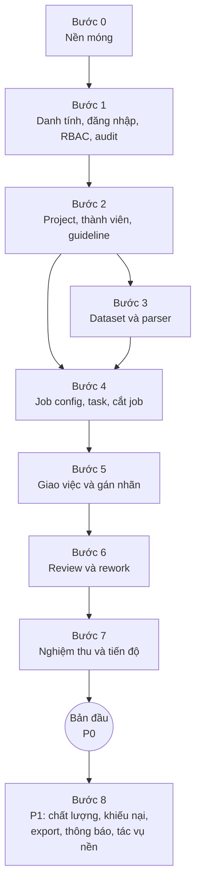

# Kế hoạch xây dựng backend

> Các bước xây dựng backend từ khung hiện có đến bản đầu chạy trọn vòng bài toán
> đánh giá tool call.
>
> Căn cứ: `docs/database_design.md`, `docs/user_stories.md`, `docs/review_workflow.md`,
> `docs/role_in_system.md`, `docs/api_design.md`, `docs/dictionary.md`.
> Trạng thái: draft.

---

## 1. Hiện trạng

| Thành phần | Có sẵn |
| --- | --- |
| Framework | FastAPI, SQLAlchemy async, Alembic, Pydantic settings |
| DB | Supabase Postgres (transaction pooler, `NullPool`); fallback SQLite khi không cấu hình |
| Cấu trúc | `endpoint → service → repository`, schema Pydantic riêng |
| Lỗi | `AppError`, `NotFoundError`, `ConflictError`; định dạng `{code, message, details}` |
| Test | pytest + httpx, chạy trên **SQLite** tạo mới mỗi test |
| Nghiệp vụ | Chưa có. Chỉ có `Item` mẫu và `health` |

**Hệ quả quan trọng:** thiết kế DB dùng `jsonb`, `uuid`, unique một phần
(`where revoked_at is null`). SQLite không có các thứ này, nên **test phải chạy trên
Postgres** trước khi viết nghiệp vụ (bước 0).

---

## 2. Nguyên tắc triển khai

| # | Nguyên tắc | Hệ quả |
| --- | --- | --- |
| 1 | **Làm theo lát dọc** | Mỗi bước xong là chạy được một phần luồng thật (bảng + service + endpoint + test), không làm hết bảng rồi mới làm API |
| 2 | **Giữ cấu trúc hiện có** | Tiếp tục chia theo lớp (`models/`, `repositories/`, `services/`, `api/v1/endpoints/`), mỗi domain một file trong từng lớp |
| 3 | **Chặn ở backend, không chặn ở DB** | Ràng buộc nghiệp vụ (role requirement, xung đột, self-review, khớp `item_type`) kiểm tra ở service. DB chỉ giữ khoá ngoại, NOT NULL, unique cơ bản |
| 4 | **Một chỗ duy nhất cho chuyển trạng thái** | Trạng thái job và task chỉ đổi qua state machine, không gán `status` trực tiếp ở nơi khác |
| 5 | **Mọi endpoint khai báo permission** | Không có endpoint nghiệp vụ nào thiếu kiểm tra quyền; có test cho cả trường hợp bị từ chối |
| 6 | **Audit đi cùng hành động** | Ghi `audit_events` trong cùng transaction với hành động |
| 7 | **Không làm trước khi cần** | Consensus, custom role, break-glass, nhiều item type để sau |

---

## 3. Lộ trình

Bước 3 và phần đầu của bước 4 (label schema, item type registry) có thể làm song song
nếu có hai người.

---

## Bước 0: Nền móng

**Mục tiêu:** dọn khung mẫu và chuẩn bị hạ tầng chung để các bước sau chỉ việc viết nghiệp vụ.

| Việc | Chi tiết |
| --- | --- |
| Test trên Postgres | Chạy Postgres bằng Docker (thêm service vào `docker-compose.yml` hoặc dùng testcontainers). Mỗi test chạy trong transaction rồi rollback, hoặc mỗi phiên test một schema riêng. Bỏ fallback SQLite cho test |
| Base model | Mixin `id` (uuid), `created_at`; quy ước đặt tên constraint cho Alembic |
| Xoá `Item` mẫu | Xoá model, repo, service, endpoint, test, migration mẫu (hoặc migration xoá bảng) |
| Lỗi mới | `UnauthorizedError` (401), `ForbiddenError` (403), `InvalidStateError` (409) |
| Request context | Lấy `ip`, `user_agent`, request id cho audit và log |
| Phân trang | Dùng lại `Page` trong `schemas/common.py`, chuẩn hoá tham số `limit`/`offset` |
| CI cục bộ | `npm run lint`, `typecheck`, `test` chạy được với Postgres |

**Xong khi:** test chạy trên Postgres, không còn code `Item`, CI xanh.

---

## Bước 1: Danh tính, đăng nhập, RBAC, audit

**Story:** ALL-01, ALL-02, HR-01, HR-02, HR-03, HR-04, HR-07.

**Bảng (migration):** `users`, `refresh_tokens`, `user_action_tokens`, `roles`, `permissions`,
`role_permissions`, `user_platform_roles`, `role_requirements`, `role_conflicts`,
`audit_events`.

**Seed trong migration:** 7 role platform, 5 role project, 24 permission, ma trận
role-permission, role requirement, role conflict (theo mục 3 của
`database_design.md`). Ma trận cố định, chưa sửa qua giao diện.

| Module | Nội dung |
| --- | --- |
| `services/auth` | JWT theo `api_design.md` mục 2: đăng nhập email + mật khẩu (băm argon2 hoặc bcrypt), access token 15 phút, refresh token lưu hash trong DB và xoay vòng, cookie httpOnly; đăng xuất; kích hoạt tài khoản bằng token một lần; kiểm tra `status` và `token_version` mỗi request |
| `services/authorization` | **Permission resolver**: nhận `user`, `permission`, `project_id` (tuỳ chọn), trả có/không và `limit`. Theo đúng thứ tự ở mục 3.6 của `database_design.md`. Đọc `expires_at`, `revoked_at` ngay lúc kiểm |
| `api/deps.py` | `CurrentUser`, `require_permission("user.manage")`, `require_project_permission("job.review")` |
| `services/user` | Tạo user, tìm kiếm, disable (offboarding: thu hồi role, tăng `token_version`, thu hồi refresh token, đánh dấu job trả về pool ở bước 5) |
| `services/platform_role` | Cấp, thu hồi role platform; kiểm tra không tự cấp, xung đột, trùng |
| `services/audit` | `record(actor, action, target, before, after, reason)`, gọi trong cùng transaction |
| Script khởi tạo | Lệnh CLI tạo `hr_admin` đầu tiên (không có ai cấp quyền cho người đầu tiên) |

**Endpoint:** xem `api_design.md` mục 3.1–3.5, 3.16.

**Test bắt buộc:** đăng nhập với user `suspended` bị từ chối; access token còn hạn bị từ chối
ngay sau offboarding; dùng lại refresh token cũ thu hồi cả family; HR không tự cấp role; `platform_admin` không cấp được role; quyền hết hạn
không còn tác dụng; mọi hành động ghi audit.

**Xong khi:** HR tạo được người, cấp và thu hồi quyền, người đó đăng nhập và `GET /me`
thấy đúng role.

---

## Bước 2: Project, thành viên, guideline

**Story:** PO-01, PO-02, PO-06, PO-17, HR-08, HR-09, ALL-02.

**Bảng:** `projects`, `project_members`, `guideline_versions`, `teams`, `team_members`, `project_teams`.

| Module | Nội dung |
| --- | --- |
| `services/project` | Tạo project (người tạo thành `owner`), đổi trạng thái `draft/active/paused/closed` |
| `services/project_member` | Thêm, gỡ thành viên; kiểm tra `role_requirements` và `role_conflicts`; gỡ thì đánh dấu job của người đó trả về pool (nối ở bước 5) |
| `services/team` | HR tạo đội, thêm, gỡ thành viên, đặt vai trò trong đội; PO gắn, gỡ đội khỏi project; kiểm tra xung đột vai trò giữa các đội (`database_design.md` 9.3) |
| `services/guideline` | Tạo version mới mỗi lần lưu, không sửa version cũ; lấy diff |
| Lọc theo membership | Mọi repository đọc dữ liệu project nhận `user` và lọc theo `project_members` còn hiệu lực |

**Endpoint:** xem `api_design.md` mục 3.6, 3.7, 3.18.

**Test bắt buộc:** thêm người thiếu role platform bị từ chối; annotator và reviewer
cùng project bị chặn; thu hồi role platform làm membership mất tác dụng; người ngoài
project không đọc được project.

**Xong khi:** HR lập một đội có annotator và reviewer, PO tạo project, gắn đội, đăng guideline v1 và v2.

---

## Bước 3: Dataset và parser

**Story:** PO-04, PO-05.

**Bảng:** `dataset_versions`, `items`.

| Module | Nội dung |
| --- | --- |
| Storage adapter | Interface lưu file (`put`, `get`, `delete`); bản đầu lưu ổ đĩa cục bộ, sau đổi sang Supabase Storage hoặc S3 mà không sửa service |
| Parser registry | `PARSERS = {"jsonl_chat": ...}`; mỗi parser có `name`, `version`, `item_type`, hàm `parse(file, options) -> items + lỗi` |
| `jsonl_chat` parser | Đọc từng dòng, áp field mapping (JSONPath) để ra trajectory chuẩn: lời user, danh sách bước, tool schema |
| Preview | Parse vài dòng đầu, trả item mẫu và lỗi, **không** lưu |
| `services/dataset` | Upload, parse, ghi `dataset_versions` (kèm `parser`, `parser_options`, `parser_version`, checksum, `item_count`) và `items` trong một lần |
| Báo lỗi parse | Trả danh sách lỗi theo số dòng; nếu lỗi quá ngưỡng thì không tạo version |

**Endpoint:** xem `api_design.md` mục 3.8.

**Lưu ý:** bản đầu parse đồng bộ trong request, giới hạn kích thước file (cấu hình). Khi
file lớn mới chuyển sang tác vụ nền (bước 8).

**Test bắt buộc:** file JSONL hợp lệ ra đúng số item; dòng hỏng báo đúng số dòng; upload
lần hai tạo version mới, không đụng version cũ; HR không đọc được item.

**Xong khi:** PO upload một file trajectory thật, xem preview, tạo dataset version v1.

---

## Bước 4: Job config, task, cắt job

**Story:** PO-07, PO-08.

**Bảng:** `job_configs`, `tasks`, `jobs`, `job_items`, `reason_codes`.

| Module | Nội dung |
| --- | --- |
| Item type registry | `ITEM_TYPES = {"tool_call": ...}`: cách lấy danh sách item cần gán nhãn từ payload, validator riêng nếu có |
| Label schema validator | Tập kiểu nhỏ: enum, multi-select, text, number, boolean, điều kiện hiện `field = value`. Hai việc: kiểm tra schema hợp lệ khi PO lưu, và kiểm tra `annotation.value` khi submit (bước 5) |
| `services/job_config` | Tạo version mới (bất biến); kiểm tra `item_type` có trong registry |
| `services/task` | Tạo task từ dataset version + job config + guideline; **kiểm tra `item_type` của dataset khớp job config**; giao task cho đội đang gắn với project; `priority` |
| Cắt job | Chia item theo `job_rules` (số item mỗi job); tạo `jobs` và `job_items`; mọi job ghim `guideline_version_id` và `job_config_id` |
| `reason_codes` | Danh mục mã lỗi theo project; seed sẵn bộ cho tool call |

**Endpoint:** xem `api_design.md` mục 3.9, 3.10.

**Test bắt buộc:** label schema sai bị từ chối; `item_type` không khớp bị từ chối; số job
và số item mỗi job đúng; một item chỉ nằm trong một job của task; job ghim đúng version.

**Xong khi:** PO tạo job config v1 cho tool call và một task, hệ thống cắt ra các job.

---

## Bước 5: Giao việc và gán nhãn

**Story:** PM-01, PM-02, PM-03, PM-04, AN-01 đến AN-08, AN-11, RV-09.

**Bảng:** `submissions`, `annotations`, thêm chỗ lưu bản nháp (xem mục 5).

| Module | Nội dung |
| --- | --- |
| **State machine job** | Một module duy nhất định nghĩa trạng thái và chuyển hợp lệ theo `review_workflow.md` mục 4; mọi đổi trạng thái gọi qua đây, kèm audit |
| `services/assignment` | **Lấy việc tiếp theo** cho annotator và reviewer theo thứ tự ưu tiên, WIP limit, `gold_rate`, khoá bằng `SELECT ... FOR UPDATE SKIP LOCKED` (`database_design.md` 9.4). PM giao tay, đổi người, phân reviewer khi cần; người nhận phải thuộc đội của task, reviewer không phải người làm |
| Lease | Nhận job thì đặt `lease_expires_at`; hết hạn thì job trả về pool (bản đầu kiểm tra khi đọc hàng đợi; tác vụ nền ở bước 8). Job về trạng thái `unassigned` |
| `services/annotation` | Lưu nháp, submit: validate theo `label_schema`, kiểm tra đủ item, kiểm tra self-check, tạo `submission` (round) và `annotations`, chuyển job sang `submitted` |
| Hàng đợi annotator | Chỉ job được giao cho mình; job bị reject hiện kèm lý do |
| Offboarding nối vào | Khi user bị disable hoặc gỡ khỏi project, job dở của họ trả về pool |

**Endpoint:** xem `api_design.md` mục 3.11, 3.12.

**Test bắt buộc:** chuyển trạng thái sai bị từ chối; annotator không mở được job của
người khác; submit thiếu item hoặc sai schema bị từ chối; `incorrect` thiếu
`reason_code` bị từ chối; lease hết hạn thì job về pool.

**Xong khi:** màn hình demo `fe/src/app/demo/annotate` đọc job thật từ API và submit được.

---

## Bước 6: Review và rework

**Story:** RV-01, RV-02, RV-03, RV-04, PM-07, AN-07, AN-08.

**Bảng:** `reviews`, `review_errors`.

| Module | Nội dung |
| --- | --- |
| Hàng đợi review | Job được phân cho mình, sắp theo cờ `unsure` rồi theo tuổi; loại job do chính mình làm |
| `services/review` | Ghi quyết định `accept`, `accept_with_fix`, `reject`, `escalate`; lỗi gắn item với `reason_code`, mức độ; `reject` bắt buộc lý do; bản ghi bất biến |
| Rework | Reject thì job về `in_progress` cho annotator, tăng `rework_count`; vượt giới hạn trong `job_rules` thì `escalated` |
| Chấm lại | Ưu tiên reviewer cũ |
| Escalate | PM quyết accept hoặc reject, bắt buộc lý do |
| Self-review | Kiểm tra `reviewer_id` khác annotator của submission, ở service |

**Endpoint:** xem `api_design.md` mục 3.13, 3.14.

**Test bắt buộc:** reviewer không chấm job của mình kể cả gọi API trực tiếp; reject 3 lần
ra `escalated`; review cũ không sửa được; annotator thấy đúng lỗi theo item.

**Xong khi:** một job đi trọn vòng submit → reject → sửa → accept.

---

## Bước 7: Nghiệm thu và tiến độ

**Story:** PO-10, PO-12, PM-05.

| Module | Nội dung |
| --- | --- |
| State machine task | `draft → active → in_acceptance → delivered` |
| `services/acceptance` | Tỷ lệ pass của task, lấy mẫu ngẫu nhiên 5–10% job `accepted` để PO xem, ký nghiệm thu, mở re-review cho task |
| `services/progress` | % hoàn thành, throughput, backlog, cycle time, stuck; tính bằng truy vấn hoặc view trên `jobs`; chỉ đếm `accepted` |

**Endpoint:** xem `api_design.md` mục 3.15.

**Test bắt buộc:** tiến độ không đếm `submitted`; PO không chấm từng job; người không
thuộc project không xem được tiến độ.

**Xong khi:** trọn vòng từ upload dữ liệu đến task `delivered` chạy được. **Đây là bản đầu
(toàn bộ story P0).**

---

## Bước 8: Sau bản đầu (P1)

| Nhóm | Việc | Story |
| --- | --- | --- |
| Tác vụ nền | Lịch chạy định kỳ: trả job hết lease về pool, cảnh báo job stuck, xử lý quyền sắp hết hạn, parse file lớn | PM-06, HR-05 |
| Khiếu nại | `appeals`: mở, PM bước 1, PO quyết cuối | AN-09, PM-08, PO-14 |
| Override | Review mới `kind = override` trỏ về bản cũ, bắt buộc lý do | PO-13 |
| Chất lượng | Gold job, `gold_answers`, metric (`pass_rate`, `gold_accuracy`...), báo cáo theo annotator và reviewer | PO-11, PO-16, AN-10, RV-08 |
| Export | Xuất nhãn của task `delivered` ra JSONL, ghi audit | PO-15 |
| Thông báo | Email kích hoạt, báo reject, báo stuck (kênh chưa chốt) | HR-01, AN-07, PM-06 |
| Vận hành | Service account, cấu hình hệ thống, xem parser và item type | AD-02, AD-03, AD-05 |
| Audit | Endpoint đọc audit có lọc, báo cáo tuân thủ | HR-06, AU-01, AU-02 |
| Trưởng nhóm | Cờ `is_lead`, permission `team.monitor`, tổng hợp tải, chất lượng, cảnh báo theo đội | HR-10, TL-01, TL-02, TL-03 |

---

## 4. Thành phần dùng chung xuyên suốt

| Thành phần | Dùng ở | Ghi chú |
| --- | --- | --- |
| Permission resolver | Mọi endpoint | Viết một lần ở bước 1, có test riêng cho từng nhánh |
| Audit service | Mọi hành động ghi | Cùng transaction |
| State machine (job, task) | Bước 5–7 | Một nơi định nghĩa chuyển hợp lệ |
| Label schema validator | Bước 4–5 | Dùng cả khi PO lưu config và khi annotator submit |
| Registry (parser, item type) | Bước 3–4 | Thêm loại mới là thêm một mục |
| Lọc theo membership | Mọi repository dữ liệu project | Không có ngoại lệ, kể cả báo cáo |
| OpenAPI | Frontend | Sinh type cho `fe/src/lib/api.ts` từ `/openapi.json` để hai bên không lệch |

---

## 5. Quyết định cần chốt trước khi bắt đầu

| # | Câu hỏi | Ảnh hưởng | Đề xuất |
| --- | --- | --- | --- |
| 1 | ~~Đăng nhập~~ | Bước 1 | **Đã chốt:** JWT access 15 phút + refresh token lưu DB + kiểm tra `token_version` mỗi request |
| 2 | **Test chạy Postgres bằng gì?** | Bước 0 | Docker Compose với một service Postgres riêng cho test |
| 3 | **Lưu file dataset ở đâu?** | Bước 3 | Bản đầu ổ đĩa cục bộ qua storage adapter, sau đổi Supabase Storage |
| 4 | ~~Bản nháp~~ | Bước 5 | **Đã chốt:** cột `jobs.draft` (jsonb) |
| 5 | **Job không bị lấy mẫu review đi đâu?** | Bước 6 | Bản đầu review 100% để tránh câu hỏi này; lấy mẫu làm ở bước 8 |
| 6 | **Rubric lưu ở đâu?** | Bước 2, 6 | Docs yêu cầu job ghim rubric nhưng DB chưa có bảng. Đề xuất bản đầu gộp rubric vào nội dung guideline version |
| 7 | **Ai giao job: PM giao hay annotator tự nhận từ pool?** | Bước 5 | Bản đầu PM giao; tự nhận để sau |
| 8 | ~~Job chưa có người nhận~~ | Bước 4, 5 | **Đã chốt:** thêm trạng thái `unassigned` |

Quyết định 1, 4, 8 đã cập nhật vào `database_design.md` và `api_design.md`. Quyết định 6 cần cập nhật khi chốt.
