# Thiết kế cơ sở dữ liệu

> Mô tả các nhóm bảng, quan hệ và ràng buộc. Chưa viết SQL.
>
> Căn cứ: `docs/prd.md`, `docs/role_in_system.md`, `docs/review_workflow.md`,
> `docs/dictionary.md`. Tên cấp công việc theo CVAT: `Project → Task → Job → Item`.
> Trạng thái: draft để chốt trước khi viết migration.

---

## 1. Nguyên tắc thiết kế

| # | Nguyên tắc | Hệ quả |
| --- | --- | --- |
| 1 | **Cột thường cho thứ điều khiển, jsonb cho nội dung** | `status`, `assignee_id`, `project_id`, thời gian là cột thật (có index, khoá ngoại). Nội dung item, nhãn, schema là jsonb |
| 2 | **Bất biến theo version** | `dataset_versions`, `guideline_versions`, `job_configs` chỉ thêm, không sửa. Job ghim đúng version lúc giao |
| 3 | **Không xoá cứng** | Dùng `revoked_at`, `left_at`, trạng thái. Audit không cascade delete |
| 4 | **Quyết định là bản ghi mới** | Muốn đổi quyết định review thì thêm bản ghi, không sửa bản cũ |
| 5 | **Bảng lõi không biết nghĩa của nhãn** | `jobs`, `reviews` chỉ biết `item_id` và jsonb; nghĩa do `item_type` và `label_schema` quyết định |
| 6 | **Mọi truy vấn dữ liệu project lọc theo `project_members`** | `project_id` luôn là cột thật ở các bảng con quan trọng để lọc nhanh |
| 7 | **Nền tảng không có thanh toán** | Không có bảng hay trạng thái liên quan đến trả tiền |

---

## 2. Tổng quan các nhóm

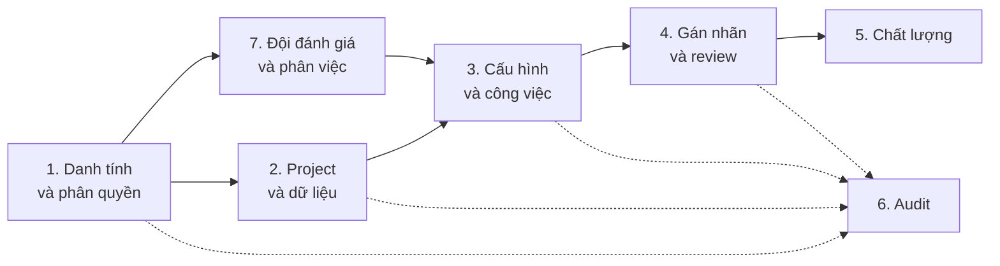

| Nhóm | Bảng |
| --- | --- |
| 1. Danh tính và phân quyền (RBAC) | `users`, `roles`, `permissions`, `role_permissions`, `user_platform_roles`, `role_requirements`, `role_conflicts`, `refresh_tokens`, `user_action_tokens` |
| 2. Project và dữ liệu | `projects`, `project_members`, `guideline_versions`, `dataset_versions`, `items` |
| 3. Cấu hình và công việc | `job_configs`, `tasks`, `jobs`, `job_items` |
| 4. Gán nhãn và review | `submissions`, `annotations`, `reviews`, `review_errors`, `corrections`, `appeals` |
| 5. Chất lượng | `reason_codes`, `gold_answers` |
| 6. Audit | `audit_events` |
| 7. Đội đánh giá và phân việc | `teams`, `team_members`, `project_teams` (và `tasks.team_id`) |

Tiến độ (% hoàn thành, throughput, backlog, cycle time, stuck) **không có bảng
riêng**; tính từ `jobs` bằng view hoặc truy vấn.

---

## 3. Nhóm 1: Danh tính và phân quyền (RBAC)

Hai lớp quyền tách biệt: HR cấp **role platform** (năng lực), PO cấp **role project**
(phạm vi, bảng `project_members` ở nhóm 2). Cả hai tham chiếu chung bảng `roles`.

### 3.1 Nguyên tắc

| # | Nguyên tắc | Hệ quả |
| --- | --- | --- |
| 1 | **User → Role → Permission** | Code kiểm tra *permission*, không kiểm tra tên role. Đổi role nào có quyền gì thì sửa dữ liệu, không sửa code |
| 2 | **Hai phạm vi: platform và project** | Role platform do HR cấp (năng lực). Role project do PO cấp (phạm vi). Một người có thể là annotator ở project A và reviewer ở project B |
| 3 | **Không có `users.role`** | Một user có nhiều role, mỗi role có phạm vi riêng |
| 4 | **Mọi gán quyền có thời hạn** | `expires_at` và `revoked_at` trên mọi bản ghi gán |
| 5 | **Role project phải được role platform "đỡ"** | Muốn là reviewer ở project thì phải có role platform `reviewer`. Khai báo bằng dữ liệu, không viết cứng |
| 6 | **Tách trách nhiệm là dữ liệu** | Cặp role không được đi cùng nhau khai báo trong bảng, không rải trong code |
| 7 | **RBAC không tự giải quyết điều kiện theo ngữ cảnh** | "Chỉ job được giao cho mình", "không review việc của chính mình" kiểm tra thêm ở service, xem 3.7 |
| 8 | **Quyền chặn ở API, không chỉ UI** | Mọi endpoint khai báo permission cần thiết |

### 3.2 Mô hình dữ liệu

```mermaid
erDiagram
    users ||--o{ user_platform_roles : "được cấp"
    users ||--o{ refresh_tokens : "đăng nhập"
    users ||--o{ user_action_tokens : "kích hoạt, đặt lại mật khẩu"
    roles ||--o{ user_platform_roles : "là"
    users ||--o{ project_members : "tham gia"
    roles ||--o{ project_members : "là"
    projects ||--o{ project_members : "có"
    roles ||--o{ role_permissions : "có"
    permissions ||--o{ role_permissions : "thuộc"
    roles ||--o{ role_requirements : "role project..."
    roles ||--o{ role_requirements : "...cần role platform"
    roles ||--o{ role_conflicts : "xung đột với"

    users {
        uuid id PK
        string kind "human | service"
        string employee_code
        string email
        string full_name
        string status "active | suspended | left"
        string employment_type "full_time | contractor | intern"
        timestamp joined_at
        timestamp left_at
        string password_hash
        int token_version "tăng lên thì mọi access token cũ mất hiệu lực"
    }
    user_action_tokens {
        uuid id PK
        uuid user_id FK
        string purpose "activate | reset_password"
        string token_hash
        timestamp expires_at
        timestamp used_at
    }
    refresh_tokens {
        uuid id PK
        uuid user_id FK
        uuid family_id "chuỗi xoay vòng"
        string token_hash
        uuid replaced_by FK
        string ip
        string user_agent
        timestamp created_at
        timestamp expires_at
        timestamp revoked_at "thu hồi khi logout, offboarding, dùng lại token cũ"
    }
    roles {
        uuid id PK
        string code "annotator, reviewer, po..."
        string scope "platform | project | team"
        string name
        string description
        boolean is_system "role hệ thống, không xoá"
        timestamp created_at
    }
    permissions {
        uuid id PK
        string code "resource.action, ví dụ job.review"
        string resource
        string action
        string description
        string level "platform | project"
    }
    role_permissions {
        uuid role_id FK
        uuid permission_id FK
        string limit "all | project | assigned | own"
    }
    user_platform_roles {
        uuid id PK
        uuid user_id FK
        uuid role_id FK
        uuid granted_by FK
        timestamp granted_at
        timestamp expires_at "null = vô thời hạn"
        timestamp revoked_at
        string revoke_reason
    }
    project_members {
        uuid id PK
        uuid project_id FK
        uuid user_id FK
        uuid role_id FK
        uuid assigned_by FK
        timestamp assigned_at
        timestamp expires_at
        timestamp revoked_at
    }
    role_requirements {
        uuid project_role_id FK
        uuid required_platform_role_id FK
    }
    role_conflicts {
        uuid role_a_id FK
        uuid role_b_id FK
        string scope "same_project | same_user"
        string effect "block | warn"
    }
```

| Bảng | Làm gì |
| --- | --- |
| `users` | Tài khoản. `kind = service` cho bot/cron, do `platform_admin` tạo, không dùng chung tài khoản người |
| `refresh_tokens` | Refresh token của JWT (lưu hash), xoay vòng mỗi lần refresh; dùng lại token đã bị thay thế thì thu hồi cả family. Access token không lưu DB; mỗi request so `users.token_version` để thu hồi ngay (xem `api_design.md` mục 2) |
| `user_action_tokens` | Token dùng một lần cho kích hoạt tài khoản và đặt lại mật khẩu (lưu hash) |
| `roles` | Danh mục role. `scope` cho biết role dùng ở cấp platform hay project. Role hệ thống (`is_system`) không xoá được |
| `permissions` | Danh mục permission, đặt tên `resource.action` |
| `role_permissions` | Role nào có permission nào, kèm `limit` (phạm vi dữ liệu) |
| `user_platform_roles` | Gán role platform cho user (HR cấp) |
| `project_members` | Gán role project cho user trong một project (PO cấp) |
| `role_requirements` | Role project nào đòi role platform nào (thay bảng "platform role tối thiểu" viết cứng) |
| `role_conflicts` | Cặp role không được đi chung, hoặc chỉ cảnh báo |

Ràng buộc dữ liệu:

- `unique(user_id, role_id)` trên `user_platform_roles` khi `revoked_at is null`.
- `unique(project_id, user_id, role_id)` trên `project_members` khi `revoked_at is null`.
- `user_platform_roles.role_id` phải có `roles.scope = platform`; `project_members.role_id`
  phải có `roles.scope = project`. Kiểm tra ở backend.
- `role_permissions.permission_id` phải cùng `level` với `roles.scope` của role.

### 3.3 Danh mục role

**Role platform (HR cấp)**

| Code | Ai thường giữ | Ghi chú |
| --- | --- | --- |
| `hr_admin` | HR / People Ops | Tạo user, cấp và thu hồi role platform. Không xem dataset |
| `po` | Product Owner | Tạo project, cấu hình, nghiệm thu |
| `annotator` | Nhân sự gán nhãn | |
| `reviewer` | QC, Team Lead | |
| `project_manager` | Ops / Team Lead | Điều phối, tiến độ, tranh chấp bước 1 |
| `platform_admin` | IT / DevOps | Vận hành hệ thống. Không cấp quyền nghiệp vụ |
| `auditor` | Compliance | Chỉ đọc audit và báo cáo |

**Role project (PO cấp)**

| Code | Ghi chú |
| --- | --- |
| `owner` | Toàn quyền trong project. Phải có owner dự phòng |
| `manager` | Chia job, theo dõi tiến độ, mở tranh chấp |
| `annotator` | Làm job được giao. **Chỉ có qua đội** (mục 9) |
| `reviewer` | Chấm job trong project. **Chỉ có qua đội** (mục 9) |
| `viewer` | Chỉ đọc tiến độ và báo cáo |

**Role project cần role platform nào (`role_requirements`)**

| Role project | Role platform tối thiểu |
| --- | --- |
| `owner` | `po` |
| `manager` | `project_manager` |
| `annotator` | `annotator` |
| `reviewer` | `reviewer` |
| `viewer` | bất kỳ (kể cả `auditor`) |

Khi thu hồi role platform, mọi `project_members` dựa vào role đó **tự vô hiệu**, kể
cả khi PO chưa gỡ. Kiểm tra lúc đọc quyền, không chờ job dọn dẹp.

**Xung đột (`role_conflicts`)**

| Cặp | Phạm vi | Hiệu ứng |
| --- | --- | --- |
| project `annotator` và project `reviewer` | cùng project, cùng user (kể cả khi đến từ hai đội khác nhau, xem 9.3) | **block** |
| platform `hr_admin` và platform `platform_admin` | cùng user | **warn** (công ty nhỏ có thể giữ cả hai, nhưng ghi nhận là hai role riêng để audit) |

### 3.4 Danh mục permission

Đặt tên `resource.action`.

| Permission | Level | Mô tả |
| --- | --- | --- |
| `user.manage` | platform | Tạo, sửa, disable user |
| `platform_role.grant` | platform | Cấp, thu hồi role platform |
| `project.create` | platform | Tạo project |
| `project.update` | project | Sửa project |
| `guideline.manage` | project | Tạo version guideline |
| `dataset.upload` | project | Upload, thay version dataset |
| `dataset.delete` | project | Xoá dataset |
| `dataset.read` | project | Xem nội dung dataset và item |
| `job_config.manage` | project | Tạo version job config |
| `member.manage` | project | Thêm, gỡ thành viên trực tiếp (owner, manager, viewer); gắn, gỡ đội khỏi project |
| `task.manage` | project | Tạo, cắt task; giao task cho đội |
| `job.assign` | project | Chia job, đổi người làm |
| `job.annotate` | project | Làm và submit job |
| `job.review` | project | Chấm job: accept, reject, escalate |
| `review.override` | project | Đổi quyết định của reviewer (bắt buộc lý do) |
| `task.accept` | project | Nghiệm thu task (sign-off) |
| `appeal.open` | project | Mở khiếu nại |
| `appeal.decide` | project | Xử lý khiếu nại |
| `progress.read` | project | Xem tiến độ |
| `quality.read` | project | Xem báo cáo chất lượng |
| `audit.read` | platform / project | Đọc audit log |
| `system.configure` | platform | Cấu hình hệ thống, quản lý service account |
| `dataset.breakglass` | platform | Truy cập dataset khẩn cấp (có lý do, có audit) |
| `export.data` | project | Export dữ liệu và báo cáo |
| `team.manage` | platform | Tạo đội, thêm, gỡ thành viên, đặt vai trò trong đội |
| `team.read` | platform | Xem danh sách đội và số thành viên theo vai trò (để chọn đội) |
| `team.monitor` | team | Xem tải, tiến độ, chất lượng (số liệu tổng hợp) của thành viên đội mình trên mọi project đội làm; nhận cảnh báo của đội |

### 3.5 Ma trận role - permission

Ký hiệu trong ô là `limit`: `all` (toàn hệ thống), `P` (project mình thuộc), `A`
(chỉ job được giao), `own` (của chính mình), `-` (không có).

**Role platform**

| Permission | hr_admin | po | annotator | reviewer | project_manager | platform_admin | auditor |
| --- | --- | --- | --- | --- | --- | --- | --- |
| `user.manage` | all | - | - | - | - | - | - |
| `platform_role.grant` | all | - | - | - | - | - | - |
| `project.create` | - | all | - | - | - | - | - |
| `system.configure` | - | - | - | - | - | all | - |
| `dataset.breakglass` | - | - | - | - | - | all (có điều kiện) | - |
| `audit.read` | all (về quyền) | - | - | - | - | all (hệ thống) | all |
| `team.manage` | all | - | - | - | - | - | - |
| `team.read` | all | all | - | - | all | - | all |

**Role đội**

| Permission | team_lead |
| --- | --- |
| `team.monitor` | T (đội mình) |

`team_lead` là role có `scope = team`, không gán qua `user_platform_roles` mà qua cờ
`team_members.is_lead` (mục 9.5). Ký hiệu `limit` thêm `T` = đội mình.

**Role project**

| Permission | owner | manager | annotator | reviewer | viewer |
| --- | --- | --- | --- | --- | --- |
| `project.update` | P | - | - | - | - |
| `guideline.manage` | P | - | - | - | - |
| `dataset.upload`, `dataset.delete` | P | - | - | - | - |
| `dataset.read` | P | P | A | A | - |
| `job_config.manage` | P | - | - | - | - |
| `member.manage` | P | P | - | - | - |
| `task.manage` | P | P | - | - | - |
| `job.assign` | P | P | - | - | - |
| `job.annotate` | - | - | A | - | - |
| `job.review` | - | - | - | A | - |
| `review.override` | P | - | - | - | - |
| `task.accept` | P | - | - | - | - |
| `appeal.open` | - | - | own | - | - |
| `appeal.decide` | P | P (bước 1) | - | - | - |
| `progress.read` | P | P | own | P | P |
| `quality.read` | P | P | own | P | P |
| `audit.read` | P | - | - | - | - |
| `export.data` | P | - | - | - | - |

Ghi chú:

- `owner` **không có** `job.review`: PO chỉ nghiệm thu task, không chấm từng job.
- `hr_admin` **không có** `dataset.read` ở bất kỳ cấp nào.
- `platform_admin` không có `platform_role.grant`.
- `viewer` dùng cho stakeholder và auditor khi cần xem một project cụ thể.

### 3.6 Quy trình kiểm tra quyền

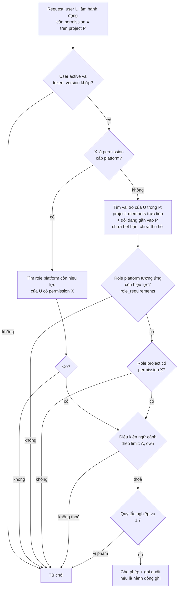

Thứ tự kiểm tra: **trạng thái user → role còn hiệu lực → permission → phạm vi dữ liệu
(`limit`) → quy tắc nghiệp vụ**. Thiếu bước nào cũng có thể bypass.

### 3.7 Điều kiện ngoài RBAC (kiểm tra ở service)

RBAC chỉ trả lời "role này có permission này không". Những điều sau phụ thuộc vào dữ
liệu cụ thể, nên kiểm tra thêm ở service, không nhét vào bảng permission.

| Quy tắc | Kiểm tra |
| --- | --- |
| Không review job của chính mình | `reviewer_id` khác `annotator_id` của submission |
| Annotator chỉ thấy job được giao | `limit = A`: `jobs.assignee_id = user` |
| Reviewer chỉ chấm job được phân | `limit = A`: `jobs.reviewer_id = user` |
| Annotator không là reviewer cùng project | `role_conflicts` (block) khi thêm member |
| PO override review phải có lý do | `reason` bắt buộc, ghi audit |
| Admin không tự cấp role cho mình | `granted_by` khác `user_id` và người cấp phải có `platform_role.grant` |
| Mọi query dữ liệu project lọc theo membership | Điều kiện `project_id` bắt buộc trong repository |
| Break-glass | Yêu cầu `reason`, ghi audit, có thời hạn ngắn |

### 3.8 Vòng đời quyền

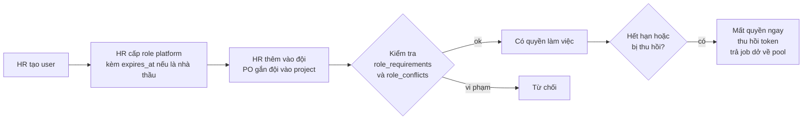

- **Onboarding:** HR cấp role platform và thêm người vào đội, **không** chọn project. PO
  chọn đội cho project. Owner, manager, viewer vẫn được PO thêm trực tiếp.
- **Offboarding:** HR disable user thì thu hồi toàn bộ role platform, vô hiệu mọi
  `project_members` và `team_members`, tăng `token_version`, thu hồi refresh token, trả job đang làm dở về pool, ghi audit.
- **Hết hạn tự động:** kiểm tra `expires_at` ngay lúc kiểm quyền, không phụ thuộc job
  dọn dẹp chạy định kỳ.
- **Chuyển vai trò giữa project:** PO không tự "thăng chức". Cần HR cấp thêm role
  platform tương ứng và đưa người đó vào một đội với vai trò mới (chưa chốt chính sách, xem mục 13).

### 3.9 Audit cho phân quyền

Ghi vào `audit_events` (nhóm 6):

- Cấp, thu hồi, đổi role platform (kèm `before`/`after`, `reason`).
- Thêm, gỡ, đổi role project.
- Đổi nội dung `role_permissions` (ai sửa ma trận quyền, lúc nào).
- Thêm hoặc xoá `role_requirements`, `role_conflicts`.
- Quyết định bị từ chối ở các hành động nhạy cảm (đọc dataset, export), để phát hiện
  thử vượt quyền.
- Break-glass.

---

## 4. Nhóm 2: Project và dữ liệu

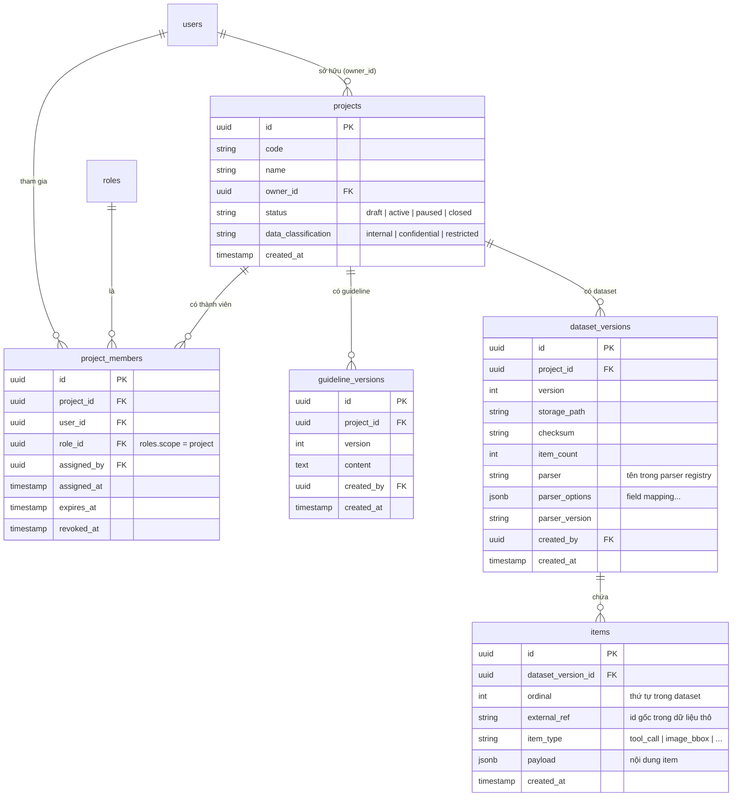

Ghi chú:

- `project_members` chỉ dùng cho `owner`, `manager`, `viewer`. Annotator và reviewer vào
  project qua đội (mục 9).
- `project_members`: điều kiện add theo `role_requirements`, chặn cặp xung đột theo
  `role_conflicts` (nhóm 1). Thu hồi role platform thì membership tương ứng vô hiệu.
- `guideline_versions`, `dataset_versions`, `items`: **append-only**.
- `projects.owner_id`: project phải có owner dự phòng (co-owner) hoặc quy trình
  transfer; cảnh báo khi owner bị disable (xử lý ở service, không cần bảng thêm
  nếu co-owner là thêm một `project_members` với role `owner`).
- Trajectory dài lưu trong `items.payload`. File ảnh/audio lớn lưu ngoài (object
  storage), `payload` chỉ giữ đường dẫn.

---

## 5. Nhóm 3: Cấu hình và công việc

`job_configs` trả lời "thế nào là một job" (PO cấu hình, có version). `tasks` là
gói dữ liệu PO nghiệm thu. `jobs` là đơn vị giao cho annotator.

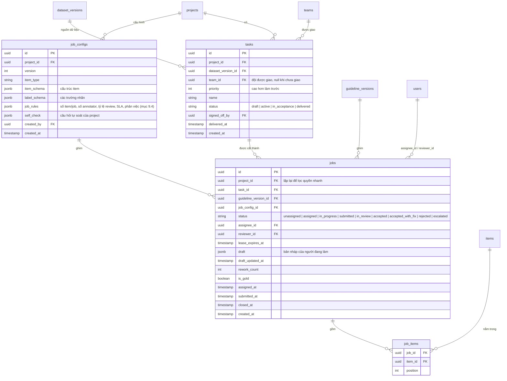

Ghi chú:

- `jobs.status` theo sơ đồ trạng thái trong `review_workflow.md`, thêm `unassigned`
  cho job trong pool chưa có người nhận. Chuyển hợp lệ và endpoint tương ứng ở
  `api_design.md` mục 5.
- `jobs.draft`: bản nháp của người đang làm, ghi đè mỗi lần lưu. Không phải
  submission. Khi đổi người làm, bản nháp cũ được ghi vào audit rồi xoá khỏi job.
- `jobs` ghim `guideline_version_id` và `job_config_id` tại lúc giao. Hai cột này
  `NOT NULL` và không đổi sau khi giao.
- `job_items`: một item chỉ nằm trong một job của một task. Nếu bật consensus thì
  một item nằm trong nhiều job (cho phép khi `job_rules` bật consensus; chưa chốt).
- `jobs.reviewer_id` khác `jobs.assignee_id` (kiểm tra ở backend).
- `jobs.rework_count` giới hạn theo `job_rules` (mặc định 2); vượt thì `escalated`.
- Task có `status = delivered` khi PO ký nghiệm thu. Tiến độ tính trên job
  `accepted` của dataset version.
- `job_configs` append-only. Đổi cấu hình thì tạo version mới; job cũ giữ cấu hình
  cũ.

---

## 6. Nhóm 4: Gán nhãn và review

Mỗi lần annotator nộp bài là một `submission` (có số vòng `round`). Nhãn
(`annotations`) gắn với submission, nên sau khi bị reject và làm lại vẫn giữ được
lịch sử các vòng.

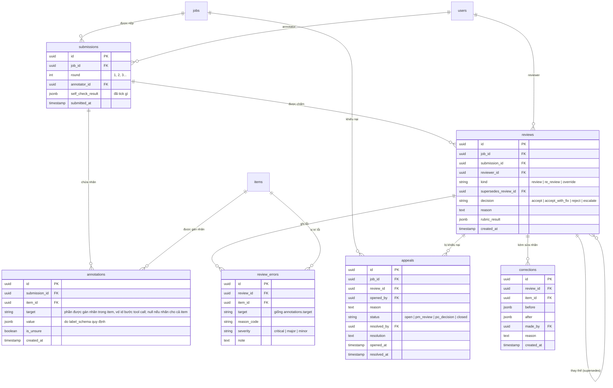

Ghi chú:

- `reviews` và `review_errors` **bất biến**. Override hoặc re-review là bản ghi
  mới (`kind` khác, `supersedes_review_id` trỏ về bản cũ). Override bắt buộc có
  `reason`.
- Reviewer không review job của chính mình: `reviews.reviewer_id` khác
  `submissions.annotator_id` (kiểm tra ở backend).
- `annotations.value` là jsonb, ví dụ với tool call:
  `{"verdict": "incorrect", "reason_codes": ["UNNECESSARY_CALL"], "note": "..."}`.
  Backend validate theo `label_schema` của job.
- `annotations.is_unsure` tách ra thành cột thật để đẩy job có item "không chắc"
  lên đầu queue review mà không phải quét jsonb.
- `corrections` chỉ dùng khi bắt buộc phải sửa nhãn trực tiếp; mặc định reviewer
  reject để annotator sửa.
- Giữ nguyên snapshot: `reviews` trỏ về `submissions`, và `jobs` đã ghim guideline
  version, nên khi tranh chấp có đủ căn cứ.

---

## 7. Nhóm 5: Chất lượng

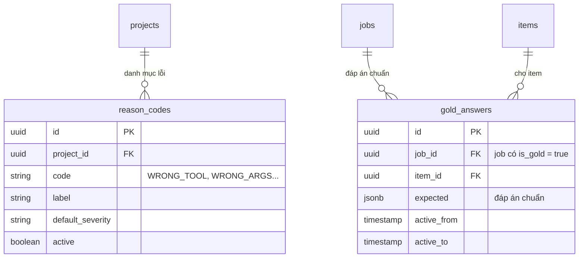

Ghi chú:

- `reason_codes` thống nhất tên lỗi để thống kê. `review_errors.reason_code` tham
  chiếu bảng này. Danh sách mã cho annotator chọn (ví dụ trong tool call review)
  nằm ở `label_schema`, nên có thể trùng hoặc khác tập mã của reviewer; cần chốt
  có dùng chung một danh mục không.
- Gold job là job bình thường có `is_gold = true`, trộn vào hàng đợi, annotator
  không được biết. Đáp án nằm ở `gold_answers`, bảng này chỉ cho vai trò chấm
  chất lượng đọc.
- Điểm chất lượng của annotator và reviewer tính từ `reviews`, `review_errors`,
  `gold_answers` bằng view; chưa tạo bảng lưu sẵn.

---

## 8. Nhóm 6: Audit

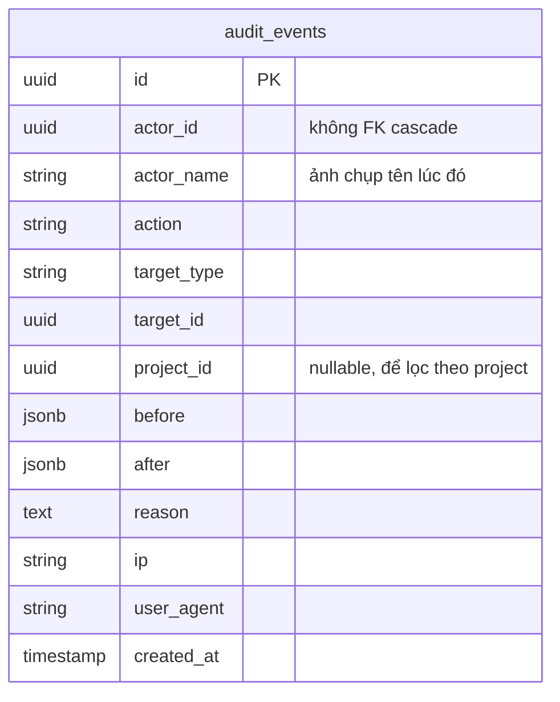

Ghi chú:

- **Append-only**: không UPDATE, không DELETE (backend chỉ có đường ghi
  thêm và đọc).
- Không dùng khoá ngoại có cascade. Khi user bị xoá hoặc disable, lịch sử vẫn
  hiển thị được tên (nhờ `actor_name`).
- Ghi: cấp/thu hồi role, đổi membership, upload hoặc đổi dataset, đổi guideline
  (kèm diff), đổi job config, submit/accept/reject/appeal/override, break-glass,
  export dữ liệu.

---

## 9. Nhóm 7: Đội đánh giá và phân việc

Người gán nhãn và người review không được thêm lẻ từng người vào project. Họ thuộc
một **đội đánh giá** (team) do HR lập. PO chọn đội nào làm project của mình và giao
từng task cho một đội. Thành viên trong đội **tự lấy việc** (pull) từ các task được
giao cho đội.

### 9.1 Ai làm gì

| Việc | Ai | Ghi chú |
| --- | --- | --- |
| Tạo đội, thêm và gỡ thành viên, đặt vai trò trong đội (`annotator` hoặc `reviewer`) | HR | HR không cần biết đội làm project nào, không xem dữ liệu |
| Gắn đội vào project, gỡ đội khỏi project | PO (owner) | Chọn trong danh sách đội có sẵn |
| Giao task cho một đội của project | PO (owner), PM (manager) | Mỗi task một đội |
| Lấy việc tiếp theo trong task của đội | Annotator, reviewer trong đội | Hệ thống chọn job, người làm không tự chọn |
| Chỉ định trưởng nhóm | HR | Một thành viên của đội, tối đa một trưởng nhóm đang hiệu lực |
| Theo dõi tải, tiến độ, chất lượng của đội; coaching; đề xuất HR thêm hoặc gỡ người | Trưởng nhóm | Chỉ xem số liệu tổng hợp, vẫn làm việc như thành viên thường (mục 9.5) |
| Giao tay, đổi người, thu hồi job | PM, PO | Xử lý ngoại lệ |

`owner`, `manager`, `viewer` vẫn thêm trực tiếp qua `project_members`. Vai trò
`annotator` và `reviewer` trong project **chỉ có được qua đội**.

### 9.2 Mô hình dữ liệu

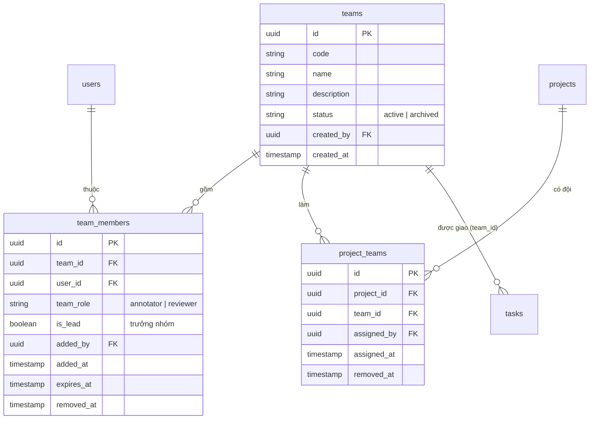

Bảng `tasks` (nhóm 3) có thêm `team_id` (đội được giao) và `priority` (task nào làm
trước).

Ghi chú:

- Một người chỉ có **một vai trò trong một đội**: `unique(team_id, user_id)` khi
  `removed_at is null`.
- `team_role` phải được role platform tương ứng "đỡ" (`annotator` cần role platform
  `annotator`, `reviewer` cần `reviewer`), giống `role_requirements`.
- Một người có thể ở nhiều đội. Một đội có thể làm nhiều project.
- Mỗi đội tối đa một trưởng nhóm đang hiệu lực: unique một phần trên
  `team_members(team_id)` khi `is_lead and removed_at is null`.
- **Vai trò hiệu lực trong project** của một người = vai trò trực tiếp trong
  `project_members` (owner, manager, viewer) + vai trò trong các đội đang gắn với
  project (annotator, reviewer). Permission resolver đọc cả hai nguồn.
- Gỡ người khỏi đội, gỡ đội khỏi project, hoặc thu hồi role platform thì quyền mất
  ngay; job dở của người đó trong các task liên quan trở về pool.

### 9.3 Xung đột vai trò khi dùng đội

Quy tắc cũ vẫn giữ: một người không vừa là annotator vừa là reviewer **trong cùng
project**. Với đội, xung đột có thể sinh ra theo ba cách, backend chặn ở cả ba:

| Hành động | Xung đột khi | Thông báo |
| --- | --- | --- |
| PO gắn đội B vào project P | Có người là annotator ở đội A và reviewer ở đội B, cả A và B cùng gắn vào P | Liệt kê người bị xung đột cho PO |
| HR thêm người vào đội hoặc đổi vai trò trong đội | Đội đó đang gắn vào project có người này với vai trò ngược lại qua đội khác | Báo HR "xung đột vai trò ở project đang dùng đội", **không** nêu tên project |
| Trong cùng một đội | Không xảy ra, vì mỗi người một vai trò trong đội | |

Ngoài ra vẫn giữ: không ai review job do chính mình làm.

### 9.4 Phân việc (pull)

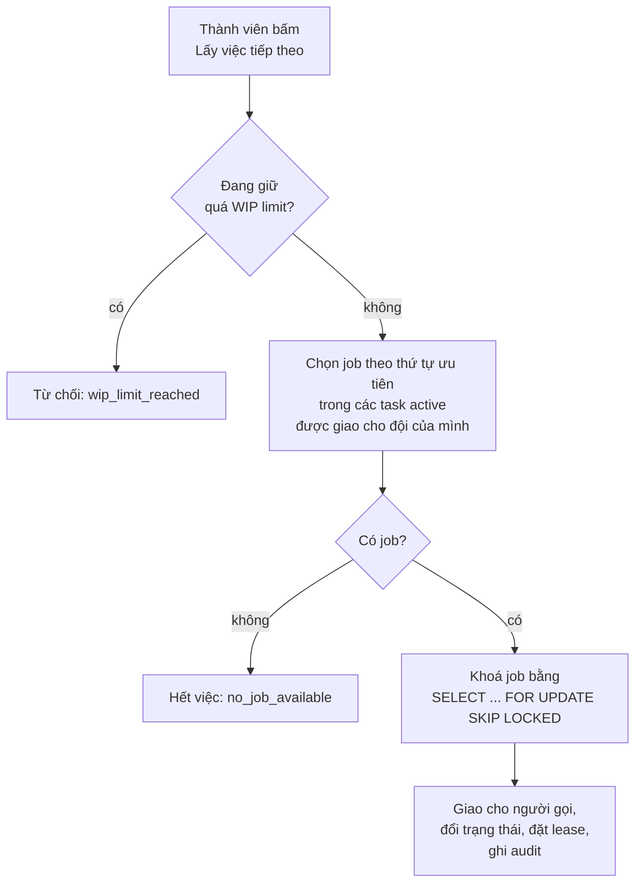

**Annotator** lấy việc: job chuyển thẳng `unassigned` → `in_progress`. Thứ tự ưu tiên:

1. Job bị reject của chính người đó (rework luôn quay về đúng người làm).
2. Job PM đã giao tay cho người đó (`assigned`).
3. Job `unassigned` trong task có `priority` cao hơn, rồi job cũ hơn.
4. Gold job được trộn vào ngẫu nhiên theo `gold_rate`.

**Reviewer** lấy việc: job chuyển `submitted` → `in_review`, `reviewer_id` là người gọi.
Thứ tự ưu tiên:

1. Job rework mà chính reviewer này đã chấm vòng trước (giữ ngữ cảnh).
2. Job có item `unsure`.
3. Job nộp sớm hơn.

Luôn loại job do chính reviewer làm.

**Cấu hình** nằm trong `job_rules` của job config:

| Trường | Ý nghĩa | Mặc định gợi ý |
| --- | --- | --- |
| `assignment_mode` | `pull` hoặc `push_only` (chỉ PM giao) | `pull` |
| `wip_limit_annotator` | Số job tối đa một annotator giữ cùng lúc | 3 |
| `wip_limit_reviewer` | Số job tối đa một reviewer đang chấm cùng lúc | 20 |
| `gold_rate` | Tỷ lệ gold job trộn vào | 0.05 |
| `lease_minutes` | Thời gian giữ job | 120 |

Lấy việc trong một transaction với `SKIP LOCKED` để nhiều người bấm cùng lúc không lấy
trùng job. Chạy được trên Supabase transaction pooler vì cả chọn và giao nằm trong một
transaction.

### 9.5 Trưởng nhóm

Trưởng nhóm là một thành viên bình thường của đội (vẫn có `team_role` là `annotator`
hoặc `reviewer` và vẫn lấy việc, làm, nộp hoặc chấm như mọi người), được HR bật cờ
`is_lead`. Không cần role platform riêng.

| Được làm thêm | Không được |
| --- | --- |
| Xem tải và tiến độ của từng thành viên trên mọi project đội đang làm (số liệu) | Xem nội dung item hay nhãn của job không được giao cho mình |
| Xem chất lượng của thành viên (tỷ lệ pass, lỗi lặp lại) để coaching | Xem đáp án gold job (trưởng nhóm vẫn bị đo bằng gold) |
| Nhận cảnh báo của đội: thiếu vai trò, job kẹt, thành viên quá tải | Ảnh hưởng đến quyết định review job của chính mình |
| Đề xuất HR thêm hoặc gỡ người (ngoài hệ thống hoặc qua ghi chú) | Tự sửa danh sách đội (vẫn là việc của HR) |
| | Giao tay job trong đội (bản đầu chưa có; xem mục 13) |

Trưởng nhóm chỉ thấy tên các project đội mình đang làm, vì bản thân họ cũng có quyền
trong các project đó qua đội.

### 9.6 Điều kiện tối thiểu của đội

Không giới hạn và không cố định số người trong đội. Backend chỉ kiểm tra:

| Khi | Điều kiện | Nếu vi phạm |
| --- | --- | --- |
| PO gắn đội vào project, PO kích hoạt task | Đội có ít nhất 1 annotator và 1 reviewer đang hiệu lực | Chặn, `team_missing_role` |
| Bật consensus (sau này) | Số annotator ≥ `annotators_per_job` | Chặn |
| HR gỡ người làm đội đang làm task mất hết một vai trò | | **Không chặn HR**; cảnh báo PM, PO của project và trưởng nhóm |
| Tỷ lệ reviewer so với annotator thấp so với `review_rate` | | Cảnh báo mềm trên màn hình gắn đội và dashboard tiến độ |

---

## 10. Quan hệ toàn cục (rút gọn)

Chỉ khoá ngoại, không có thuộc tính, để nhìn cấu trúc tổng thể.

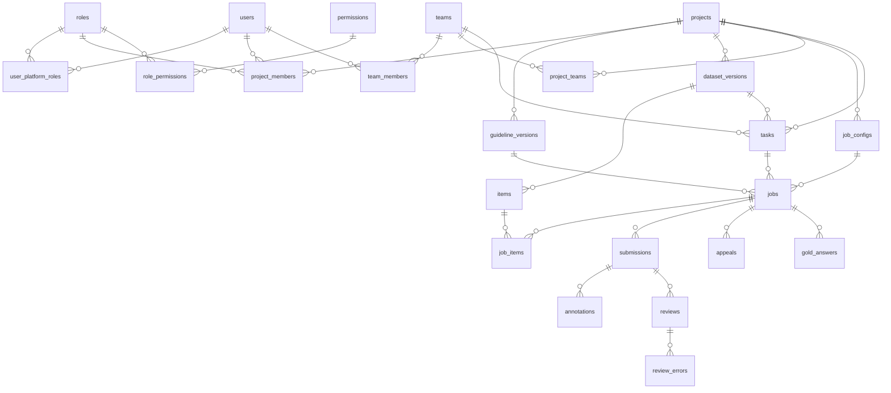

---

## 11. Ràng buộc quan trọng

Quy tắc nghiệp vụ **kiểm tra ở backend**, không dùng trigger hay CHECK nghiệp vụ ở DB.
DB chỉ giữ khoá ngoại, `NOT NULL` và unique cơ bản.

| # | Ràng buộc | Cách thực hiện |
| --- | --- | --- |
| 1 | User phải có role platform còn hiệu lực mới được là project member tương ứng | Backend: `role_requirements`, kiểm tra khi thêm và lúc kiểm quyền |
| 2 | Cặp role xung đột không đi chung (annotator và reviewer cùng project) | Backend: `role_conflicts`, kiểm tra khi thêm member |
| 3 | `jobs.reviewer_id` khác `jobs.assignee_id` | Backend, khi phân reviewer |
| 4 | Reviewer khác annotator của submission được chấm | Backend, khi review |
| 5 | `dataset_versions`, `guideline_versions`, `job_configs`, `items`, `reviews`, `review_errors`, `audit_events` chỉ thêm | Backend không có đường sửa/xoá; repository chỉ có hàm tạo và đọc |
| 6 | Job ghim `guideline_version_id` và `job_config_id`, không đổi sau khi giao | DB: `NOT NULL`. Backend: không có đường đổi |
| 7 | Một version của một project là duy nhất | `unique(project_id, version)` |
| 8 | Một role platform đang hiệu lực là duy nhất cho mỗi user; tương tự với `project_members` | Unique một phần (`revoked_at is null`) |
| 9 | Một item thuộc đúng một job trong một task (khi không bật consensus) | Unique trên `(task_id, item_id)` qua `job_items` |
| 10 | `annotations.value` đúng cấu trúc `label_schema` | Validate ở backend khi submit |
| 11 | Annotator, reviewer chỉ vào project qua đội; task chỉ giao cho đội đang gắn với project | Backend |
| 12 | Không lấy trùng job khi nhiều người lấy việc cùng lúc | `SELECT ... FOR UPDATE SKIP LOCKED` trong transaction |
| 13 | Một người một vai trò trong một đội | Unique một phần trên `team_members(team_id, user_id)` (`removed_at is null`) |

---

## 12. Index gợi ý

- `jobs(project_id, status)`: hàng đợi, backlog, tiến độ.
- `jobs(assignee_id, status)`: danh sách việc của annotator.
- `jobs(reviewer_id, status)` và `jobs(status, submitted_at)`: queue review theo
  tuổi.
- `jobs(task_id)`.
- `jobs(task_id, status, created_at)`: lấy việc tiếp theo.
- `team_members(user_id)`, `project_teams(project_id)`, `project_teams(team_id)`.
- `project_members(user_id)` (lọc quyền ở mọi truy vấn), `project_members(project_id)`.
- `job_items(item_id)`.
- `annotations(submission_id)`, `review_errors(review_id)`.
- `audit_events(target_type, target_id)`, `audit_events(project_id, created_at)`.
- GIN trên jsonb chỉ khi thực sự cần lọc theo nội dung; chưa tạo từ đầu.

---

## 13. Các điểm chưa chốt

1. **Consensus**: nếu có, một item nằm trong nhiều job và cần cách gộp kết quả
   (bảng `consensus_results`?). Hiện thiết kế chưa có.
2. ~~Trạng thái `unassigned`~~: **đã chốt**, thêm vào `jobs.status`.
3. **Danh mục `reason_code`** dùng chung giữa annotator và reviewer hay tách?
4. ~~Phiên đăng nhập~~: **đã chốt** JWT (access 15 phút + refresh token lưu DB +
   `token_version`).
5. **Lưu file lớn** (ảnh, audio, dataset): object storage nào, `payload` chỉ giữ
   đường dẫn.
6. **Tách `annotations.value` ra bảng theo từng item riêng** nếu sau này thống kê
   theo nhãn nhiều; hiện để jsonb trong `annotations`.
7. **Phân quyền xem dữ liệu của `hr_admin`**: không có endpoint nào trả về nội dung
   `items.payload` hay `annotations.value`; đã phản ánh ở `api_design.md` (quy ước chung).
8. **Co-owner của project**: thêm bằng `project_members` role `owner` hay cột
   riêng.
9. **Bảng `consensus` và bảng đo lường điểm chất lượng sẵn** (hiện tính bằng view).
10. ~~Đội có trưởng nhóm không~~: **đã chốt**, có (mục 9.5). Còn mở: có cho trưởng nhóm giao tay job
    trong đội không (bản đầu: không).
11. **Một task giao cho nhiều đội?** Hiện mỗi task một đội.
12. **Reviewer chấm chéo đội?** Hiện reviewer chấm job trong task của đội mình.

### Phân quyền (RBAC)

1. **Sửa ma trận quyền có cho phép trong giao diện không?** Nếu có, ai được sửa
   (`platform_admin`?) và cần duyệt hai người. Nếu không, ma trận cố định theo seed
   trong migration. Bản đầu nên cố định.
2. **Custom role:** cho PO hoặc HR tự tạo role mới không, hay chỉ role hệ thống? Bản
   đầu nên chỉ role hệ thống.
3. **PO có tự cấp role platform `reviewer` cho người của mình không**, hay bắt buộc
   qua HR (câu hỏi 1 trong `role_in_system.md`).
4. **Break-glass:** ai duyệt, thời hạn bao lâu, có cần người thứ hai xác nhận.
5. **Cache quyền:** cache bao lâu. Thu hồi phải có hiệu lực ngay, nên cần xoá cache khi
   thu hồi hoặc TTL rất ngắn.
6. **Service account:** gán role thế nào (có cần role platform riêng cho bot không).
7. **`limit` có đủ biểu diễn?** `all`, `P`, `A`, `own` đủ cho ma trận hiện tại. Nếu cần
   điều kiện phức tạp hơn (theo mức phân loại dữ liệu, theo giờ làm việc) thì RBAC thuần
   không đủ và cần thêm thuộc tính (ABAC).
8. **Mức phân loại dữ liệu** (`internal`, `confidential`, `restricted`): có ràng buộc
   thêm lên ai được xem không (câu hỏi 5 trong `role_in_system.md`).
