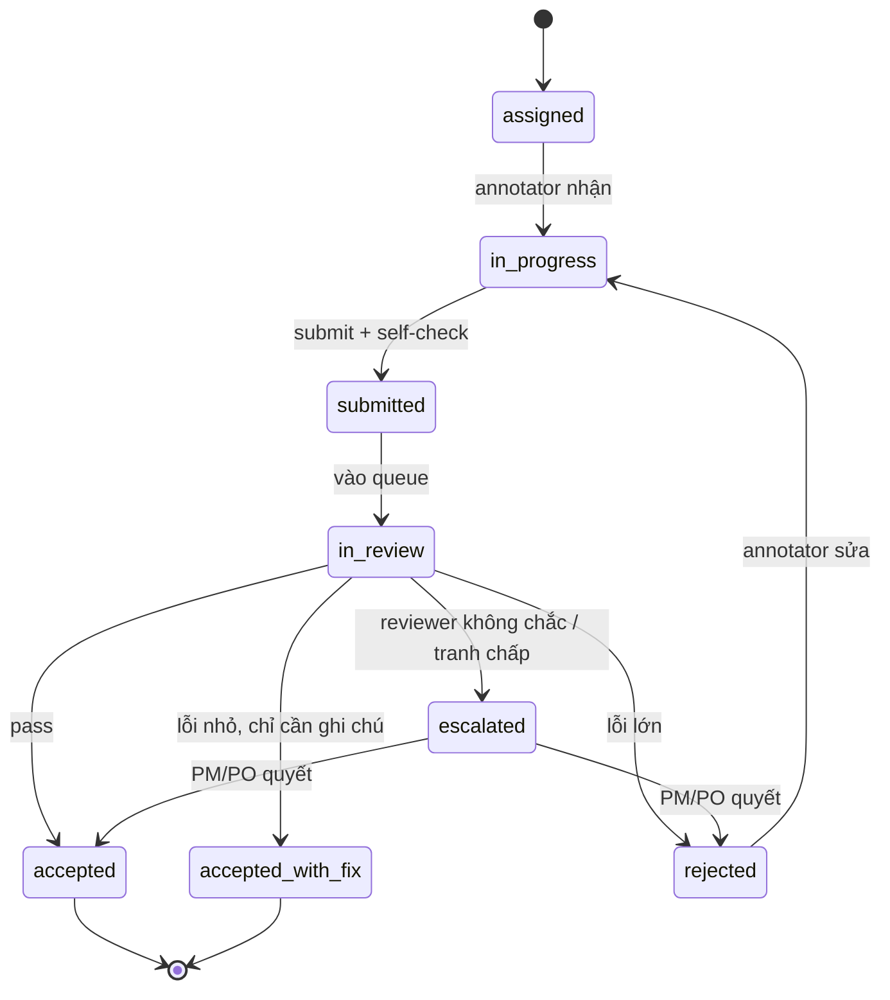

# Quy trình review nội dung annotation

> Tài liệu mô tả **cách chấm và nghiệm thu nội dung đã được annotate**: ai chấm,
> chấm theo căn cứ nào, quyết định gồm những loại gì, đo chất lượng ra sao, và
> xử lý khi có bất đồng.
>
> Liên quan: `docs/prd.md`, `docs/role_in_system.md`.
> Trạng thái: draft để chốt trước khi thiết kế schema job/review.

---

## 1. Mục tiêu

Review phải trả lời được 3 câu, nếu không thì chưa phải review:

1. **Đúng hay sai** so với guideline — và sai ở chỗ nào, mức nào?
2. **Có được nghiệm thu** để đưa vào dataset huấn luyện/giao khách không?
3. **Người làm có học được gì** để lần sau không lặp lại lỗi?

Review không phải là "sửa hộ cho đẹp rồi pass". Nếu reviewer tự sửa label thì
mất khả năng đo chất lượng annotator, và mất luôn căn cứ để cải thiện guideline.

---

## 2. Nguyên tắc

| # | Nguyên tắc | Hệ quả thực tế |
| --- | --- | --- |
| 1 | **Chấm theo đúng guideline version đã pin vào job** | Job phải lưu `guideline_version_id` tại lúc assign; reviewer chỉ được chấm theo version đó |
| 2 | **Không review job của chính mình** | Chặn ở service, không chỉ ẩn nút trên UI |
| 3 | **Review phải có căn cứ viết ra được** | Mỗi quyết định reject phải gắn `reason_code` + mô tả; không có "sai rồi" chung chung |
| 4 | **Quyết định là bất biến** | Muốn đổi thì tạo bản ghi mới (re-review/override), không sửa bản cũ |
| 5 | **Không sửa nhãn trực tiếp** | Reviewer reject để annotator sửa; nếu bắt buộc sửa thì tạo `correction` có audit riêng |
| 6 | **Review phải đo được** | Có metric cho cả annotator và reviewer; reviewer cũng bị chấm |
| 7 | **Thống nhất trước khi chấm** | Rubric + buổi calibration trước khi project bắt đầu, không chấm bằng cảm tính |

Điểm 7 là điểm hay bị bỏ nhất. Hai reviewer cùng chấm một job mà ra hai kết quả
khác nhau thì lỗi nằm ở rubric, không nằm ở annotator.

---

## 3. Ba lớp kiểm soát

```
Annotator submit
      │
      ▼
┌─────────────────┐
│ 1. Self-check   │  annotator tự soát theo checklist trước khi submit
└─────────────────┘
      │
      ▼
┌─────────────────┐
│ 2. Reviewer QC  │  chấm theo rubric → accept / accept_with_fix / reject
└─────────────────┘
      │
      ▼
┌─────────────────┐
│ 3. PO nghiệm thu│  duyệt task → đóng gói giao cho stakeholder
└─────────────────┘
```

### Lớp 1 — Self-check (annotator)

Không phải review chính thức, nhưng giảm tải rất nhiều. Trước khi bấm submit,
annotator phải tick checklist:

- Đã đọc guideline đúng version chưa?
- Đã phủ hết item trong job chưa (không bỏ trống)?
- Có item nào bị đánh dấu "không chắc" không? (nếu có, ghi chú để reviewer biết)
- Có vi phạm rule cấm nào không (PII, nội dung ngoài phạm vi)?

Job có item "không chắc" nên được đẩy lên đầu queue review, không xếp cuối.

### Lớp 2 — Reviewer QC

Chấm từng job. Đây là lớp chính, quyết định job có được đưa vào dataset hay không.

### Lớp 3 — PO nghiệm thu (acceptance)

PO **không chấm lại từng job**. PO kiểm tra ở mức task:

- Tỷ lệ pass của task có đạt ngưỡng cam kết không?
- Có lỗi hệ thống nào lặp lại (do guideline mơ hồ) không?
- Sample ngẫu nhiên 5–10% để xác nhận chất lượng reviewer, không phải để chấm annotator.
- Ký nghiệm thu (sign-off) → task chuyển `delivered`.

Nếu PO phát hiện reviewer chấm sai hàng loạt → mở `re-review` cho task, không
tự sửa từng job.

---

## 4. Trạng thái job



Quy tắc:

- `rejected` **không** trả về `submitted` ngay — annotator phải thấy lý do trước.
- Mỗi job giới hạn **tối đa 2 lần rework** (cấu hình được). Lần thứ 3 → `escalated`
  để PM xem lại: lỗi do người làm hay do guideline.
- `accepted_with_fix` được xem là hợp lệ như `accepted` (vẫn vào dataset) nhưng vẫn
  ghi nhận lỗi nhỏ vào hồ sơ chất lượng.
- Job đã `accepted` mà muốn sửa → tạo `re_review`, không mở lại job cũ.

---

## 5. Chuẩn bị trước khi review

Không có bước này thì review sẽ thành tranh cãi.

### 5.1 Rubric

PO viết rubric **trước khi project bắt đầu**, gồm:

- Tiêu chí pass/fail (bắt buộc đúng/sai rõ ràng)
- Tiêu chí chất lượng (mức độ đầy đủ, độ chính xác biên, tính nhất quán)
- Các trường hợp biên (edge case) đã được PO quyết trước
- Ví dụ đúng/sai cho từng tiêu chí (golden examples)

Rubric phải versioned giống guideline. Job pin cả hai.

### 5.2 Calibration

Trước khi chấm thật:

1. PO chọn 10–20 job mẫu đại diện (có cả ca khó).
2. Tất cả reviewer chấm độc lập, không xem kết quả nhau.
3. So sánh, thảo luận từng chỗ lệch, chốt cách hiểu chung.
4. Ghi lại kết luận vào guideline/rubric (nếu cần sửa thì sửa luôn).
5. Chỉ bắt đầu chấm thật khi tỷ lệ đồng thuận đạt ngưỡng (gợi ý: ≥ 80%, hoặc
   Cohen's kappa ≥ 0.7).

Calibration lặp lại định kỳ (gợi ý 2 tuần/lần, hoặc sau mỗi lần guideline đổi).

---

## 6. Quy trình review một job

Thời gian mục tiêu: 1–5 phút/job tuỳ loại dữ liệu. Nếu lâu hơn nhiều, rubric
đang thiếu hoặc job quá lớn (nên chia nhỏ).

**Checklist reviewer:**

1. **Đúng người, đúng phạm vi** — job này có thuộc project mình được phân không?
   Mình có phải người annotate job này không? (nếu có → từ chối, hệ thống phải
   chặn từ trước)
2. **Đúng version** — guideline version ghi trên job có khớp với cái mình đang
   đọc không?
3. **Đủ coverage** — tất cả item đã được xử lý chưa? Item bị bỏ trống là lỗi
   `critical` mặc định.
4. **Đúng nhãn** — so từng nhãn với rubric, không so với "cảm giác đúng".
5. **Đúng định dạng** — box có ôm sát object không, span có đúng ranh giới từ
   không, nhãn có nằm trong label set không.
6. **Nhất quán nội bộ** — cùng một object xuất hiện nhiều lần trong job có được
   gán cùng nhãn không? Hai nhãn mâu thuẫn nhau không?
7. **Ghi lỗi** — mỗi lỗi gắn `reason_code`, vị trí (item id), và mô tả ngắn.
8. **Quyết định** — chọn 1 trong 4: `accept` / `accept_with_fix` / `reject` /
   `escalate`.
9. **Feedback** — nếu reject: viết 1–3 câu chỉ rõ cần sửa gì. Không viết "làm
   lại đi".

---

## 7. Phân loại lỗi

Dùng chung một bộ mã lỗi cho toàn hệ thống, để thống kê và huấn luyện được.

| Mức | Mã lỗi | Ý nghĩa | Ví dụ |
| --- | --- | --- | --- |
| Critical | `MISSING_ITEM` | Bỏ sót object bắt buộc | Ảnh có 5 xe, chỉ gán 3 |
| Critical | `WRONG_LABEL` | Gán sai nhãn hoàn toàn | Xe tải gán thành xe buýt |
| Critical | `OUT_OF_SCOPE` | Gán nhãn thứ guideline cấm | Gán nhãn người trong ảnh scene |
| Critical | `PII_LEAK` | Đưa dữ liệu nhạy cảm vào output | Copy nguyên văn số CCCD vào note |
| Major | `PARTIAL_COVERAGE` | Box/span không phủ đủ object | Box chỉ ôm nửa chiếc xe |
| Major | `BOUNDARY_ERROR` | Box/span lệch quá ngưỡng cho phép | IoU < 0.7 |
| Major | `WRONG_ATTRIBUTE` | Đúng object, sai thuộc tính | Đúng xe, sai màu |
| Major | `INCONSISTENT` | Mâu thuẫn trong cùng job | Cùng object 2 nhãn khác nhau |
| Minor | `FORMAT_ERROR` | Sai định dạng, không sai nội dung | Toạ độ ngoài khung ảnh |
| Minor | `TYPO` | Lỗi chính tả trong text annotation | |
| Minor | `MISSING_NOTE` | Thiếu ghi chú khi guideline yêu cầu | |

Ngưỡng quyết định (gợi ý, PO chỉnh theo project):

| Điều kiện | Quyết định |
| --- | --- |
| 0 lỗi | `accept` |
| Chỉ có `minor` | `accept_with_fix` |
| Có ≥ 1 `major`, không có `critical` | `reject` |
| Có bất kỳ `critical` | `reject` |
| Reviewer không chắc vì guideline mơ hồ | `escalate` |

**Lưu ý:** nếu lỗi thuộc dạng "guideline không nói rõ", đó **không phải lỗi của
annotator**. Phải `escalate` để PO sửa guideline, và job đó không được tính
vào điểm chất lượng của annotator.

---

## 8. Lỗi đặc thù theo loại dữ liệu

| Loại | Điểm cần soi kỹ |
| --- | --- |
| Bounding box (ảnh) | Box có ôm sát không (IoU), object bị che khuất có được gán không, object nhỏ ở rìa ảnh, box trùng lặp cho cùng object |
| Phân loại ảnh (classification) | Nhãn đa lớp có bị chọn thiếu/ thừa không, nhãn hiếm có bị bỏ qua không |
| Text / NER | Ranh giới span (có lấy cả dấu câu không), thực thể lồng nhau, thực thể xuất hiện nhiều lần, viết tắt |
| Phân loại văn bản | Nhãn có đúng định nghĩa không, ca biên (văn bản trung tính), mất cân bằng nhãn |
| Audio / speech | Ranh giới segment, chỗ nói chồng tiếng, tiếng ồn, ngôn ngữ trộn, chính tả phiên âm |
| Video | Tracking có bị mất ID khi object khuất không, có nhảy nhãn giữa frame không, frame đầu/cuối |
| OCR / transcription | Ký tự dễ nhầm (0/O, 1/l), dấu tiếng Việt, xuống dòng, ký tự đặc biệt |

Mỗi loại nên có **golden example** trong rubric.

---

## 9. Review toàn bộ hay lấy mẫu?

| Giai đoạn | Cách làm |
| --- | --- |
| Tuần đầu của project / annotator mới | Review **100%** |
| Sau khi annotator đạt ngưỡng ổn định | Giảm xuống **20–30%** ngẫu nhiên |
| Annotator có dấu hiệu tụt chất lượng | Quay lại 100% cho đến khi ổn định |
| Task cuối trước khi giao khách | Review 100% hoặc sample theo thoả thuận với PO |

**Nguyên tắc lấy mẫu:** phải ngẫu nhiên thật, và **không báo trước job nào sẽ bị
chấm**. Nếu annotator đoán được job nào không bị chấm, chất lượng sẽ rơi ngay ở
những job còn lại.

Reviewer cũng cần được kiểm tra: mỗi tuần chọn ngẫu nhiên 5–10% job mà reviewer
đã accept, cho reviewer thứ hai chấm độc lập (double review). Lệch nhiều → calibrate
lại.

---

## 10. Consensus — khi một job có nhiều annotator

Chỉ áp dụng nếu project yêu cầu (ví dụ dữ liệu huấn luyện cần độ chính xác cao).

| Số người | Cách chốt |
| --- | --- |
| 2 | Phải khớp; lệch → reviewer/adjudicator quyết |
| 3 | Majority (2/3); nếu cả 3 khác nhau → adjudicator |
| ≥ 4 | Majority; đo thêm mức đồng thuận (Fleiss' kappa) |

Khi consensus:

- Ghi nhận **từng** annotation riêng, không ghi đè.
- Kết quả cuối là một bản ghi `adjudicated` riêng, có `decided_by`.
- Annotator có ý kiến thiểu số vẫn được ghi nhận là đã hoàn thành và vẫn được ghi
  nhận chất lượng theo kết quả cuối (không phạt oan nếu họ đúng).

---

## 11. Gold job & đo chất lượng

### 11.1 Gold job

Job đã có đáp án chuẩn, cài lẫn vào queue thật để đo:

- Annotator có làm đúng không (phát hiện làm ẩu, dùng tool tự động).
- Reviewer có chấm đúng không (phát hiện reviewer chấm qua loa).

Quy tắc:

- Không đánh dấu gold job ở bất kỳ API/UI nào mà annotator/reviewer truy cập được.
- Không cài quá dày (gợi ý ≤ 5% tổng job), tránh annotator nhận ra pattern.
- Gold job thay đổi định kỳ, không dùng mãi một bộ.

### 11.2 Metric

| Metric | Ý nghĩa | Ngưỡng gợi ý |
| --- | --- | --- |
| `pass_rate` | % job pass lần đầu | ≥ 90% |
| `critical_error_rate` | % job có lỗi critical | ≤ 1% |
| `rework_count` | Số lần sửa trung bình/job | ≤ 1.2 |
| `gold_accuracy` | Độ chính xác trên gold job | ≥ 95% |
| `iaa` | Đồng thuận giữa các annotator (kappa) | ≥ 0.7 |
| `reviewer_agreement` | Đồng thuận giữa reviewer khi double review | ≥ 0.8 |
| `review_latency` | Thời gian từ submit đến có quyết định | ≤ 24h |

Metric phải nhìn theo **xu hướng**, không chỉ theo một con số. Một annotator có
`pass_rate` 92% nhưng đang giảm dần qua 3 tuần là vấn đề, dù vẫn trên ngưỡng.

---

## 12. Reject, rework và chống lặp vô hạn

```
reject → annotator thấy lý do + vị trí lỗi
       → sửa → submit lại
       → reviewer chấm lại (ưu tiên đúng reviewer cũ để giữ ngữ cảnh)
```

Quy tắc:

- **Tối đa 2 vòng rework.** Vòng 3 → `escalated`.
- Reviewer chấm lại **không được** đổi lý do reject ban đầu nếu annotator đã sửa
  đúng phần đó. Muốn thêm lỗi mới phải ghi rõ là lỗi mới phát hiện.
- Nếu job bị reject 2 lần vì cùng một `reason_code` → gắn cờ "hiểu sai guideline",
  đưa vào buổi coaching, không chỉ phạt điểm.
- Nếu **nhiều annotator** cùng mắc một lỗi → lỗi guideline, PO phải sửa, không
  xử lý cá nhân.

---

## 13. Escalate và tranh chấp

| Tình huống | Người xử lý | Kết quả |
| --- | --- | --- |
| Reviewer không chắc vì guideline mơ hồ | PO | Sửa guideline, chấm lại |
| Annotator không đồng ý quyết định reject | PM | Xem lại, giữ hoặc đổi quyết định |
| PM và reviewer bất đồng | PO | Quyết định cuối |
| Nghi ngờ annotator gian lận | PM + HR | Điều tra, có thể đình chỉ |
| Reviewer chấm sai hàng loạt | PO | Re-review task, calibrate lại |

Nguyên tắc tranh chấp:

- Annotator có quyền appeal trong **7 ngày** kể từ quyết định (cấu hình được).
- Appeal phải kèm lý do; appeal không kèm lý do bị từ chối tự động.
- Quyết định cuối cùng của PO là bất biến, nhưng phải ghi lý do.
- Mọi bước giữ nguyên `guideline_version`, `review` cũ, không xoá.

---

## 14. SLA và tải làm việc

| Việc | SLA gợi ý |
| --- | --- |
| Job vào queue → có quyết định đầu tiên | ≤ 24h (giờ làm việc) |
| Job rework → chấm lại | ≤ 8h |
| Appeal → phản hồi bước 1 | ≤ 3 ngày làm việc |
| Task → PO nghiệm thu | ≤ 3 ngày làm việc |

Vận hành:

- Queue review sắp theo **tuổi job** và **cờ ưu tiên** (job có item "không chắc",
  job sắp hết hạn, job của annotator mới).
- Không để một reviewer giữ quá nhiều job đang mở (gợi ý ≤ 20).
- Job quá hạn review phải cảnh báo PM, không âm thầm nằm đó.

---

## 15. Ghi nhận dữ liệu review

```
reviews
  id, job_id, reviewer_id, round (1,2,...),
  decision (accept | accept_with_fix | reject | escalate),
  guideline_version_id,        -- version dùng để chấm
  rubric_version_id,
  reason_code,                 -- lỗi chính (nếu reject)
  note,                        -- feedback cho annotator
  item_refs_json,              -- vị trí lỗi cụ thể
  created_at

review_findings              -- 1 review có thể có nhiều lỗi
  id, review_id, reason_code, severity, item_ref, note

review_overrides             -- PO/PM đổi quyết định
  id, review_id, actor_id, new_decision, reason, created_at

gold_jobs
  id, job_id, expected_output_json, active_from, active_to

quality_metrics_daily
  id, subject_type (annotator|reviewer), subject_id, project_id, date,
  pass_rate, critical_error_rate, rework_count, gold_accuracy
```

Ràng buộc:

- `reviews` append-only. Sửa = tạo `review_overrides`.
- Mỗi `review` phải có `guideline_version_id` và `rubric_version_id` — thiếu là
  không hợp lệ.
- Không cho tạo `review` nếu `job.assignee_id == reviewer_id`.

---

## 16. Vòng cải tiến

Review chỉ có giá trị nếu quay lại cải thiện guideline và đào tạo:

```
Review → thống kê lỗi theo reason_code
       → lỗi nào chiếm > 15% tổng lỗi trong 1 tuần?
       → nếu do guideline mơ hồ  → PO sửa guideline + bump version
       → nếu do hiểu sai        → buổi coaching ngắn + cập nhật golden example
       → nếu do annotator yếu   → tăng tỷ lệ review, xem xét lại phân công
```

Họp calibration định kỳ, có số liệu, không họp cảm tính.

---

## 18. Anti-pattern

| Anti-pattern | Hệ quả |
| --- | --- |
| Reviewer sửa label rồi accept | Không đo được chất lượng annotator, mất audit |
| Reject không ghi lý do | Annotator sửa mò, rework vô hạn |
| Chấm theo guideline mới cho job làm theo guideline cũ | Tranh chấp không phân xử được |
| Review 100% mãi mãi | Không scale, reviewer kiệt sức, chấm ẩu |
| Lấy mẫu không ngẫu nhiên | Annotator đoán được, chất lượng rơi ở phần không chấm |
| Gold job lộ | Mất tác dụng phát hiện gian lận |
| Một reviewer duy nhất cho cả project | Thiên vị, không ai kiểm tra reviewer |
| Không có ngưỡng pass rõ ràng | Cùng job, reviewer khác nhau ra kết quả khác nhau |
| Phạt annotator vì guideline mơ hồ | Mất người, vấn đề thật vẫn còn |

---

## 19. Checklist nhanh cho reviewer

```
[ ] Đúng project, không phải job của mình
[ ] Đúng guideline + rubric version
[ ] Đã phủ hết item, không có item bỏ trống
[ ] Nhãn khớp rubric, không khớp "cảm giác"
[ ] Định dạng đúng (box/span/nhãn hợp lệ)
[ ] Không mâu thuẫn nội bộ trong job
[ ] Mỗi lỗi có reason_code + vị trí + mô tả
[ ] Quyết định đúng ngưỡng (minor → accept_with_fix, major/critical → reject)
[ ] Nếu guideline mơ hồ → escalate, không reject annotator
[ ] Feedback ngắn, chỉ rõ cần sửa gì
```

---

## 20. Câu hỏi cần chốt

1. Ngưỡng pass của project là bao nhiêu? Có khác nhau giữa các project không?
2. Review 100% trong bao lâu trước khi chuyển sang lấy mẫu?
3. Ai là adjudicator khi 2 annotator lệch nhau?
4. Có dùng gold job không, và ai chịu trách nhiệm cập nhật?
5. Appeal trong bao nhiêu ngày, ai là người quyết cuối?
6. Chỉ số chất lượng có ảnh hưởng đến lương/thưởng không? (nếu có, phải minh bạch
   cách tính trước khi áp dụng)
7. Task giao khách có yêu cầu định dạng nghiệm thu riêng không (biên bản, mẫu
   kiểm tra)?
