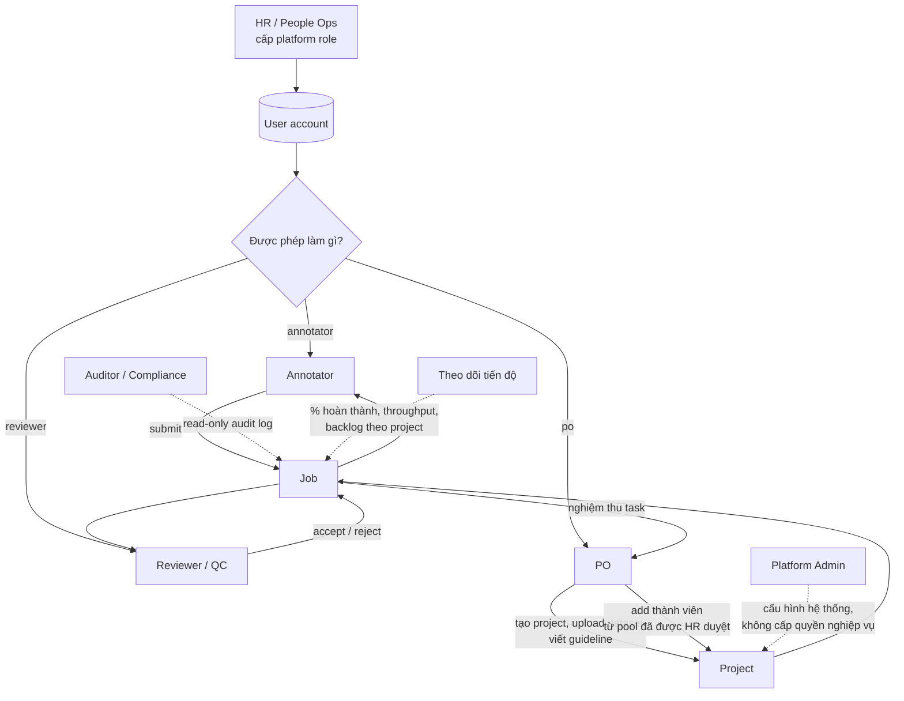

# Vai trò & phân quyền trong hệ thống

> Tài liệu này mô tả mô hình vai trò cho **annotation platform nội bộ của công ty**
> (không phải marketplace, annotator là nhân sự/nhà thầu của công ty, không phải
> người dùng tự do đăng ký).
>
> Nguồn gốc yêu cầu: `docs/prd.md`.
> Trạng thái: draft để chốt trước khi thiết kế schema.

---

## 1. Bối cảnh

Ba nhóm người dùng theo PRD được map vào tổ chức thật như sau:

| PRD | Trong công ty | Việc thực tế họ làm |
| --- | --- | --- |
| "người đi thuê annotator" | **PO (Product Owner)** | Nhận yêu cầu từ stakeholder, có dataset, viết guideline, nghiệm thu kết quả |
| "annotator" | **Annotator** | Làm job theo guideline |
| "reviewer, admin" | **Reviewer (QC)** + **HR** + **Platform Admin** | Chấm chất lượng / cấp quyền / vận hành hệ thống |

Điểm khác biệt so với marketplace: **không có chuyện "ai cũng đăng ký được"**. Tài
khoản do công ty tạo, quyền do HR cấp, và mọi quyền đều gắn với hợp đồng lao
động/hợp đồng nhà thầu còn hiệu lực hay không.

**Phạm vi hệ thống:** annotation platform **chỉ làm thu thập và gán nhãn** — tạo
project, quản lý dataset, phân job, annotate, review, nghiệm thu kết quả và
**theo dõi tiến độ**. Hệ thống trả lời được hai câu: "project đang tới đâu" và
"chất lượng đang thế nào".

---

## 2. Nguyên tắc thiết kế

Bốn nguyên tắc dưới đây là ràng buộc kiến trúc, không phải "nice to have". Nếu
vi phạm, hệ thống sẽ phải sửa lại từ gốc.

### 2.1 Tách "năng lực" và "phạm vi"

> **HR cấp năng lực (platform role). PO cấp phạm vi (project role).**

- HR quyết định: người này **được phép** làm annotator / reviewer / PO hay không.
- PO quyết định: người này **được làm** trong project nào.

HR không biết và không nên biết chi tiết project. PO không có quyền tạo tài khoản
hay cấp năng lực. Hai bên không thể thay thế nhau.

**Hệ quả bắt buộc:** một người muốn vào project với vai trò annotator thì phải
thoả **cả hai** điều kiện: có platform role `annotator` (hoặc cao hơn) **và** có
`project_membership` với role `annotator`. Thiếu một trong hai → từ chối.

### 2.2 Role không phải thuộc tính toàn cục

Một người có thể là **annotator ở project A** và **reviewer ở project B**. Vì vậy
không được dùng `users.role` kiểu enum đơn. Phải có hai bảng tách biệt:

- `platform_roles` — năng lực toàn hệ thống
- `project_members` — vai trò trong từng project

### 2.3 Quyền có thời hạn

Nhà thầu, thực tập, người nghỉ phép dài, người được điều chuyển tạm thời — tất cả
đều là chuyện thường ngày. Mọi bản ghi quyền phải có `expires_at` (nullable =
vô thời hạn cho nhân viên chính thức). Hết hạn thì tự động mất quyền, không cần
ai nhớ đi thu hồi.

### 2.4 Ít quyền nhất + tách trách nhiệm

- HR **không** được xem nội dung dataset (không cần thiết cho công việc).
- Platform Admin **không** được tự cấp quyền nghiệp vụ (chỉ HR cấp).
- Annotator **không** được là reviewer của chính project đó.
- Không ai review được job do chính mình làm.
- PO **không** chấm QC thay reviewer — PO chỉ nghiệm thu cuối (accept/reject cả
  task), và nếu override thì phải ghi lý do vào audit log.

---

## 3. Sơ đồ actor



---

## 4. Platform roles (HR cấp)

Đây là lớp quyền thứ nhất, do HR quản lý. Mỗi user có thể có nhiều platform role.

| Role | Ai thường giữ | Được làm | **Không** được làm |
| --- | --- | --- | --- |
| `hr_admin` | HR / People Ops | Tạo/disable tài khoản; cấp/thu hồi platform role; xem trạng thái hợp đồng; xem audit log về thay đổi quyền | Xem dataset, guideline, nội dung annotation; vào project |
| `po` | Product Owner / Data Owner | Tạo project; upload dataset; viết guideline; add/remove thành viên project; nghiệm thu cuối | Tạo tài khoản; cấp platform role; tự chấm QC |
| `annotator` | Annotator, nhân sự gán nhãn | Nhận job được giao; annotate; submit; sửa khi bị reject | Xem project mình không thuộc; xem nhãn của người khác; duyệt kết quả |
| `reviewer` | QC, Team Lead | Chấm job trong project được phân; accept/reject; ghi lỗi | Review job của chính mình; sửa label trực tiếp (phải reject để annotator sửa, hoặc dùng quyền riêng có audit) |
| `project_manager` | Ops / Team Lead | Điều phối job, cân tải, theo dõi tiến độ, xử lý tranh chấp bước 1 | Sửa label; thay đổi guideline; nghiệm thu thay PO |
| `platform_admin` | IT / DevOps | Cấu hình hệ thống, xử lý sự cố, quản lý service account | Cấp/thu hồi platform role nghiệp vụ; đọc dataset (trừ break-glass có lý do + audit) |
| `auditor` | Compliance / nội bộ | Đọc audit log, báo cáo tuân thủ | Sửa bất cứ thứ gì; xem nội dung dataset nếu chưa được cấp quyền |

**Ghi chú thực tế**

- `po`, `reviewer`, `annotator` là **năng lực**, không phải chức danh. Một Team Lead
  có thể có cả `reviewer` và `project_manager`.
- `hr_admin` và `platform_admin` là hai role **không được gộp**. Nếu một người giữ
  cả hai (công ty nhỏ), hệ thống vẫn phải ghi nhận là hai role riêng để audit
  biết hành động nào thuộc thẩm quyền nào.
- **Theo dõi tiến độ là việc của PO và PM, không phải một role riêng.** Không có
  role "báo cáo" hay "kế toán"; ai cần xem tiến độ thì dùng tài khoản PO/PM/viewer
  đã được cấp.
- Tài khoản `service` (bot, cron) tách riêng, do `platform_admin` tạo, không dùng
  chung tài khoản người.

---

## 5. Project roles (PO cấp)

Lớp quyền thứ hai, chỉ có hiệu lực trong một project cụ thể.

| Project role | Ai cấp | Quyền chính |
| --- | --- | --- |
| `owner` | HR/system khi tạo project | Toàn quyền trong project: sửa guideline, đổi thành viên, nghiệm thu, archive |
| `manager` | owner | Chia job, đổi người làm, theo dõi tiến độ, mở tranh chấp |
| `annotator` | owner/manager | Làm job được giao trong project này |
| `reviewer` | owner/manager | Chấm job trong project này |
| `viewer` | owner | Chỉ đọc: xem tiến độ, xem báo cáo; dùng cho stakeholder/auditor |

**Điều kiện để được add vào project:**

```
platform role của user  ⊇  project role được gán
```

| Project role | Platform role tối thiểu |
| --- | --- |
| `annotator` | `annotator` |
| `reviewer` | `reviewer` |
| `manager` | `project_manager` |
| `owner` | `po` |
| `viewer` | bất kỳ (kể cả `auditor`) |

Nếu HR thu hồi platform role → mọi `project_membership` tương ứng **tự động
vô hiệu**, kể cả khi PO chưa remove. Đây là điểm hay bị bỏ sót: offboarding chỉ
disable user là chưa đủ.

---

## 6. Ma trận quyền chi tiết

Ký hiệu: `F` = full, `W` = write/create, `R` = read, `O` = chỉ trong phạm vi
được giao, `-` = không có.

| Tài nguyên / Hành động | HR | PO | Annotator | Reviewer | PM | Admin | Auditor |
| --- | --- | --- | --- | --- | --- | --- | --- |
| Tạo/sửa user | F | - | - | - | - | - | - |
| Cấp/thu hồi platform role | F | - | - | - | - | - | - |
| Tạo project | - | W | - | - | - | - | - |
| Sửa project / guideline | - | F (owner) | - | - | - | - | - |
| Upload / xoá dataset | - | W (owner) | - | - | - | - | - |
| Xem dataset | - | R (owner) | R (job được giao) | R (job được giao) | R | break-glass | - |
| Add/remove thành viên project | - | F (owner) | - | - | W | - | - |
| Chia job / đổi người làm | - | W | - | - | W | - | - |
| Annotate / submit | - | - | W (O) | - | - | - | - |
| Chấm / accept / reject | - | - | - | W (O) | - | - | - |
| Nghiệm thu task cuối | - | W (owner) | - | - | - | - | - |
| Xem tiến độ project | R (tổng hợp) | R (project mình) | R (của mình) | R (project mình) | R (project mình) | - | R |
| Xem báo cáo chất lượng | R (tổng hợp) | R (project mình) | R (của mình) | R (project mình) | R (project mình) | - | R |
| Audit log | R (quyền) | R (project mình) | - | - | - | R (hệ thống) | R |
| Sửa nhãn của người khác | - | - | - | - (phải reject) | - | - | - |

**Quy tắc chặn ở tầng API, không chỉ ở UI:**

1. `annotator` không được là `reviewer` trong **cùng** một project (hard block khi
   add member).
2. Reviewer không review được job do chính mình annotate (`job.author_id !=
   reviewer_id`).
3. PO không chấm QC từng job; nếu override quyết định của reviewer thì phải có
   `reason` bắt buộc và ghi audit.
4. Mọi query đọc dữ liệu project phải lọc theo `project_members` của user hiện tại
   — không có ngoại lệ, kể cả endpoint báo cáo.
5. `hr_admin` không có endpoint nào trả về nội dung dataset/annotation.

---

## 7. Các luồng thực tế

### 7.1 Onboarding

```
HR tạo user
  → gán platform role theo vị trí (annotator / reviewer / po...)
  → set expires_at nếu là nhà thầu
  → user nhận email kích hoạt, đăng nhập
  → (chưa thấy project nào)
PO add user vào project
  → hệ thống kiểm tra platform role tương ứng
  → user bắt đầu thấy job
```

Thực tế HR không biết user sẽ vào project nào, nên **không được** yêu cầu HR
chọn project khi tạo tài khoản. Nếu làm vậy, HR sẽ phải hỏi PO mỗi lần onboard,
và quy trình sẽ bị tắc.

### 7.2 Offboarding (quan trọng nhất)

```
HR disable user
  → revoke toàn bộ platform roles
  → vô hiệu toàn bộ project_memberships
  → huỷ session đang hoạt động (không chờ token hết hạn)
  → job đang làm dở quay về pool
  → ghi audit: ai thu hồi, lúc nào, lý do
```

Mục tiêu: **quyền mất ngay khi HR bấm**, không phải "trong vòng vài giờ". Với
dataset nhạy cảm, đây là yêu cầu bảo mật, không phải tiện ích.

### 7.3 Chuyển vai trò giữa project

```
Annotator X làm tốt ở project A
  → PO muốn cho X làm reviewer ở project B
  → HR phải cấp thêm platform role `reviewer` (có thể kèm chứng nhận/đánh giá)
  → PO add X vào project B với role reviewer
```

Đây là điểm ma sát thật: PO không thể tự "thăng chức" người của mình. Nếu công ty
muốn PO tự quyết, thì phải chốt chính sách đó rõ ràng — nhưng khi đó `hr_admin`
không còn là nguồn chân lý duy nhất về quyền, và audit sẽ phức tạp hơn.

### 7.4 PO nghỉ / đổi dự án

- Project phải có **owner dự phòng** (co-owner) hoặc quy trình transfer owner
  yêu cầu HR + quản lý trực tiếp xác nhận.
- Không cho phép project "mồ côi" — hệ thống cảnh báo khi owner bị disable mà
  project còn active.

### 7.5 Tranh chấp chất lượng

```
Annotator không đồng ý quyết định reject
  → mở appeal (kèm lý do)
  → PM xem xét bước 1
  → nếu không giải quyết: PO quyết định cuối
  → mọi bước ghi audit, giữ nguyên snapshot guideline version tại thời điểm làm
```

Điều kiện để tranh chấp có nghĩa: job phải pin `guideline_version` tại lúc
assign, và quyết định review phải lưu lại không sửa được.

---

## 8. Xung đột lợi ích cần chặn

| Tình huống | Xử lý |
| --- | --- |
| Annotator kiêm reviewer cùng project | Chặn cứng khi add member |
| Reviewer review job của chính mình | Chặn ở query/service |
| Reviewer và annotator là quản lý – nhân viên trực tiếp | Cảnh báo, cho phép khai báo conflict; PM đổi reviewer |
| PO vừa viết guideline vừa chấm QC | PO chỉ nghiệm thu task, không chấm từng job |
| HR vừa cấp quyền vừa xem dataset | Không cấp quyền xem dataset cho `hr_admin` |
| Admin hệ thống tự cấp quyền PO cho mình | Chặn ở tầng role: chỉ `hr_admin` cấp được platform role |

---

## 9. Audit — bắt buộc, không phải optional

Mọi hành động sau phải ghi log **append-only**:

- Cấp / thu hồi / đổi platform role
- Add / remove / đổi project role
- Upload / xoá / thay version dataset
- Sửa guideline (lưu diff + version)
- Submit, accept, reject, appeal, override
- Truy cập dataset qua break-glass (kèm lý do)
- Export dữ liệu / báo cáo

Mỗi bản ghi tối thiểu: `actor_id`, `action`, `target_type`, `target_id`,
`before`, `after`, `reason`, `ip/user_agent`, `created_at`.

**Quan trọng:** khi user bị xoá/disable, lịch sử vẫn phải giữ nguyên và hiển thị
được tên người đó. Không dùng cascade delete cho audit.

---

## 10. Gợi ý mô hình dữ liệu

Phù hợp với cấu trúc `endpoint → service → repository` hiện có của repo.

```
users
  id, employee_code, email, full_name, status(active|suspended|left),
  employment_type(full_time|contractor|intern), joined_at, left_at

platform_roles
  id, user_id, role(hr_admin|po|annotator|reviewer|project_manager|
                   platform_admin|auditor),
  granted_by, granted_at, expires_at, revoked_at, revoke_reason
  -- unique(user_id, role) where revoked_at is null

projects
  id, code, name, owner_id, status(draft|active|paused|closed),
  data_classification(internal|confidential|restricted)

project_members
  id, project_id, user_id, project_role(owner|manager|annotator|reviewer|viewer),
  assigned_by, assigned_at, expires_at, revoked_at

dataset_versions      -- bất biến, không sửa
  id, project_id, version, storage_path, checksum, item_count, created_by

guideline_versions    -- bất biến, không sửa
  id, project_id, version, content, created_by, created_at

jobs
  id, project_id, dataset_version_id, guideline_version_id,
  status, assignee_id, reviewer_id, lease_expires_at

reviews
  id, job_id, reviewer_id, decision(accept|reject|accept_with_fix),
  rubric_json, reason, created_at

audit_events
  id, actor_id, action, target_type, target_id, before_json, after_json,
  reason, ip, user_agent, created_at
```

Ràng buộc quan trọng ở DB (không chỉ ở service):

- `project_members` phải có trigger/check đảm bảo user có platform role tương ứng
  còn hiệu lực.
- `reviews.reviewer_id` không được trùng `jobs.assignee_id`.
- Không có unique constraint nào cho phép một user vừa `annotator` vừa `reviewer`
  trong cùng `project_id`.
- `dataset_versions` và `guideline_versions` là **append-only**.

Với repo hiện tại, các hàm cần có trong `be/app/api/deps.py`:

```python
require_platform_role(*roles)      # chặn ở lớp năng lực
require_project_role(project_id, *roles)  # chặn ở lớp phạm vi
require_not_self_review(job, user)       # chặn xung đột
```

### 10.1 Theo dõi tiến độ

Tiến độ là phần **bắt buộc** của platform, vì PO cần trả lời được "project đang
tới đâu" mà không phải mở bảng tính riêng.

Chỉ số tối thiểu:

| Chỉ số | Định nghĩa | Ai xem |
| --- | --- | --- |
| `% hoàn thành` | job `accepted` / tổng job của dataset version | PO, PM |
| `throughput` | Số job accepted/ngày (theo annotator và theo project) | PM |
| `backlog` | Job chưa có người làm + đang chờ review | PM |
| `cycle_time` | Thời gian trung bình từ assign → accepted | PO, PM |
| `stuck` | Job nằm quá SLA ở một trạng thái | PM, Admin (cảnh báo) |

Quy tắc:

- Tiến độ tính trên **job `accepted`**, không tính job `submitted` (submitted có
  thể bị reject, đếm vào sẽ báo sai).
- Tiến độ phải tính theo **dataset version** — đổi dataset giữa chừng thì mẫu số
  thay đổi và % sẽ nhảy lung tung nếu không tách version.
- Dashboard chỉ đọc, không cho sửa trạng thái từ màn hình báo cáo.
- Người xem chỉ thấy project mình thuộc; không có báo cáo xuyên tenant.
- Cảnh báo `stuck` gửi cho PM, không gửi trực tiếp cho annotator (tránh tạo áp lực
  sai chỗ khi nguyên nhân là thiếu reviewer).
- Platform **không** tính tiền, không quy đổi job ra tiền tệ dù chỉ để "ước tính".

---

## 11. Những anti-pattern phải tránh

| Anti-pattern | Vì sao hỏng |
| --- | --- |
| `users.role = 'annotator'` (một cột enum) | Không biểu diễn được người làm nhiều vai ở nhiều project |
| HR phải chọn project khi tạo user | HR không có thông tin, quy trình tắc, và HR bị ép biết nội dung dự án |
| PO tự tạo tài khoản cho annotator | Mất kiểm soát nhân sự, nghỉ việc vẫn còn tài khoản |
| Disable user nhưng không revoke membership | Người đã nghỉ vẫn thấy dữ liệu nếu token còn hạn |
| Gộp `reviewer` và `admin` | Reviewer tự sửa label, xoá log, đổi guideline |
| Chỉ chặn quyền ở UI | Gọi API trực tiếp là bypass toàn bộ |
| Xoá cứng user/project | Mất audit trail, không giải trình được khi có sự cố |
| Guideline/dataset sửa tại chỗ | Kết quả cũ trỏ vào dữ liệu mới, tranh chấp không phân xử được |
| Không có `expires_at` | Nhà thầu hết hạn vẫn giữ quyền vĩnh viễn |

---

## 12. Câu hỏi cần chốt với công ty

1. PO có được tự cấp platform role `reviewer` cho người của mình không, hay bắt
   buộc qua HR? (ảnh hưởng trực tiếp đến mô hình quyền)
2. Reviewer thuộc team QC riêng hay là annotator senior được luân chuyển?
3. Có cần chấm chéo (consensus nhiều annotator/job) không, hay 1 annotator +
   1 reviewer là đủ?
4. Nhà thầu có ký NDA riêng cho từng project không, hay NDA chung khi onboard?
5. Có bao nhiêu mức phân loại dữ liệu, và ai được xem mức cao nhất?
6. Tiến độ cần theo dõi ở mức nào (job / item / % task), cập nhật realtime hay
   theo ngày, và ai là người nhận cảnh báo job bị kẹt?
7. Có yêu cầu gì về thời gian thu hồi quyền khi offboarding (ngay lập tức / 24h)?
8. Ai là người quyết định cuối khi PO và reviewer bất đồng?
