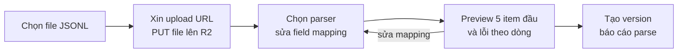
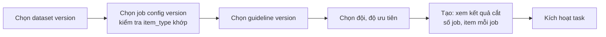

# Screen flow theo vai trò

> Các màn hình của web, ai dùng, đi từ đâu đến đâu, gọi API nào.
>
> Căn cứ: `docs/user_stories.md`, `docs/api_design.md`, `docs/database_design.md`.
> Tên cấp công việc theo CVAT: `Project → Task → Job → Item`.
> Trạng thái: draft để chốt trước khi làm frontend.

---

## 1. Nguyên tắc

| # | Nguyên tắc | Hệ quả |
| --- | --- | --- |
| 1 | **Một người nhiều vai** | Không tách app theo vai trò. Một web, menu bên trái chỉ hiện mục người đó có quyền (đọc từ `/me/permissions`, `/me/projects`, `/me/teams`) |
| 2 | **Trang chủ là "việc cần làm"** | Sau đăng nhập vào `/` hiện các thẻ việc theo vai trò: job đang làm, job bị trả lại, job chờ chấm, escalation, task chờ nghiệm thu |
| 3 | **Project là một workspace** | Mọi thứ của một project (dữ liệu, cấu hình, task, job, tiến độ) nằm trong `/projects/[id]` với các tab; tab nào hiện tuỳ quyền trong project |
| 4 | **Annotator và reviewer không chọn job** | Chỉ có nút "Lấy việc tiếp theo". Không có màn hình duyệt pool |
| 5 | **Màn hình làm việc tối giản** | Màn gán nhãn và màn chấm chiếm toàn trang, không có menu, chỉ có nút thoát về hàng đợi |
| 6 | **Quyền chặn ở API** | Ẩn nút chỉ để gọn giao diện; API vẫn kiểm tra |
| 7 | **Thao tác không đảo ngược phải xác nhận** | Disable user, thu hồi role, gỡ đội, ký nghiệm thu, quyết định reject: có hộp xác nhận và ô lý do khi API bắt buộc |

---

## 2. Sơ đồ tổng (sitemap)

```mermaid
flowchart TD
    LOGIN[/login] --> HOME[/ Việc cần làm]
    ACT[/activate?token] --> LOGIN

    HOME --> WORK[/work Gán nhãn]
    HOME --> REVIEW[/review Chấm]
    HOME --> PROJECTS[/projects]
    HOME --> ADMIN[/admin]
    HOME --> ACCOUNT[/account]

    WORK --> ANNOTATE[/jobs/id/annotate]
    REVIEW --> REVIEWJOB[/jobs/id/review]

    PROJECTS --> NEWP[/projects/new]
    PROJECTS --> WS[/projects/id workspace]
    WS --> T1[Tổng quan]
    WS --> T2[Thành viên và đội]
    WS --> T3[Guideline]
    WS --> T4[Dữ liệu]
    WS --> T5[Cấu hình job]
    WS --> T6[Task]
    WS --> T7[Job]
    WS --> T8[Escalation]
    T6 --> TASK[/projects/id/tasks/tid]
    TASK --> ACCEPT[Nghiệm thu]

    ADMIN --> USERS[/admin/users]
    USERS --> USER[/admin/users/uid]
    ADMIN --> TEAMS[/admin/teams]
    TEAMS --> TEAM[/admin/teams/tid]
    ADMIN --> EXP[/admin/roles/expiring]
    ADMIN --> AUDIT[/admin/audit]
```

Menu bên trái (hiện theo quyền):

| Mục | Hiện khi | Route |
| --- | --- | --- |
| Việc cần làm | Luôn | `/` |
| Gán nhãn | Là annotator trong ít nhất một đội đang gắn với project | `/work` |
| Chấm | Là reviewer trong ít nhất một đội đang gắn với project | `/review` |
| Project | Có `project.create` hoặc thuộc ít nhất một project với vai trò owner, manager, viewer | `/projects` |
| Người dùng | `user.manage` | `/admin/users` |
| Đội đánh giá | `team.manage` | `/admin/teams` |
| Quyền sắp hết hạn | `platform_role.grant` | `/admin/roles/expiring` |
| Audit | `audit.read` | `/admin/audit` |
| Tài khoản | Luôn | `/account` |

---

## 3. Chung cho mọi người

```mermaid
flowchart LR
    A[HR gửi link kích hoạt] --> B[/activate?token<br/>đặt mật khẩu]
    B --> C[/login]
    C --> D{Đăng nhập}
    D -- sai --> C
    D -- đúng --> E[/ Việc cần làm]
    E --> F[/account<br/>xem role, đổi mật khẩu]
    F --> G[Đăng xuất] --> C
```

| Màn hình | Route | Nội dung | API | Story |
| --- | --- | --- | --- | --- |
| Đăng nhập | `/login` | Email, mật khẩu; báo lỗi chung "sai email hoặc mật khẩu"; báo tài khoản bị khoá | `POST /auth/login` | ALL-01 |
| Kích hoạt | `/activate?token=` | Đặt mật khẩu (nhập 2 lần, tối thiểu 10 ký tự); link hết hạn thì báo "liên hệ HR" | `POST /auth/activate` | HR-01 |
| Việc cần làm | `/` | Thẻ theo vai trò (mục 4.0) | `/me`, `/me/projects`, `/me/teams`, `/me/jobs`, `/me/reviews` | ALL-02 |
| Tài khoản | `/account` | Thông tin, role platform kèm ngày hết hạn, đội và vai trò trong đội, project và vai trò, đổi mật khẩu | `/me`, `/me/teams`, `/me/projects`, `POST /auth/change-password` | ALL-02, ALL-03 |

Phiên đăng nhập: access token giữ trong bộ nhớ, tự gọi `POST /auth/refresh` khi tải trang và khi gặp 401 `token_expired`. Gặp 401 `token_revoked` thì về `/login` kèm thông báo "phiên đã bị thu hồi".

---

## 4. Theo vai trò

### 4.0 Trang "Việc cần làm"

| Thẻ | Ai thấy | Nội dung | Bấm vào |
| --- | --- | --- | --- |
| Đang làm | Annotator | Job `in_progress` của tôi, hạn lease | Màn gán nhãn |
| Bị trả lại | Annotator | Job `rejected` của tôi, số lượt sửa còn lại | Màn gán nhãn (hiện lỗi) |
| Lấy việc | Annotator | Nút "Lấy việc tiếp theo" theo từng project | Màn gán nhãn |
| Đang chấm | Reviewer | Job `in_review` của tôi | Màn chấm |
| Lấy việc chấm | Reviewer | Nút theo từng project, số job chờ chấm | Màn chấm |
| Escalation | PM, PO | Số job `escalated` theo project | Tab Escalation |
| Job kẹt | PM | Số job quá SLA | Tab Job, lọc kẹt |
| Chờ nghiệm thu | PO | Task mà mọi job đã kết thúc | Màn nghiệm thu |
| Thiết lập dở | PO | Project `draft` còn thiếu bước (mục 4.3) | Tab Tổng quan |
| Quyền sắp hết hạn | HR | Số role hết hạn trong 30 ngày | `/admin/roles/expiring` |

### 4.1 HR

```mermaid
flowchart TD
    A[/admin/users] --> B[Tạo người dùng]
    B --> C[Hiện link kích hoạt<br/>nút sao chép]
    A --> D[/admin/users/uid]
    D --> E[Cấp role<br/>chọn role, hạn]
    D --> F[Gia hạn / thu hồi role<br/>bắt buộc lý do]
    D --> G[Cấp lại link kích hoạt]
    D --> H[Offboarding<br/>suspended hoặc left + lý do]
    I[/admin/teams] --> J[Tạo đội]
    I --> K[/admin/teams/tid]
    K --> L[Thêm người<br/>annotator hoặc reviewer]
    K --> M[Đổi vai trò, chỉ định trưởng nhóm]
    K --> N[Gỡ người + lý do]
    O[/admin/roles/expiring] --> D
```

| Màn hình | Route | Nội dung | API | Story |
| --- | --- | --- | --- | --- |
| Danh sách người dùng | `/admin/users` | Tìm theo tên/email/mã; lọc trạng thái, loại hợp đồng, role; cột "đã kích hoạt"; nút Tạo | `GET /users`, `POST /users` | HR-01, HR-07 |
| Chi tiết người dùng | `/admin/users/[id]` | Thông tin; bảng role (cấp, gia hạn, thu hồi); cấp lại link; offboarding. Không có thông tin project | `GET /users/{id}`, `POST/PATCH/DELETE /users/{id}/platform-roles`, `POST /users/{id}/activation-link`, `POST /users/{id}/disable` | HR-02, HR-03, HR-04 |
| Danh sách đội | `/admin/teams` | Mã, tên, số annotator, số reviewer, trưởng nhóm; nút Tạo đội | `GET /teams`, `POST /teams` | HR-08 |
| Chi tiết đội | `/admin/teams/[id]` | Bảng thành viên: vai trò, trưởng nhóm, hạn; thêm, đổi, gỡ. Không hiện đội làm project nào | `GET /teams/{id}`, `POST/PATCH/DELETE /teams/{id}/members` | HR-09, HR-10 |
| Quyền sắp hết hạn | `/admin/roles/expiring` | Lọc 7/30/90 ngày; bấm vào người để gia hạn | `GET /platform-roles/expiring` | HR-05 |
| Audit về quyền | `/admin/audit` | Bảng sự kiện; HR chỉ thấy sự kiện user và role | `GET /audit-events` | HR-06, AU-01 |

Xử lý lỗi thường gặp: `role_conflict_warning` thì hiện hộp "vẫn cấp?" rồi gửi lại với `acknowledge_warning`; `last_hr_admin` thì báo không thể thu hồi; `role_conflict` khi thêm người vào đội thì báo "xung đột vai trò ở một project đang dùng đội".

### 4.2 PO: thiết lập project

PO đi theo một **checklist thiết lập** trên tab Tổng quan. Mỗi bước mở đúng tab cần làm, bước nào xong thì đánh dấu.

```mermaid
flowchart TD
    A[/projects] --> B[/projects/new<br/>mã, tên, mô tả, phân loại dữ liệu]
    B --> C[/projects/id Tổng quan<br/>checklist thiết lập]
    C --> S1[1. Guideline<br/>viết version 1]
    C --> S2[2. Đội<br/>gắn ít nhất một đội đủ vai trò]
    C --> S3[3. Dữ liệu<br/>upload, mapping, preview, tạo version]
    C --> S4[4. Cấu hình job<br/>label schema, quy tắc, self-check, xem trước]
    C --> S5[5. Task<br/>chọn dataset, cấu hình, guideline, đội]
    S5 --> S6[6. Kích hoạt project và task]
    S6 --> RUN[Project đang chạy]
```

**Wizard upload dữ liệu** (tab Dữ liệu → "Thêm version"):



**Wizard tạo task** (tab Task → "Tạo task"):



| Màn hình | Route / tab | Nội dung | API | Story |
| --- | --- | --- | --- | --- |
| Danh sách project | `/projects` | Project tôi thuộc, vai trò, trạng thái, % hoàn thành; nút Tạo (nếu có `project.create`) | `GET /projects` | ALL-02 |
| Tạo project | `/projects/new` | Form | `POST /projects` | PO-01 |
| Tổng quan | tab `overview` | Trạng thái và nút kích hoạt/tạm dừng/đóng; checklist thiết lập; số liệu tiến độ chính | `GET /projects/{id}`, `GET /projects/{id}/progress`, `POST .../activate|pause|close` | PO-01, PO-09, PO-10 |
| Thành viên và đội | tab `people` | Bảng thành viên trực tiếp (owner, manager, viewer) + thêm/gỡ; bảng đội đang gắn + gắn/gỡ đội; cảnh báo tỷ lệ reviewer | `GET/POST/DELETE /projects/{id}/members`, `GET/POST/DELETE /projects/{id}/teams`, `GET /teams` | PO-02, PO-03, PO-17 |
| Guideline | tab `guideline` | Danh sách version; xem; soạn version mới (Markdown, gồm cả rubric); diff giữa hai version; mã lỗi của project | `GET/POST /projects/{id}/guidelines`, `.../diff`, `GET/POST/PATCH /projects/{id}/reason-codes` | PO-06 |
| Dữ liệu | tab `data` | Danh sách dataset version, số item, báo cáo parse; wizard upload; xem item | `POST .../datasets/upload-url`, `.../preview`, `POST/GET .../datasets`, `.../items` | PO-04, PO-05 |
| Cấu hình job | tab `config` | Danh sách version; soạn version mới: label schema (form dựng trường), quy tắc job, self-check; nút "Xem trước" mở màn gán nhãn với một item thật ở chế độ không lưu | `POST .../job-configs/validate`, `POST/GET .../job-configs` | PO-07 |
| Task | tab `tasks` | Danh sách task, đội, độ ưu tiên, % hoàn thành; wizard tạo task | `GET/POST .../tasks`, `POST .../tasks/{tid}/team`, `.../activate` | PO-08 |
| Chi tiết task | `/projects/[id]/tasks/[tid]` | Kết quả cắt, tiến độ theo trạng thái, danh sách job; nút Nghiệm thu khi đủ điều kiện | `GET .../tasks/{tid}`, `GET .../progress?task_id=` | PO-08, PO-10 |
| Nghiệm thu | `/projects/[id]/tasks/[tid]/acceptance` | Tỷ lệ pass so với ngưỡng; mẫu ngẫu nhiên job đã accept (mở chỉ đọc); ký nghiệm thu; mở re-review | `GET .../acceptance`, `POST .../sign-off`, `POST .../re-review` | PO-12 |

### 4.3 PM: điều phối

```mermaid
flowchart TD
    A[/ Việc cần làm<br/>escalation, job kẹt] --> B[/projects/id]
    B --> C[Tab Job<br/>lọc trạng thái, task, người, kẹt]
    C --> D[Giao tay / đổi người / thu hồi]
    C --> E[Phân reviewer]
    C --> F[Xem tải theo người]
    B --> G[Tab Escalation]
    G --> H[Mở job chỉ đọc<br/>bài làm, các vòng review]
    H --> I[Quyết accept / reject + lý do<br/>đánh dấu lỗi do guideline]
```

| Màn hình | Route / tab | Nội dung | API | Story |
| --- | --- | --- | --- | --- |
| Job | tab `jobs` | Bảng job có lọc; chọn nhiều để giao hoặc phân reviewer; đổi người, thu hồi; panel tải theo người | `GET /projects/{id}/jobs`, `GET .../workload`, `POST .../jobs/assign`, `POST /jobs/{id}/reassign|unassign`, `POST .../jobs/reviewers` | PM-01 đến PM-04 |
| Tiến độ | tab `overview` | Throughput, backlog, cycle time, kẹt; chia theo người và task | `GET .../progress`, `.../progress/breakdown` | PM-05 |
| Escalation | tab `escalations` | Danh sách job `escalated` với lý do; mở xem; quyết định | `GET .../escalations`, `GET /jobs/{id}/review-context`, `POST /jobs/{id}/escalation-decision` | PM-07 |

PM thấy các tab: Tổng quan, Thành viên và đội (chỉ thêm manager/viewer), Task, Job, Escalation. Không thấy tab Guideline ở chế độ sửa, Dữ liệu, Cấu hình job.

### 4.4 Annotator

```mermaid
flowchart TD
    A[/ Việc cần làm hoặc /work] --> B{Có job dở<br/>hoặc bị trả lại?}
    B -- có --> C[Mở job đó]
    B -- không --> D[Bấm Lấy việc tiếp theo<br/>chọn project]
    D -- hết việc --> E[Thông báo hết việc]
    D -- quá giới hạn --> F[Báo đang giữ đủ job]
    D -- có job --> C
    C --> G[/jobs/id/annotate]
    G --> H[Gán nhãn từng tool call<br/>tự lưu nháp]
    H --> I[Self-check]
    I --> J[Nộp]
    J --> K{Tiếp?}
    K -- Lấy việc tiếp --> D
    K -- Về --> A
```

| Màn hình | Route | Nội dung | API | Story |
| --- | --- | --- | --- | --- |
| Hàng đợi của tôi | `/work` | Theo từng project: job đang làm, job bị trả lại (kèm lý do), nút "Lấy việc tiếp theo" | `GET /me/jobs`, `GET /me/teams`, `POST /projects/{id}/jobs/next` | AN-01, AN-02 |
| Gán nhãn | `/jobs/[id]/annotate` | Toàn trang. Thanh trên: project, job, guideline version (bấm để đọc), hạn lease, tiến độ x/y. Trái: tool có sẵn + trajectory. Phải: form nhãn theo label schema cho bước đang chọn. Dưới phải: self-check, nộp. Nếu là vòng sửa: banner lỗi vòng trước, bước có lỗi được đánh dấu | `GET /jobs/{id}`, `POST /jobs/{id}/start`, `PUT /jobs/{id}/draft`, `POST /jobs/{id}/submit` | AN-03 đến AN-08, AN-11 |

Bản hiện có `fe/src/app/demo/annotate` là khung của màn này; khi làm thật đổi sang đọc label schema thay vì viết cứng.

Hết lease khi đang làm: API trả 409 `lease_expired`, màn hiện "job đã được trả về hàng đợi" và nút về `/work`.

### 4.5 Reviewer

```mermaid
flowchart TD
    A[/ Việc cần làm hoặc /review] --> B{Có job đang chấm?}
    B -- có --> C[Mở job]
    B -- không --> D[Bấm Lấy việc chấm<br/>chọn project]
    D -- hết việc --> E[Thông báo]
    D -- có job --> C
    C --> F[/jobs/id/review]
    F --> G[Xem trajectory và nhãn của annotator<br/>đánh dấu lỗi từng bước]
    G --> H{Quyết định}
    H -- accept / accept_with_fix --> I[Xong]
    H -- reject + lý do --> I
    H -- escalate + lý do --> I
    I --> J{Tiếp?}
    J -- Lấy việc tiếp --> D
    J -- Về --> A
```

| Màn hình | Route | Nội dung | API | Story |
| --- | --- | --- | --- | --- |
| Hàng đợi chấm | `/review` | Theo từng project: job đang chấm, số job chờ, nút "Lấy việc chấm" | `GET /me/reviews`, `POST /projects/{id}/reviews/next` | RV-01, RV-09 |
| Chấm | `/jobs/[id]/review` | Toàn trang. Trái: trajectory, mỗi tool call hiện nhãn annotator. Bấm vào bước để thêm lỗi (reason code, mức độ, ghi chú). Phải: guideline, danh sách lỗi đã ghi, gợi ý quyết định theo ngưỡng (0 lỗi → accept, chỉ minor → accept_with_fix, có major/critical → reject), ô lý do, nút quyết định. Tab "Vòng trước" nếu là rework | `GET /jobs/{id}/review-context`, `POST /jobs/{id}/reviews` | RV-02 đến RV-05 |

### 4.6 Trưởng nhóm (P1)

| Màn hình | Route | Nội dung | API | Story |
| --- | --- | --- | --- | --- |
| Đội của tôi | `/teams/[id]` | Tải, tiến độ, chất lượng từng thành viên; cảnh báo | `GET /teams/{id}/overview|quality|alerts` | TL-01 đến TL-03 |

Vẫn dùng `/work` hoặc `/review` như thành viên bình thường.

### 4.7 Auditor, viewer, platform admin

| Vai trò | Màn hình | Ghi chú |
| --- | --- | --- |
| Auditor | `/admin/audit` đầy đủ, `GET /permissions` (ma trận quyền chỉ đọc) | AU-01, AU-02 |
| Viewer | `/projects/[id]` chỉ tab Tổng quan, không có nút thao tác | AU-03 |
| Platform admin | `/admin/audit` (hệ thống); cấu hình hệ thống để sau vì chưa có thiết kế | AD-01 hoãn |

---

## 5. Tab trong workspace project theo vai trò

| Tab | Owner (PO) | Manager (PM) | Viewer | Annotator, reviewer |
| --- | --- | --- | --- | --- |
| Tổng quan | Đầy đủ + checklist | Đầy đủ | Chỉ đọc | Không vào workspace; dùng `/work`, `/review` |
| Thành viên và đội | Sửa | Thêm manager, viewer | — | — |
| Guideline | Sửa | Đọc | — | Đọc trong màn làm việc |
| Dữ liệu | Sửa | Đọc | — | — |
| Cấu hình job | Sửa | Đọc | — | — |
| Task | Sửa, nghiệm thu | Tạo, giao đội | — | — |
| Job | Đầy đủ | Đầy đủ | — | — |
| Escalation | Quyết định | Quyết định | — | — |

---

## 6. Thứ tự làm frontend

| Đợt | Màn hình | Đủ để |
| --- | --- | --- |
| 1 | Đăng nhập, kích hoạt, khung menu, trang Việc cần làm, Tài khoản | Đăng nhập được |
| 2 | HR: người dùng, đội | Lập người và đội |
| 3 | PO: project, checklist, thành viên và đội, guideline, dữ liệu, cấu hình job, task | Thiết lập project chạy được |
| 4 | Annotator: `/work`, màn gán nhãn | Gán nhãn trọn vòng |
| 5 | Reviewer: `/review`, màn chấm; PM: tab Job, Escalation | Review trọn vòng |
| 6 | Nghiệm thu, tiến độ | Task `delivered` |
| 7 | P1: trưởng nhóm, khiếu nại, export, quyền sắp hết hạn | |

---

## 7. Đã chốt

1. Annotator **không** xem trước job; bấm "Lấy việc" là nhận luôn.
2. Màn gán nhãn **không** có phím tắt.
3. PO dùng **một trang dashboard**: `/projects` hiện các project của PO kèm tiến độ, job kẹt, escalation, task chờ nghiệm thu. Không có trang tổng hợp riêng.
4. **Không** có chuông thông báo; trang Việc cần làm là đủ.

---

## 8. Trạng thái cài đặt (frontend)

Đã có (`fe/src/app/`): đăng nhập, kích hoạt, Việc cần làm, tài khoản, Gán nhãn và Chấm (hàng đợi và màn làm việc), HR (người dùng, đội, quyền sắp hết hạn, audit), Project (danh sách, tạo, workspace với các tab Tổng quan, Thành viên và đội, Guideline kèm mã lỗi, Dữ liệu kèm wizard upload, Cấu hình job kèm xem trước, Task, Job, Escalation), chi tiết task kèm nghiệm thu.

Đã thêm phần P1: trang trưởng nhóm (`/teams/[id]`), khiếu nại (annotator gửi ở hàng đợi, PM/PO xử lý ở tab Khiếu nại), đổi quyết định (owner, ở màn chấm), gold job và export (trang chi tiết task), tab Chất lượng và Nhật ký, chất lượng cá nhân ở trang tài khoản, trang Hệ thống.

Chưa có: service account, calibration, break-glass, thông báo (đã chốt không có chuông). `next build` và lint sạch; đã chạy kịch bản trình duyệt Chrome thật (`scripts/e2e/e2e.js`) qua HR, PO, annotator, reviewer: 28/29 bước đạt, bước còn lại là lỗi hoa/thường của kịch bản (đã sửa).
