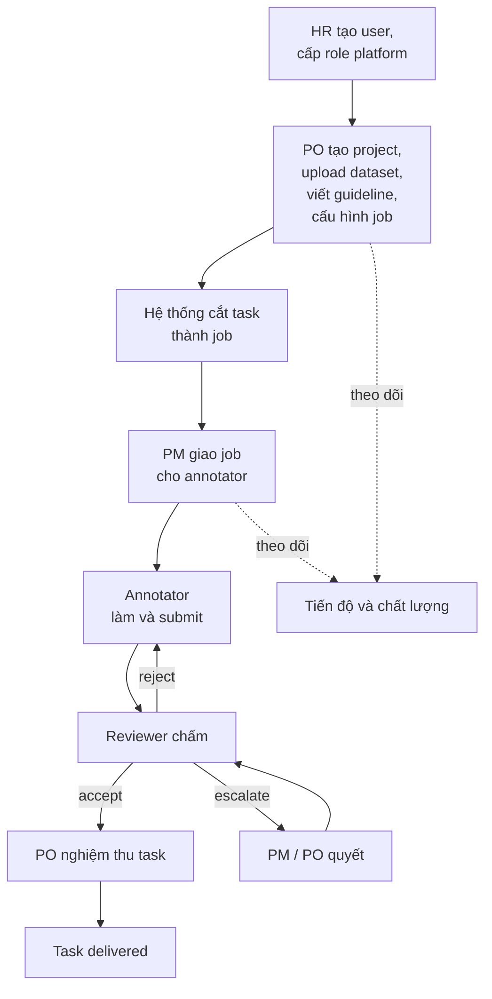

# User story theo vai trò

> Mô tả từng vai trò cần làm gì trên hệ thống, kèm tiêu chí chấp nhận.
>
> Căn cứ: `docs/prd.md`, `docs/role_in_system.md`, `docs/review_workflow.md`,
> `docs/database_design.md`, `docs/dictionary.md`.
> Tên cấp công việc theo CVAT: `Project → Task → Job → Item`.
> Trạng thái: draft để chốt phạm vi bản đầu.

---

## 0. Cách đọc

**Mã story:** `<VAI TRÒ>-<số>`, ví dụ `PO-03`.

| Mã vai trò | Vai trò | Loại |
| --- | --- | --- |
| `HR` | `hr_admin` | Platform |
| `PO` | `po` / project `owner` | Platform + project |
| `PM` | `project_manager` / project `manager` | Platform + project |
| `AN` | `annotator` | Platform + project |
| `RV` | `reviewer` | Platform + project |
| `AD` | `platform_admin` | Platform |
| `AU` | `auditor` / project `viewer` | Platform + project |
| `ALL` | Mọi người dùng đã đăng nhập | |

**Độ ưu tiên**

| Mức | Ý nghĩa |
| --- | --- |
| **P0** | Cần cho bản đầu chạy được trọn vòng: bài toán đánh giá tool call, từ upload dữ liệu đến PO nghiệm thu |
| **P1** | Cần sớm sau bản đầu |
| **P2** | Để sau, khi có nhu cầu thật |

**Quy ước chung cho mọi story**

- Quyền kiểm tra ở API, không chỉ ẩn nút trên giao diện.
- Mọi hành động ghi quan trọng ghi `audit_events`.
- Người dùng chỉ thấy project mình thuộc.
- Không có chức năng nào liên quan đến trả tiền hay tính tiền.

---

## 1. Luồng tổng thể

---

## 2. ALL: Mọi người dùng

### ALL-01 Đăng nhập và đăng xuất `P0`

Là người dùng, tôi muốn đăng nhập bằng tài khoản công ty đã được cấp, để vào hệ thống.

- Không có đăng ký tự do; chỉ tài khoản do HR tạo mới đăng nhập được.
- Tài khoản `suspended` hoặc `left` không đăng nhập được.
- Đăng xuất huỷ phiên hiện tại.
- Phiên bị thu hồi (do offboarding) mất hiệu lực ngay, không chờ hết hạn.

### ALL-02 Xem các project và vai trò của mình `P0`

Là người dùng, tôi muốn thấy danh sách project mình thuộc và vai trò ở từng project,
để biết mình được làm gì.

- Chỉ hiện project có `project_members` còn hiệu lực.
- Hiện vai trò, ngày hết hạn quyền nếu có.
- Người chưa thuộc project nào thấy trạng thái trống, không báo lỗi.

### ALL-03 Xem và cập nhật hồ sơ của mình `P1`

Là người dùng, tôi muốn xem thông tin tài khoản và các vai trò platform của mình.

- Xem được họ tên, email, loại hợp đồng, role platform và ngày hết hạn.
- Không tự sửa role hay trạng thái.

---

## 3. HR: HR / People Ops

### HR-01 Tạo tài khoản người dùng `P0`

Là HR, tôi muốn tạo tài khoản cho nhân sự mới, để họ có thể đăng nhập.

- Nhập họ tên, email, mã nhân viên, loại hợp đồng (`full_time`, `contractor`, `intern`).
- Email không trùng.
- Người dùng nhận email kích hoạt.
- **Không** phải chọn project khi tạo tài khoản.
- Ghi audit.

### HR-02 Cấp role platform `P0`

Là HR, tôi muốn cấp role platform cho người dùng, để họ đủ năng lực tham gia project.

- Chọn một hoặc nhiều role: `po`, `annotator`, `reviewer`, `project_manager`,
  `platform_admin`, `auditor`, `hr_admin`.
- Có thể đặt `expires_at` (bắt buộc gợi ý với nhà thầu và thực tập).
- Không tự cấp role cho chính mình.
- Cấp trùng một role đang hiệu lực thì báo lỗi.
- Cặp role xung đột kiểu cảnh báo (`hr_admin` và `platform_admin`) hiện cảnh báo nhưng
  vẫn cho phép sau khi xác nhận.
- Ghi audit (ai cấp, cho ai, role gì, lúc nào).

### HR-03 Thu hồi hoặc đổi role platform `P0`

Là HR, tôi muốn thu hồi hoặc đổi role của một người, để quyền luôn khớp với công việc.

- Bắt buộc nhập lý do thu hồi.
- Thu hồi một role thì mọi `project_members` dựa vào role đó vô hiệu ngay, kể cả khi
  PO chưa gỡ.
- Job đang làm dở của người đó (nếu mất quyền annotator) quay về pool.
- Ghi audit.

### HR-04 Offboarding một người `P0`

Là HR, tôi muốn vô hiệu hoá một người khi họ nghỉ việc, để họ mất quyền ngay.

- Một thao tác: disable user, thu hồi toàn bộ role platform, vô hiệu mọi membership,
  huỷ mọi phiên đăng nhập.
- Quyền mất ngay, không có độ trễ.
- Job đang làm dở quay về pool; PM được báo.
- Nếu người đó là `owner` duy nhất của một project đang hoạt động thì hệ thống cảnh
  báo và yêu cầu chuyển owner trước hoặc đánh dấu project cần xử lý.
- Lịch sử của người đó vẫn hiển thị tên, không bị xoá.

### HR-05 Quản lý quyền sắp hết hạn `P1`

Là HR, tôi muốn xem danh sách quyền sắp hết hạn, để gia hạn hoặc để chúng tự hết.

- Lọc theo số ngày còn lại (7, 30 ngày).
- Gia hạn bằng cách đặt `expires_at` mới, có ghi audit.
- Quyền hết hạn tự mất hiệu lực, không cần HR thao tác.

### HR-06 Xem thay đổi quyền `P1`

Là HR, tôi muốn xem lịch sử cấp và thu hồi quyền, để giải trình khi cần.

- Lọc theo người dùng, role, khoảng thời gian.
- Chỉ xem được audit về quyền, **không** xem được nội dung dataset hay nhãn.

### HR-07 Tìm và xem danh sách người dùng `P0`

Là HR, tôi muốn tìm và xem danh sách người dùng cùng trạng thái, để quản lý nhân sự.

- Tìm theo tên, email, mã nhân viên.
- Lọc theo trạng thái, loại hợp đồng, role.
- Không hiện thông tin về project hay nội dung công việc chi tiết.

---

## 4. PO: Product Owner

### PO-01 Tạo project `P0`

Là PO, tôi muốn tạo project mới, để bắt đầu một đợt gán nhãn.

- Nhập mã, tên, mô tả, mức phân loại dữ liệu (`internal`, `confidential`, `restricted`).
- Tôi tự động là `owner` của project.
- Project mới ở trạng thái `draft`.
- Ghi audit.

### PO-02 Quản lý thành viên project `P0`

Là PO, tôi muốn thêm và gỡ thành viên project, để đúng người làm đúng việc.

- Chọn người từ danh sách đã được HR cấp role platform tương ứng.
- Thêm người thiếu role platform cần thiết thì bị từ chối với thông báo rõ.
- Thêm một người làm cả annotator và reviewer trong cùng project thì bị chặn.
- Có thể đặt `expires_at` cho membership.
- Gỡ thành viên thì job đang làm dở của họ quay về pool.
- Ghi audit.

### PO-03 Chỉ định owner dự phòng `P1`

Là PO, tôi muốn có thêm co-owner, để project không "mồ côi" khi tôi nghỉ hoặc đổi dự án.

- Thêm một thành viên khác làm `owner`.
- Hệ thống cảnh báo khi project chỉ còn một owner.
- Chuyển owner cần xác nhận của người được chuyển.

### PO-04 Upload dataset `P0`

Là PO, tôi muốn upload dữ liệu thô lên project, để có cái gán nhãn.

- Hỗ trợ ít nhất JSONL (bản đầu).
- Mỗi lần upload tạo một **dataset version** mới, không ghi đè.
- Chọn parser và field mapping khi upload (xem PO-05).
- Hiện kết quả đọc: tổng số item, số item lỗi, vị trí lỗi cụ thể để sửa.
- Tính checksum và `item_count`.
- Ghi audit.

### PO-05 Chọn parser và ánh xạ trường `P0`

Là PO, tôi muốn chỉ định cách đọc dữ liệu của mình, để hệ thống hiểu đúng cấu trúc.

- Chọn parser trong danh sách có sẵn (ví dụ JSONL chat messages).
- Khai báo field mapping: trường nào là lời user, bước suy nghĩ, tên tool, tham số,
  kết quả tool.
- Xem **preview** vài item đã parse trước khi xác nhận.
- Hệ thống ghi lại `parser` và `parser_version` đã dùng cho dataset version.

### PO-06 Viết và đổi guideline `P0`

Là PO, tôi muốn viết guideline cho project, để annotator và reviewer có căn cứ chung.

- Mỗi lần lưu tạo **guideline version** mới, version cũ giữ nguyên.
- Job đã giao vẫn chấm theo version đã ghim.
- Lưu diff giữa các version.
- Ghi audit.

### PO-07 Cấu hình job `P0`

Là PO, tôi muốn quy định thế nào là một job, để việc chia công phù hợp với loại dữ liệu.

- Chọn `item_type` (bản đầu: `tool_call`).
- Cấu hình **label schema**: các trường nhãn (ví dụ `verdict`, `reason_code`, `note`),
  kiểu, bắt buộc hay không, điều kiện hiện.
- Cấu hình **job rules**: số item mỗi job, số annotator mỗi job, tỷ lệ review (100% hoặc
  lấy mẫu), SLA, số lần rework tối đa.
- Cấu hình **câu hỏi self-check** riêng của project.
- Xem **preview** màn hình gán nhãn như annotator sẽ thấy.
- Bấm xuất bản thì tạo **job config version** bất biến.
- Đổi cấu hình sau đó tạo version mới; job đã giao giữ cấu hình cũ.
- Ghi audit kèm diff.

### PO-08 Tạo task và cắt thành job `P0`

Là PO, tôi muốn tạo task từ một dataset version, để hệ thống cắt thành các job theo cấu
hình.

- Chọn dataset version, job config version, guideline version.
- Hệ thống tự cắt thành job theo `job rules`; không tạo job thủ công.
- Hiện kết quả cắt: số job, số item mỗi job, item nào bị bỏ (nếu có).
- Một item chỉ thuộc một job trong một task (khi chưa bật consensus).
- Task có trạng thái `draft` đến khi PO kích hoạt.

### PO-09 Kích hoạt, tạm dừng, đóng project `P1`

Là PO, tôi muốn đổi trạng thái project, để kiểm soát khi nào việc được làm.

- Trạng thái: `draft`, `active`, `paused`, `closed`.
- `paused` thì annotator không nhận thêm job mới, job đang làm vẫn giữ.
- `closed` thì chỉ đọc.
- Không xoá cứng project.

### PO-10 Theo dõi tiến độ project `P0`

Là PO, tôi muốn biết project đang tới đâu, để không phải mở bảng tính riêng.

- Xem **% hoàn thành** (job `accepted` / tổng job của dataset version), **cycle time**.
- Lọc theo task.
- Số liệu chỉ tính job `accepted`, không tính `submitted`.
- Màn hình báo cáo chỉ đọc, không sửa trạng thái.

### PO-11 Xem báo cáo chất lượng `P1`

Là PO, tôi muốn xem chất lượng gán nhãn, để biết dữ liệu có đạt không.

- Tỷ lệ pass, tỷ lệ reject, phân bố `reason_code`.
- Chất lượng theo annotator và theo reviewer.
- Lỗi lặp lại gợi ý guideline mơ hồ.

### PO-12 Nghiệm thu task `P0`

Là PO, tôi muốn nghiệm thu cả task, để giao cho stakeholder.

- Xem tỷ lệ pass của task so với ngưỡng cam kết.
- Xem mẫu ngẫu nhiên 5–10% job đã `accepted` để kiểm chứng chất lượng reviewer.
- Ký nghiệm thu thì task chuyển `delivered`.
- Không chấm lại từng job. Nếu phát hiện reviewer chấm sai hàng loạt thì mở
  **re-review** cho task.
- Ghi audit.

### PO-13 Override quyết định của reviewer `P1`

Là PO, tôi muốn đổi quyết định review trong trường hợp đặc biệt, để sửa sai sót.

- Bắt buộc nhập lý do.
- Tạo bản ghi review mới trỏ về bản cũ, không sửa bản cũ.
- Ghi audit.

### PO-14 Xử lý khiếu nại bước cuối `P1`

Là PO, tôi muốn đưa quyết định cuối cho khiếu nại không giải quyết được ở bước PM, để
có kết luận.

- Xem toàn bộ ngữ cảnh: bài làm, review, guideline version đã ghim, lý do khiếu nại.
- Quyết định được lưu bất biến, ghi audit.

### PO-15 Xuất dữ liệu và báo cáo `P1`

Là PO, tôi muốn export nhãn đã nghiệm thu, để đưa vào huấn luyện hoặc giao khách.

- Chỉ export từ task `delivered` (hoặc job `accepted`).
- Chọn định dạng (bản đầu: JSONL).
- Ghi audit mọi lần export.

### PO-16 Quản lý gold job `P1`

Là PO, tôi muốn đánh dấu job có đáp án chuẩn, để đo chất lượng annotator.

- Tạo gold job kèm đáp án chuẩn.
- Gold job được trộn vào hàng đợi, annotator không nhận ra.
- Chỉ vai trò chấm chất lượng xem được đáp án.

---

## 5. PM: Project manager

### PM-01 Xem hàng đợi job `P0`

Là PM, tôi muốn xem toàn bộ job trong project theo trạng thái, để nắm công việc.

- Lọc theo trạng thái, task, người làm.
- Thấy job chưa có người nhận, job đang chờ review, job quá SLA.

### PM-02 Giao job cho annotator `P0`

Là PM, tôi muốn giao job cho annotator, để việc được phân công.

- Chỉ giao được cho thành viên project có role annotator còn hiệu lực.
- Giao hàng loạt nhiều job.
- Thấy tải hiện tại của từng annotator trước khi giao.
- Job ghim guideline version và job config version tại lúc giao.
- Ghi audit.

### PM-03 Đổi người làm và thu hồi job `P0`

Là PM, tôi muốn đổi người làm hoặc thu hồi job, để xử lý người nghỉ hoặc quá tải.

- Đổi người làm job đang `assigned` hoặc `in_progress`.
- Khi đổi, bài làm dở của người cũ được giữ trong lịch sử.
- Job có `lease` hết hạn thì tự quay về pool; PM thấy và giao lại.

### PM-04 Phân reviewer cho job `P0`

Là PM, tôi muốn chỉ định reviewer cho job, để việc chấm được phân tải đều.

- Chỉ chọn được thành viên có role reviewer trong project.
- Không chọn được người đã làm job đó.
- Có thể gán theo lô.

### PM-05 Theo dõi tiến độ vận hành `P0`

Là PM, tôi muốn xem tiến độ chi tiết, để điều phối.

- Xem **throughput**, **backlog**, **cycle time**, **stuck**.
- Chia theo annotator, reviewer, task.
- Xem job nào kẹt ở trạng thái nào quá SLA.

### PM-06 Nhận cảnh báo job kẹt `P1`

Là PM, tôi muốn được báo khi job nằm quá SLA, để can thiệp sớm.

- Cảnh báo gửi cho PM, không gửi trực tiếp cho annotator.
- Nêu rõ trạng thái kẹt và thời gian.
- Gợi ý nguyên nhân thường gặp (thiếu reviewer, annotator chưa nhận).

### PM-07 Xử lý job bị escalate `P0`

Là PM, tôi muốn xem xét job bị escalate (reviewer không chắc hoặc quá số lần rework),
để quyết định.

- Xem bài làm, các vòng review, guideline version.
- Quyết định accept hoặc reject, kèm lý do bắt buộc.
- Nếu lỗi do guideline mơ hồ thì ghi nhận để PO sửa guideline.
- Ghi audit.

### PM-08 Xử lý khiếu nại bước 1 `P1`

Là PM, tôi muốn xem xét khiếu nại của annotator, để giải quyết trước khi lên PO.

- Xem lý do khiếu nại và toàn bộ ngữ cảnh.
- Giải quyết (đồng ý hoặc không) hoặc chuyển lên PO.
- Ghi audit.

### PM-09 Xử lý xung đột lợi ích `P2`

Là PM, tôi muốn đổi reviewer khi reviewer và annotator có quan hệ trực tiếp, để đảm bảo
công bằng.

- Annotator hoặc reviewer khai báo xung đột.
- PM đổi reviewer cho các job liên quan.

### PM-10 Thêm thành viên project `P1`

Là PM, tôi muốn thêm thành viên vào project, để bổ sung nhân lực nhanh.

- Quyền như PO-02 nhưng không thêm được role `owner`.

---

## 6. AN: Annotator

### AN-01 Xem danh sách job của mình `P0`

Là annotator, tôi muốn thấy các job được giao, để biết cần làm gì.

- Chỉ thấy job được giao cho mình, trong project mình thuộc.
- Hiện trạng thái, hạn chót, số item.
- Job bị reject hiện nổi bật và kèm lý do.

### AN-02 Nhận job `P0`

Là annotator, tôi muốn nhận job được giao, để bắt đầu làm.

- Nhận thì job chuyển `in_progress` và bắt đầu tính **lease**.
- Không nhận được job không phải của mình.
- Lease hết hạn mà chưa nộp thì job có thể bị thu hồi.

### AN-03 Đọc guideline `P0`

Là annotator, tôi muốn đọc guideline đúng version của job, để làm đúng quy tắc.

- Hiện đúng guideline version đã ghim vào job, không phải bản mới nhất.
- Xem được ngay trong màn hình làm việc.

### AN-04 Gán nhãn từng item `P0`

Là annotator, tôi muốn gán nhãn cho từng item trong job, để hoàn thành công việc.

- Với tool call review: thấy lời user, tool có sẵn, trajectory, kết quả tool; chọn một
  tool call để đánh giá.
- Gán `verdict` (`correct`, `incorrect`, `unsure`).
- Nếu `incorrect` thì bắt buộc chọn ít nhất một `reason_code`.
- Có ô ghi chú; nên ghi khi chọn `unsure`.
- Hiện tiến độ trong job (bao nhiêu item đã gán nhãn).
- Dữ liệu tự lưu nháp, đóng trình duyệt không mất.

### AN-05 Đánh dấu không chắc `P0`

Là annotator, tôi muốn đánh dấu item mình không chắc, để reviewer chú ý.

- Nhãn `unsure` kèm ghi chú.
- Job có item `unsure` được đẩy lên đầu hàng đợi review.

### AN-06 Self-check và submit `P0`

Là annotator, tôi muốn tự soát trước khi nộp, để giảm lỗi.

- Các mục tự kiểm tra được bằng code (đã gán nhãn đủ chưa, có item `unsure` không) do
  hệ thống tự kiểm, không bắt tick tay.
- Các câu hỏi self-check do PO cấu hình hiện để tick.
- Nộp chỉ được khi gán nhãn đủ và tick hết.
- Nộp xong tạo một **submission** (vòng `round` tương ứng), job chuyển `submitted`.
- Sau khi nộp không sửa được trừ khi bị reject.

### AN-07 Xem phản hồi khi bị reject `P0`

Là annotator, tôi muốn xem lý do bị reject, để sửa đúng chỗ.

- Thấy từng lỗi gắn đúng item, kèm `reason_code`, mức độ và ghi chú.
- Phải xem được lý do trước khi sửa lại.
- Job quay về `in_progress`; số lần rework còn lại hiện rõ.

### AN-08 Sửa và nộp lại `P0`

Là annotator, tôi muốn sửa theo phản hồi và nộp lại, để job được duyệt.

- Chỉ sửa trong giới hạn rework (mặc định 2 lần).
- Lần thứ 3 bị reject thì job chuyển `escalated`, không tự quay lại tay annotator.
- Mỗi lần nộp là một submission mới, lịch sử các vòng được giữ.

### AN-09 Khiếu nại quyết định reject `P1`

Là annotator, tôi muốn khiếu nại khi không đồng ý, để được xem xét lại.

- Nhập lý do khiếu nại.
- Theo dõi trạng thái xử lý.
- Căn cứ chấm là guideline version đã ghim lúc làm.

### AN-10 Xem tiến độ và chất lượng của mình `P1`

Là annotator, tôi muốn biết mình làm thế nào, để cải thiện.

- Số job đã làm, tỷ lệ accept, lỗi thường gặp.
- Chỉ xem số liệu của mình, không xem của người khác.

### AN-11 Giới hạn truy cập `P0`

Là annotator, tôi chỉ thấy phần dữ liệu cần cho việc của mình.

- Không xem project mình không thuộc.
- Không xem nhãn của annotator khác.
- Không duyệt kết quả.
- Không là reviewer của chính project mình làm.

---

## 7. RV: Reviewer

### RV-01 Xem hàng đợi review `P0`

Là reviewer, tôi muốn xem các job cần chấm, để chọn việc.

- Chỉ thấy job được phân cho mình.
- Sắp theo tuổi job và cờ ưu tiên (job có item `unsure` lên đầu).
- Không thấy job do chính mình làm.

### RV-02 Chấm một job `P0`

Là reviewer, tôi muốn chấm job theo rubric, để quyết định đạt hay không.

- Thấy bài làm của annotator, guideline version đã ghim, item gốc.
- Chấm từng item; gắn lỗi vào đúng item với `reason_code`, mức độ (`critical`, `major`,
  `minor`) và ghi chú.
- Quyết định: `accept`, `accept_with_fix`, `reject`, `escalate`.
- `reject` bắt buộc có lý do; không sửa nhãn trực tiếp.
- Quyết định lưu bất biến.

### RV-03 Escalate khi không chắc `P0`

Là reviewer, tôi muốn chuyển lên PM khi không chắc, để không chấm bừa.

- Chọn `escalate` kèm lý do.
- Job chuyển `escalated`, PM nhận.

### RV-04 Chặn review việc của chính mình `P0`

Là reviewer, tôi không được chấm job do chính mình làm.

- Job tôi làm không xuất hiện trong hàng đợi review của tôi.
- Gọi API trực tiếp cũng bị từ chối.

### RV-05 Xem lịch sử các vòng `P1`

Là reviewer, tôi muốn xem các vòng rework trước của job, để chấm nhất quán.

- Xem các submission và review cũ.
- Thấy annotator đã sửa gì sau phản hồi.

### RV-06 Hiệu chuẩn trước khi chấm `P1`

Là reviewer, tôi muốn tham gia buổi hiệu chuẩn trước khi project bắt đầu, để chấm giống nhau.

- Chấm thử một tập mẫu và so với đáp án chuẩn hoặc với reviewer khác.
- Xem độ lệch của mình.

### RV-07 Sửa nhãn trong trường hợp bắt buộc `P2`

Là reviewer có quyền riêng, tôi muốn sửa nhãn trực tiếp khi bắt buộc, để hoàn tất.

- Cần quyền riêng; mặc định phải reject.
- Tạo bản ghi `correction` với `before`, `after`, lý do, ghi audit riêng.

### RV-08 Xem chất lượng chấm của mình `P1`

Là reviewer, tôi muốn biết chất lượng chấm của mình, để cải thiện.

- Tỷ lệ chấm lệch so với gold job và so với các override.
- Chỉ xem của mình.

---

## 8. AD: Platform admin

### AD-01 Cấu hình hệ thống `P0`

Là platform admin, tôi muốn cấu hình hệ thống, để vận hành ổn định.

- Quản lý tham số hệ thống (thời hạn phiên, lease mặc định, giới hạn upload).
- Không cấp hay thu hồi role nghiệp vụ.

### AD-02 Quản lý service account `P1`

Là platform admin, tôi muốn tạo tài khoản cho bot và job nền, để chạy tự động mà không
dùng tài khoản người.

- Tạo, vô hiệu hoá service account.
- Ghi audit.

### AD-03 Giám sát vận hành `P1`

Là platform admin, tôi muốn xem sức khoẻ hệ thống, để xử lý sự cố.

- Trạng thái dịch vụ, lỗi, hàng đợi xử lý nền.
- Cảnh báo job `stuck` ở cấp hệ thống.
- Không xem nội dung dataset.

### AD-04 Truy cập khẩn cấp dataset (break-glass) `P2`

Là platform admin, tôi muốn truy cập dataset khi có sự cố, để khắc phục.

- Bắt buộc nhập lý do.
- Có thời hạn ngắn, tự hết.
- Ghi audit chi tiết, thông báo cho PO của project.

### AD-05 Quản lý parser và item type `P1`

Là platform admin, tôi muốn xem danh sách parser và item type đang có, để biết hệ thống
hỗ trợ gì.

- Xem tên, phiên bản, trạng thái.
- Thêm loại mới thực hiện qua phát hành code, không qua giao diện.

---

## 9. AU: Auditor và viewer

### AU-01 Đọc audit log `P0`

Là auditor, tôi muốn đọc nhật ký hành động, để kiểm tra tuân thủ.

- Lọc theo người thực hiện, hành động, đối tượng, khoảng thời gian, project.
- Hiện `before`, `after`, lý do, IP.
- Chỉ đọc, không sửa hay xoá.
- Tên người đã nghỉ vẫn hiển thị.

### AU-02 Xem báo cáo tuân thủ `P1`

Là auditor, tôi muốn xem báo cáo về cấp quyền, truy cập dataset và export, để rà soát.

- Danh sách break-glass, thay đổi role, export dữ liệu.
- Không xem nội dung dataset nếu chưa được cấp quyền.

### AU-03 Xem tiến độ project (viewer) `P1`

Là stakeholder hoặc viewer, tôi muốn xem tiến độ và báo cáo của một project, để nắm tình
hình.

- Được PO thêm vào project với role `viewer`.
- Xem tiến độ và báo cáo chất lượng, không xem nội dung item chi tiết.
- Chỉ đọc.

---

## 10. Tổng hợp theo mức ưu tiên

| Mức | Số story | Mã |
| --- | --- | --- |
| **P0** | 37 | ALL-01, 02; HR-01, 02, 03, 04, 07; PO-01, 02, 04, 05, 06, 07, 08, 10, 12; PM-01, 02, 03, 04, 05, 07; AN-01, 02, 03, 04, 05, 06, 07, 08, 11; RV-01, 02, 03, 04; AD-01; AU-01 |
| **P1** | 23 | ALL-03; HR-05, 06; PO-03, 09, 11, 13, 14, 15, 16; PM-06, 08, 10; AN-09, 10; RV-05, 06, 08; AD-02, 03, 05; AU-02, 03 |
| **P2** | 3 | PM-09; RV-07; AD-04 |

Lưu ý: số lượng ở bảng trên đếm theo danh sách mã. Nếu thêm hay đổi mức ưu tiên thì cập
nhật bảng này.

---

## 11. Các điểm chưa chốt ảnh hưởng đến story

| # | Câu hỏi | Ảnh hưởng |
| --- | --- | --- |
| 1 | PO có tự cấp role platform `reviewer` cho người của mình không | HR-02, PO-02 |
| 2 | Có dùng consensus (nhiều annotator một job) không | PO-07, PM-02, RV-02 |
| 3 | Annotator tự nhận job từ pool hay chỉ PM giao | AN-02, PM-02 |
| 4 | Reviewer thuộc team QC riêng hay luân chuyển từ annotator senior | RV-01, PM-04 |
| 5 | Tiến độ cập nhật realtime hay theo ngày | PO-10, PM-05 |
| 6 | Thời gian thu hồi quyền khi offboarding (ngay lập tức hay 24h) | HR-04 (hiện đang giả định ngay lập tức) |
| 7 | Có cho annotator thấy điểm chất lượng của mình không | AN-10 |
| 8 | Hệ thống gửi thông báo qua kênh nào (email, trong ứng dụng, chat) | HR-01, PM-06, AN-07 |
